# Rework des arbres : la hiérarchie des races (v17)

Ce qui change de la v16 après ta relecture (v17) : **l'ange a son UC (acté, ta proposition)** : le choix 1 de l'Ange devient l'Ange Éveillé ➕ · UC, et depuis lui trois portes : la coloration (l'eau, l'aube, le sabre · R), la voie céleste (la bonne voie, l'Archange), la mauvaise volonté (les anges dévoyés) ; le nom reste à dédoublonner d'avec l'Éveillé du Seuil (10.1-5). **Le tirage des N est précisé (acté)** : dans les donjons à des taux très bas, dans la nature (les zones d'errance), et une ou deux offertes au début du jeu, pour que le premier choix entier soit là dès le départ (1.5). **Les communes manquantes me sont déléguées (v17)** : le premier lot est refermé, la commune des Gens des Sèves est proposée (Pousse des Sèves ➕ · C) et celle du zèle aussi (Fidèle du Jour ➕ · C) ; le balayage complet passe dans la refonte des sorts, famille par famille. **Et la refonte des sorts est lancée (v17)** : un design doc dédié (la typologie, l'acquisition, l'arbre des sorts complet), et le plan de la grosse mise à jour (les races, les sorts, le mode RPG avec l'agilité et l'intelligence, les zones d'errance) s'y trace (10.1-23).

Ce qui change de la v15 après ta relecture (v16) : **les N sont des drops (acté)** : chaque donjon droppe des naissances, et le début du jeu peut en donner une ou en débloquer une ; et c'est le but du rang : un N n'a encore rien choisi, tu l'amènes où tu veux (la voie du sabre, la voie du bretteur, la voie du caveau, la voie du vol...) ; une commune a déjà un premier choix fait, on ne peut pas aller partout avec elle (1.5). **Les Enge passent N partout (corrige v15)** : dans les webs et les mystiques, leur éveil mène à la commune C de leur famille d'accueil, le trou de C est refermé (6, 8.2, 8.3). **Les divines suivent le même modèle (acté)** : un N unique, l'Esprit Divin ➕ (**nom acté v16**), qui s'éveille en Ange, Démon ou Éveillé du Seuil · C ; et l'Ange Gardien ➕ meurt (proposition) : une carte à elle seule ne fait pas un palier, l'ange devient directement un ange de quelque chose, le service à retracer (5, 10.1). **Les communes manquantes sont posées (acté)** : Novice du Crépuscule ➕ · C (le prêtre d'ombre), Mercenaire ➕ · C (le vol, ta piste), et les communes d'accueil des Enge (2.3, 2.4, 6). **Et la refonte des sorts est appliquée au dist (v0.47)** : Tranche-Monde (le sort L de Kenji, la carte garde son nom) et Nuit Éternelle (le sort L de Kira) ; « Kenji : Zénith Tranchant » reste, l'Aube garde son exception assumée (Aube Éternelle) ; repéré au passage : le sort L d'Argus répète encore le nom de sa carte, à renommer (10.1).

Ce qui change de la v14 après ta relecture (v15) : **la Légion Solaire ne monte pas jusqu'à l'Astre Capiteux (acté)** : l'Astre est une carte divine, elle reste autre part, dans l'arbre des anges ; les croisés s'arrêtent à leur L existante, **Aurorine, Lance de l'Aube** (2.1, 2.3, 1.4). **L'éveil du mage perd la foi et les assassins (acté)** : plus de Novice de l'Aube ni de Rôdeur des Ombres chez le mage ; la loyauté lumière/ombre se joue au choix 1, avec ses convergences au SR (2.2). **Les cinq Bestiau passent rang N et deviennent les cinq Embryons (acté)** : Embryon des Eaux, des Flammes, du Vivant, des Ténèbres, des Cieux ; la carte N qui n'a pas encore choisi ce qu'elle devient ; le renommage s'appliquera au dist (4, 11.1) ; et la voie mécanique de l'épéiste s'affiche entière, jusqu'à Argus, Forteresse Vivante (2.1). **Le web de la Fournaise recevra un dragon (proposition)** : quelque chose devient un dragon, un M de dragon (8.2) ; et l'Ange de la Fournaise, une mystique C, reste à placer (10.1). **La chute se scénarise (proposition)** : un ange L qui en bat un autre, par événement, tombe en ange déchu (3.3) ; et le duel de la Mort s'ouvre (proposition) : vaincre la Mort donne une carte L ou M qui rend la vie à tous, perdre fait du tombé un mort-vivant (3.2). **Les solos et le RPG de capture passent en chantier** : les évolutions tous les 10 niveaux (bloqué jusqu'à évolution), les niveaux 1 à 100 à la Pokémon, et lever les jetons pour un vrai RPG de capture où le monstre vaincu demande à rejoindre l'équipe (10.1). **Et la section 10 est rangée en deux (ta demande)** : 10.1 ce qui reste à trancher, 10.2 tout ce qui est acté et validé ; les noms proposés sont validés, au pire tu les modifieras (10.2).

Ce qui change de la v13 après ta relecture (v14) : **le nom verrouille la chaîne (1.4, acté)**. À partir du moment où une carte obtient un nom, sa voie est la sienne : elle ne rejoint jamais la chaîne d'un autre nommé. Les cinq graines sans sommet (Naïa, Aïna, Roc, Ember, Sylve) créent chacune leur propre voie et leur propre L (2.5) ; le chevalier du Bouclier a sa propre L et la double convergence vers Argus meurt (2.1) ; et l'eau finit en deux L : la coloration divine en Calypso, Déesse des Océans, la mortelle régressée en Alix, Déesse de l'Eau (3.1). **L'arbre du prêtre perd la garde et gagne le zèle (2.3, acté)** : plus de Gardien-Mécanique chez le prêtre (il reste à l'épéiste), l'éveil du zèle ouvre la commune du zèle ➕ puis le choix entre le Clergé du Plein Jour (Chapelain du Jour) et la Légion Solaire (Arbalétrier Doré) ; et le paladin a son choix du zèle : la dévotion reste vers Isaure, le zèle rejoint la Légion Solaire (2.1). **Battre l'Astre Capiteux le fait tomber (proposition)** : vaincu au Zénith Ardent, il devient l'Ange Déchu, obtenable (3.3, 5). **Les démons se nomment (5)** : la lignée du désir devient Succube → Grande Succube → Dame du Désir → Asmodia, Reine du Désir ; le trône des démons est nommé : Lilith, Reine des Démons ; et la lignée du Gouffre des Vices mange : La Faim, un des sept grands monstres possibles. **Et les sorts entrent dans le chantier (10.2)** : renommages des sorts L de Kenji, Kira et Léna, typologie des sorts par rôle et ciblage ; les caractéristiques vitesse et intelligence sont actées, et la direction RPG aussi : les zones d'errance pour les premières cartes, les donjons pour les rares, un monde à traverser (10.2).

Ce qui change de la v12 après ta relecture : **le trou d'UR du brigand est comblé aussi dans l'arbre du voleur** (mon oubli : il l'était dans celui de l'épéiste, pas du voleur), et **Gadianton est acté** comme Chef des Brigands. **L'Astre Capiteux entre dans l'arbre des anges (acté)** : depuis l'Ange Gardien, un deuxième choix s'ouvre, **la mauvaise volonté**, la branche des anges dévoyés, qui mène jusqu'à lui (section 5). **La malédiction du Bosquet est affinée** : c'est une carte de la lignée de Solen qui tue le Cœur du Bosquet, elle devient un membre de sa famille (une plante, un gardien de la forêt), et **la transformation n'arrive qu'une seule fois** : il n'y a qu'un Cœur (section 3.4). **Le boss de la mort d'Isaure est acté : l'Archiliche**. **L'Éclat de régression ne droppe qu'à partir des donjons en difficulté Difficile, jamais avant** (sauf mécanismes secrets). **Le tirage des naissances est borné par les déblocages** : uniforme, mais jamais une commune d'un biome dont le donjon n'est pas encore débloqué (section 1.2). Et **les essences futures sont actées** : l'Enge de la Fournaise et l'Enge de la Lumière, à dessiner plus tard (leurs formats sont un peu spécifiques : la mise en place se définira alors). **Et l'arbre du prêtre est détaillé (v13)** : le zèle (l'Invocatrice de l'Aube, la passerelle du prêtre vers les paladins), la nécromancie (l'Évocatrice du Caveau), la conversion funèbre tracée avec ses deux portes (2.3), la lignée des Sylvains, la branche druide du mage (2.2), et l'école des invocations (2.6). **Et les trois autres webs de biomes sont tracés (v13, section 8)** : la Fournaise, le Vivant et l'Au-delà bestial, sur le gabarit des Flots, avec l'ancre de chaque biome (Vulcain, le Cœur du Bosquet, la Mort). **La fusion du Bosquet (7.1)** : Maïa obtenue par la lame et par la racine fusionne en Maïa, Déesse des Sèves, la nouvelle voie du Bosquet des dryades. **Et la règle des noms (1.4)** : un nommé garde son nom à travers tout, un doublon de L est permis. **Et la fusion totale (acté)** : les graines, les solos et les mini-lignées sont fondues dans les arbres, aucune carte ne reste à côté (11.3) ; **la Légion Solaire et le Clergé du Plein Jour sont des familles humaines (acté)** : des croyants fourvoyés entraînés à la suite de l'Astre Capiteux, replacés dans leur contexte (le clergé chez le prêtre, la Légion chez le paladin, 11.4), et **le miroir est acté** : les voies droites restent à créer (le zèle vers Isaure, le paladin), les fourvoyées existent déjà (le Clergé vers Apolline, la Légion vers l'Astre). **Et le rang N est acté (1.5)** : les 15 naissances passent sous C, hors lignée, hors des drops, et s'éveillent en la commune C de la famille choisie.

Ce document est **la référence exhaustive des arbres d'évolution du jeu** : les quatre arbres humains (section 2), les cinq biomes (les cieux en 4, les quatre autres webs en 8), la race divine (5), les mystiques (6), et toutes les règles de passage entre eux (1, 3, 7). Chaque nom y est posé : acté, ou proposé ; rien n'est implicite. Pour les trois webs tracés en v13, l'audit des cartes existantes du biome remplace les noms proposés (les existantes d'abord, acté). **Et l'audit du catalogue réel est fait (section 11)** : les 238 cartes de la v0.43.1 sont passées en revue, naissance par naissance, famille par famille ; le jeu avait déjà la moitié du rework en place (les naissances, les sept familles humaines complètes, les six webs et leurs mythiques), les propositions cèdent devant l'existant, et le volume restant tombe à environ 85-95 cartes.

Le reste de la v12 reste acté : la règle de la rareté-palier (1.3) et l'audit des trous, les communes raciales et la naissance au hasard, la hiérarchie des races, la régression chiffrée, la malédiction des quais, Morzak à étages et neutre, la chute de l'ange déchu, la Mort qui reste la Mort.

## 1. La hiérarchie des races : base, supérieure, noble

Ta lecture, actée : **l'humain est la race de base, la créature mystique la race supérieure, la créature divine la race noble**, avec évolution entre les trois. La même échelle court à l'intérieur de chaque biome : race commune (gobelin), race supérieure (moqueur), race noble (sirène). **La race noble d'un biome est toujours une mystique** (acté).

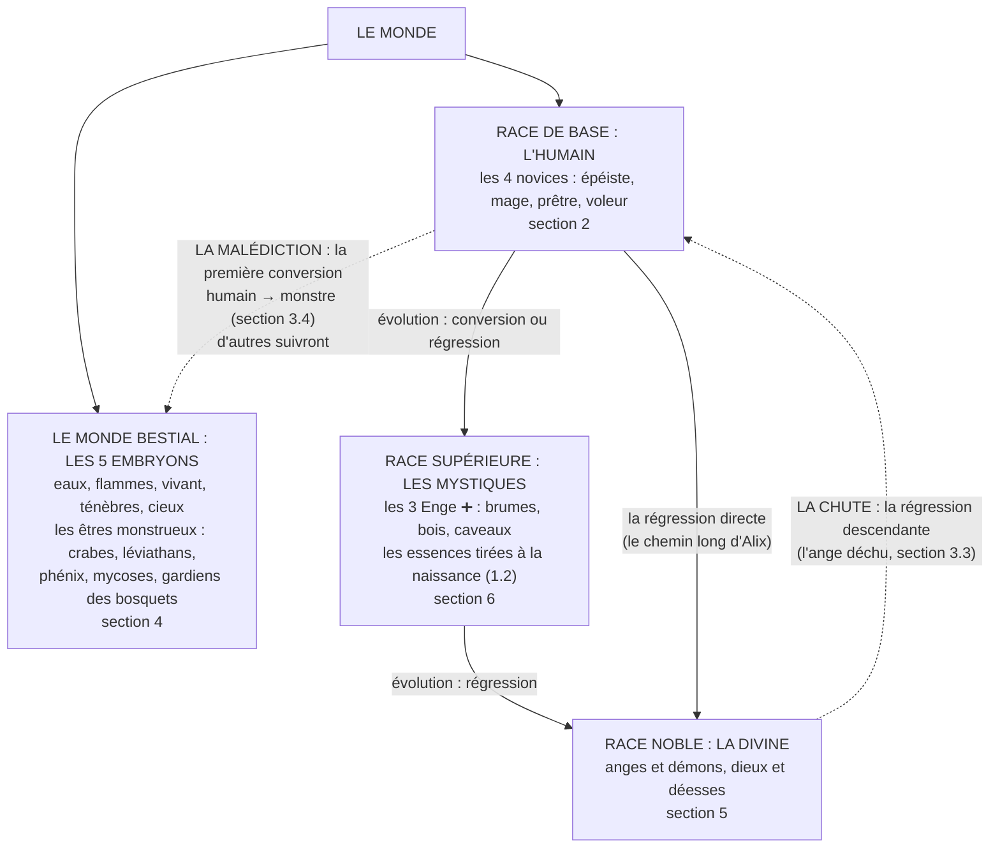

- **La double sortie de l'humain** : devenir mystique (les conversions) ou devenir monstre (la malédiction des quais, section 3.4, d'autres chemins suivront).
- **La chaîne des évolutions** : base → supérieure → noble, chaque saut par conversion ou régression. Le raccourci base → noble existe (Alix), et **la chute** est le saut inverse : noble → mortel (l'ange déchu, section 3.3).
- **L'Embryon reste dans le monde bestial** : il n'atteint jamais les races nobles (sirène, dryade), qui sont des mystiques.
- **La règle d'accès universel (actée)** : toute race se joue depuis une carte commune raciale qu'on fait évoluer, et cette commune porte le premier choix, tiré au hasard (1.2). La régression et la conversion sont des **options** : souvent prises, éventuellement cachées, jamais le seul chemin.
- **Les stats de base grimpent avec la race (chiffré, acté)** : l'humain est la référence, le monstre naît **+10 %**, la mystique **+20 %**, la divine **+30 %**. Et **la régression comble exactement cet écart** : un humain régressé entre dans la race plus forte avec sa vie en plus (100 % des sorts, 10 % de ses stats), il rattrape les naissances natives puis les dépasse au fil des paliers cumulés.

Griffe commune : la race naît avec la carte, la classe se choisit aux évolutions, l'élément est élu (Neutre au départ), la rareté est le palier. **Sans élément = hors oppositions** (novices, bestiaux, neutres du Seuil).

| Race-racine | Rang | Accès (jeton · conversion · régression) | Stats de base | Sommets |
| --- | --- | --- | --- | --- |
| Humaine | base | **jeton** : les 4 novices N, tirés au hasard · **régression** : la chute de l'ange déchu (3.3) | référence | L mortelles, puis conversion mystique ou régression |
| Monstre | bestial | **jeton** : les 5 Embryons N (eaux, flammes, vivant, ténèbres, cieux ; ex-Bestiaux, v15), tirés au hasard · **conversion** : la malédiction des quais (3.4) | +10 % | Léviathan, Titan, les M des biomes |
| Mystique | supérieure | **jeton** : les 3 Enge N (brumes, bois, caveaux), tirés au hasard, et les naissances C des biomes · **conversion ou régression** d'un mortel, jamais les monstres | +20 % | les L de leur biome, certaines M (la Mort) |
| Divine | noble | **jeton du défi du jour** : l'Esprit Divin ➕ · N, son éveil donne le camp (Ange, Démon ou Éveillé du Seuil C, v16) · **régression** : les colorations des mortels | +30 % | dieux et déesses, rois des démons |

**La régression est l'avantage des lignages humains** : les monstres n'y ont pas accès. Eux ont le nombre et les biomes, nous avons la profondeur.

### 1.1 La grammaire unifiée : le même squelette pour les quatre races

Chaque race suit désormais exactement le même schéma, seule la nature des choix change, et **le premier choix n'est plus au joueur : il est dans la carte N, tirée au hasard (1.2, 1.5)** ; l'éveil qui suit est un préalable, pas un choix de progression (acté) :

```mermaid
flowchart TD
  subgraph HUM["HUMAINE · base · référence"]
    H1["les 4 Novices · N (1.5)<br/>épéiste, mage, prêtre ou voleur<br/>tirés à la naissance"] -->|"l'éveil : la famille (préalable)"| H1b["la commune de la famille · C"] --> H2["la discipline · UC"] -->|"choix 1 : la spécialité"| H3["la classe · R"] --> H4["SR<br/>verrou"] --> H5["UR"] --> H6["L<br/>mortalité"]
  end
  subgraph MON["MONSTRE · bestial · +10 %"]
    M1["les 5 Embryons · N (1.5)<br/>eaux, flammes, vivant, ténèbres, cieux<br/>l'affinité est tirée à la naissance"] -->|"l'éveil : la branche locale (préalable)"| M1b["la commune de la famille · C"] --> M2["l'entrée du web · UC"] -->|"choix 1 : le métier du biome"| M3["la race locale · R"] --> M4["SR<br/>verrou"] --> M5["UR"] --> M6["L"] --> M7["M<br/>convergence du biome"]
  end
  subgraph MYS["MYSTIQUE · supérieure · +20 %"]
    Y1["les 3 Enge · N (1.5)<br/>brumes, bois, caveaux<br/>l'essence est tirée à la naissance"] -->|"l'éveil : la forme (préalable)"| Y1b["la commune de la famille d'accueil · C"] --> Y2["l'UC de la famille d'accueil<br/>nœud partagé avec les naissances locales"] -->|"choix 1"| Y3["la famille d'accueil · R"] --> Y4["SR<br/>verrou"] --> Y5["UR"] --> Y6["L<br/>certaines M"]
  end
  subgraph DIV["DIVINE · noble · +30 %"]
    D1["l'Esprit Divin ➕ · N (1.5, v16)<br/>la naissance divine générique<br/>le camp tombe à l'éveil"] -->|"l'éveil : le camp"| D1b["Ange / Démon / Éveillé du Seuil · C (v16)<br/>Lumière / Ombre / le neutre<br/>les trois communes divines"] -->|"choix 1 : le service"| D2["l'UC du rang<br/>(Huissier de l'Entre-Deux, Choriste Miroir,<br/>Aiguille du Pont)"] -->|"choix 2 : la voie"| D3["la voie · R"] --> D4["SR<br/>verrou"] --> D5["UR"] --> D6["L<br/>dieux et déesses"]
  end
```

Et les mêmes règles pour tous : **le premier choix (la naissance) est porté par la carte N et tiré au hasard (1.2, 1.5)** ; l'éveil qui suit (la famille, la branche, la forme, le service) est **un préalable, pas un choix de progression (acté)** ; les choix qui comptent commencent après la commune C : **au moins un, souvent deux, entre la C et le verrou (acté)**, la spécialité souvent au palier R ; verrou au SR (variable selon la lignée) ; jamais de verrou après L ; convergences aux sommets ; naissances nommées en raccourcis.

**Plus aucun saut de palier (v12, acté)** : la règle de la rareté s'applique partout (1.3). Les natifs mystiques passent par **l'UC de leur famille d'accueil** (nœud partagé avec les naissances locales : Chanteuse des Récifs, Serpent des Récifs, Luciole Hargneuse...), puis le R ; les divines passent par **l'UC de leur famille** (Huissier de l'Entre-Deux, Choriste Miroir, Aiguille du Pont), puis le R. Les conversions et régressions, elles, entrent toujours au palier R : c'est leur raccourci à elles, une entrée latérale dans une lignée existante, pas un trou dans la lignée.

### 1.3 La rareté est un palier, pas une étiquette (acté, v12)

Toute lignée complète respecte **tous** les paliers : C → UC → R → SR → UR → L, puis M. Un saut (C→R direct, un UR manquant avant la L) est un trou, pas un style. L'audit de la v12 a comblé les trous des schémas précédents : les UR manquants (paladin, chevalier, brigand, jongleur, quais, prêtre de l'ombre, archange, succube, démons, phénix, déchus, Morzak) et les UC manquants (anges, démons, phénix). S'il en reste, on fait des propositions, on ne laisse pas de case vide. Les paliers H (HUC, HSR), des variantes futures encore en imagination, restent en réserve (section 10).

### 1.2 La naissance au hasard : le premier choix n'est pas au joueur (acté)

La carte N de chaque race (1.5) porte déjà le premier choix : **un des 4 novices** côté humain, **un des 5 Embryons** (eaux, flammes, vivant, ténèbres, cieux), **un des 3 Enge** (brumes, bois, caveaux), **le camp de l'Esprit Divin ➕** (Ange, Démon ou Éveillé du Seuil, le neutre, v16). Le jeton tire la race (50/30/15/5), puis la naissance N au hasard dans la race : le joueur ne choisit pas sa naissance.

- **La boucle de recherche** : « je voulais un mage, j'ai eu un épéiste » ; on rejoue le défi pour tenter la bonne naissance. Le hasard ouvre la partie, le joueur reprend la main à la première évolution : la voie, la branche, la forme ou le rang.
- **Les taux internes du tirage (actés, v13)** : uniformes, mais pas 100 % uniformes : **on ne peut pas tirer une naissance d'un biome dont le donjon n'est pas encore débloqué** (pas de bestiaux du caveau ni d'anges avant le bon donjon, pas de cartes des flots ou de la forêt tant que la forêt n'est pas débloquée). Le début du jeu reste un peu linéaire sur les cartes qu'on peut recevoir, puis l'éventail s'ouvre avec les déblocages.
- **La règle d'accès universel tient** : les naissances raccourcies (Gobelin des Marées, Sirène Nouvelle, Gorgonne Nouvelle, Fée Nouvelle, les communes de la Crypte) restent des entrées directes ; le hasard n'est jamais le seul chemin.

### 1.4 Les noms se gardent, les doublons se tracent (acté, v13)

- **Les noms se gardent** : une carte nommée qui régresse, tombe ou se transforme garde son nom ; seul le titre change. Kenji → Ange du Sabre → Kenji, Dieu du Sabre ; Isaure → Isaure, Chevalière Défunte ; Kenji → Kenji, l'Éternel Revenant ; Maïa → Maïa, Déesse des Sèves (la fusion, 7.1). Le nom est l'identité de la carte, le titre raconte ce qu'elle est devenue.
- **Le doublon de L est permis** : une même voie peut porter deux L, chacune avec sa nuance (le serment brisé : Siegfried, la rancune, et Isaure, la lumière dans la mort). Un doublon n'est pas un trou de dessin : c'est une voie à deux visages, et elle reste rare (aucune voie n'en porte plus de deux).
- **Le nom verrouille la chaîne (acté, v14)** : à partir du moment où une carte obtient un nom, sa chaîne est verrouillée : elle ne rejoint jamais la chaîne d'un autre nommé, et aucune chaîne ne converge dans un sommet nommé. Deux voies qui se rejoignent finissent en **deux L distincts, chacun avec son nom** (le serment brisé : Siegfried et Isaure ; l'eau : Calypso et Alix). Exceptions : les **mythiques (M)**, qui peuvent coiffer plusieurs voies (l'Astre Capiteux, sommet de la mauvaise volonté ; la Légion Solaire s'arrête avant lui, à sa L : v15), et les maillons **non nommés**, qui convergent librement tant qu'aucun nom n'est posé. Un nommé va jusqu'au bout de sa ligne.
- **Les sommets partagés deviennent des doublons (v14)** : les anciens sommets partagés (Argus pour le chevalier et le bouclier ; Maïa pour la lame et la racine ; Isaure pour le paladin et le zèle) se réalignent sur la règle : chacun finit dans sa propre L nommée (le chevalier : 2.1, acté ; le zèle et la racine : à trancher, 10.1). Et si le joueur obtient les deux L d'une même histoire par ses deux voies, **la fusion** s'ouvre (7.1).

### 1.5 Le rang N : la naissance hors lignée (acté)

Les 15 naissances passent **N**, un rang sous C, **hors lignée** : la grammaire des paliers (1.3) commence à C, le N n'y participe pas (aucune lignée n'a de trou au-dessus de son N). La naissance reste une carte : fiche, sorts, ascendance, forge.

- **L'acquisition : les drops avant tout (acté v16, précisé v17)** : chaque donjon droppe des naissances N à des taux très bas ; la nature en donne aussi (les zones d'errance, v17) ; le début du jeu en offre une ou deux, pour que le premier choix entier soit là dès le départ (acté v17) ; le défi du jour et les événements en donnent aussi. **Et c'est l'intérêt du rang** : un N n'a encore rien choisi, tu l'amènes où tu veux (la voie du sabre, la voie du bretteur, la voie du caveau, la voie du vol...) ; une commune a déjà un premier choix fait, on ne peut pas aller partout avec elle. Si les paliers au-dessus du N tombent encore en donjon, et à quel poids : à trancher (10.1).
- **L'éveil** : avec des jetons ou des pierres, la carte N s'éveille **en la commune C de la famille choisie** ; les liens « novice → UC » des données deviennent des liens N → C : Épéiste Novice N → Épéiste en Herbe C, ou Gardien-Mécanique C, ou Traqueur du Bosquet C ; Mage Novice N → Apprentie des Rivières, Allumeur de Braises ou Traqueur du Bosquet C (v15 : plus d'éveil vers la foi ni les assassins, 2.2) ; Prêtre Novice N → Novice de l'Aube C (la lumière), la commune du zèle ➕ (le Clergé du Plein Jour et la Légion Solaire, 2.3 ; plus de garde : le Gardien-Mécanique reste à l'épéiste, acté v14) ou Novice du Crépuscule ➕ · C (l'ombre, v16 ; sa lignée monte vers la Servante du Crépuscule ➕ · UC) ; Voleur Novice N → Rôdeur des Ombres, Braconnier des Quais, Jongleur de Fête ou Mercenaire ➕ · C (le vol, v16) ; les Embryons et les Enge N → la commune C de la famille de leur biome ; et le divin suit le même modèle (v16) : l'Esprit Divin ➕ · N → Ange, Démon ou Éveillé du Seuil C (le camp, le choix tombe à l'éveil ; puis le choix 1, le service, mène à l'UC du rang : Huissier de l'Entre-Deux, Choriste Miroir, Aiguille du Pont, les existantes de l'audit 11.1). **L'éveil est un préalable, pas un choix de progression (acté)** : les choix comptés avant le verrou (1.1, 7) commencent après la commune C.
- **La conséquence** : les communes d'origine (Épéiste en Herbe, Rôdeur des Ombres, Novice de l'Aube...) ne sont plus des doublons en parallèle : elles redeviennent les vraies premières marches des familles.
- **Le reste ne bouge pas** : le hasard de la naissance (1.2), la boucle de recherche, le tirage borné par les déblocages, le genre libre.

## 2. La race humaine : les quatre novices

**Épéiste Novice, Mage Novice, Prêtre Novice, Voleur Novice** : quatre cartes N humaines, Neutres (1.5), et **le hasard de la naissance (1.2) s'applique dès ici** : le jeton donne l'un des quatre au hasard ; le joueur qui visait un mage et qui reçoit un épéiste rejoue le défi. C'est la boucle de recherche de la race humaine, inchangée dans le reste : le genre des quatre cartes est libre : ce sont les noms des voies finales qui définissent hommes et femmes (acté). Les compagnons nommés restent des naissances raccourcies et les mini-lignées se greffent (table en 2.5).

### 2.1 L'arbre de l'épéiste

Ton découpage des rôles, acté : Bretteur = full dégâts, Brigand = le mix lame/vol, la voie sylvestre = la chasseuse, Paladin = lumière + soins et boosts, Chevalier = le tank (« attaquez-moi, moi je protège tout le monde »).

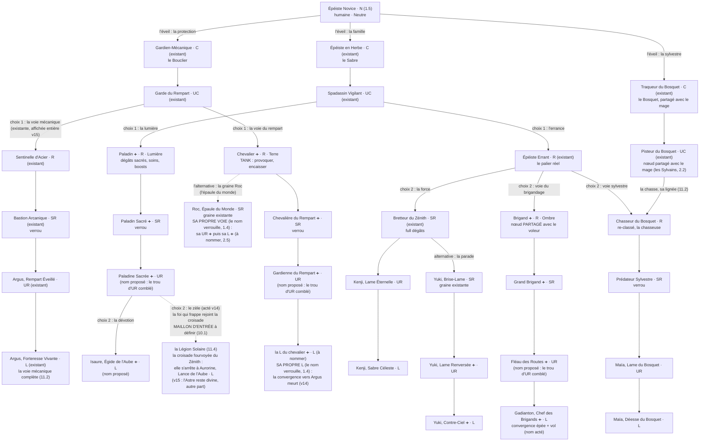

**Et la Légion Solaire, la croisade fourvoyée (acté)** : famille humaine du Zénith (11.4), le pendant paladin de la voie de la lumière : des croisés qui se sont fourvoyés et se sont laissés entraîner à la suite de l'Astre Capiteux, l'ange dévoyé qu'ils ont pris pour un dieu. Mais leur sommet à eux n'est pas lui (acté v15) : ils s'arrêtent à **Aurorine, Lance de l'Aube**, la L existante de la famille (le Héraut du Zénith en est l'autre L) ; l'Astre Capiteux reste une carte divine (5), ailleurs dans l'arbre, au-dessus d'eux. Le miroir sombre du paladin : la même foi qui frappe, sans la bonne volonté. Et le paladin peut les rejoindre : son **choix du zèle** (choix 2, acté v14) quitte la dévotion d'Isaure et rejoint la croisade ; le maillon d'entrée dans la Légion reste à définir (10.1).

### 2.2 L'arbre du mage : l'élection entre UC et R, et ses convergences

Acté : l'élection descend. Le mage choisit son élément à l'éveil (la famille, 1.5), puis **au palier UC→R il choisit sa loyauté (choix 1)** : fidèle à son élément, ou la lumière, ou l'ombre. Et les élus lumière/ombre **convergent vers les lignées du prêtre** (comme le Brigand pour l'épée et le vol) : le trou des cases élues est comblé sans nouvelles lignées solitaires. **Et l'éveil du mage perd la foi et les assassins (acté v15)** : il ne mène plus à la Novice de l'Aube ni au Rôdeur des Ombres ; un mage avec un sort de mage qui devient voleur, ça ne vaut pas vraiment, sauf s'il y a derrière une vraie histoire et de vrais choix. Ces communes restent les portes du prêtre et du voleur, et la loyauté lumière/ombre se joue au choix 1, avec ses convergences au SR.

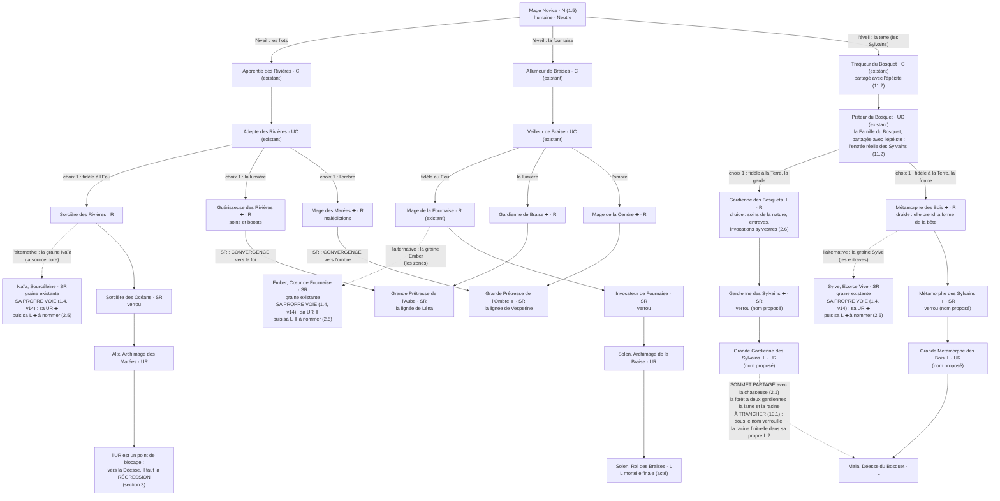

**La lignée des Sylvains (tracée v13, à valider)** : la branche druide du mage, presque une branche elfe, sans les elfes : celle qui prend soin de la nature et la protège. Deux voies : **la garde** (soigner le bosquet, gêner l'ennemi, invoquer les esprits des bois) et **la forme** (la transformation : la druide devient la bête qui défend la forêt). Les deux convergent vers **Maïa, Déesse du Bosquet**, le sommet partagé avec la chasseuse de l'épéiste (2.1) : la forêt a deux gardiennes, la lame et la racine (un sommet partagé nommé : sous le nom verrouillé, à trancher, 10.1). Les graines sylvaines : **Sylve (les entraves) s'y sème en alternative, dans sa propre voie (2.5, v14)** ; la graine Naïa revient à sa famille de l'Eau, chez les Sorcières (2.5, l'audit 11.3). Les élus lumière/ombre du mage terre restent à trancher (section 10.1).

### 2.3 L'arbre du prêtre : le deuxième choix

Acté : au palier UC→R, le prêtre choisit **la nature de son pouvoir** : la foi pure ou la magie (invocation).

Détaillé v13 (tracé, à valider) : le prêtre n'est pas un mage qui prie. Le mage demande « quel élément ? » ; le prêtre demande « quelle loyauté ? » (l'éveil : la lumière, le zèle ou l'ombre ; plus de garde, acté v14 : le Gardien-Mécanique reste à l'épéiste seul), puis « la foi ou la magie ? » (choix 1). Quatre voies, quatre rôles :

- **La foi (Prêtresse de l'Aube)** : soins et boosts, la lignée de Léna. Le prêtre qui garde les vivants.
- **La magie céleste (Invocatrice de l'Aube), le zèle** : **le prêtre qui frappe**. Elle ne soigne pas : elle invoque les esprits de lumière et rend le coup pour le compte de sa foi, des dégâts sacrés. Une croisée plus qu'une clerc : **la passerelle du prêtre vers les paladins**, sa lignée rejoint Isaure, Égide de l'Aube, le sommet du paladin (2.1). La lumière se bat aussi bien par la foi que par l'épée.
- **Les malédictions (Prêtresse Noire)** : dégâts d'ombre, peu de boosts, la lignée de Vesperine. Et la première porte de la conversion funèbre : sa mort la mène aux banshees.
- **L'invocation des morts (Évocatrice du Caveau), la nécromancie** : elle lève les défunts et les fait travailler pour elle : drain, dégâts d'ombre, invocations funèbres (2.6). La nécromancie vivante s'arrête à son UR : **son vrai sommet est de l'autre côté**, la conversion funèbre.

**Et le Clergé du Plein Jour, la foi fourvoyée (acté)** : famille humaine du Zénith (11.4), le pendant sacerdotal de l'arbre du prêtre : des croyants qui se sont fourvoyés et se sont laissés entraîner à la suite de l'Astre Capiteux. Le miroir sombre de la foi de Léna ; leur M à eux, Apolline, Prophétesse du Jour, est un M humain, comme Morzak. Et le Clergé est maintenant rejoignable depuis l'arbre du prêtre : l'éveil du zèle y mène (le schéma, acté v14).

**La conversion funèbre, le pendant de la chute (3.3), tracée v13** : la chute, c'est un divin qui descend ; la conversion funèbre, c'est un vivant qui passe. Deux portes, illustrées par les deux pointillés du schéma :

- **Le sacrifice, la porte choisie** : depuis la voie de l'ombre du prêtre, le joueur peut sacrifier sa carte. Contrairement à la régression, la mort ne copie pas : **elle prend**. La carte vivante est consommée, et une carte défunte naît, **entrée au palier R de l'Au-delà** (elle choisit sa mort : le gouffre, le deuil marin, le devoir brisé, section 6.1), avec **100 % de ses sorts traduits en sorts de mort** et **10 % de ses stats gagnées** (les mêmes nombres que la régression). Sans retour : on ne remonte pas de la mort, sauf événement (la résurrection d'Isaure, 7.1, en est née).
- **La chute au combat, la porte de l'échec** : certaines défaites convertissent la carte tombée, au cas par cas, par événement, comme la mort du héros (7.1). Première tracée : la Prêtresse Noire qui tombe face à l'Archiliche des Caveaux rejoint les banshees (sa mort : le deuil qui hurle).
- Le principe « tout mortel peut rejoindre les morts » reste acté (6.1) ; l'élargissement de la porte du sacrifice aux autres arbres se tranchera (section 10.1).

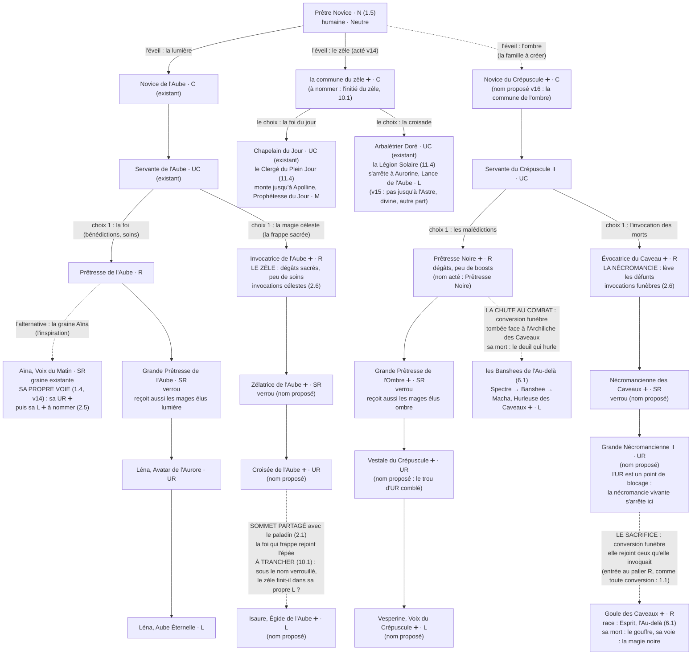

### 2.4 L'arbre du voleur : trois voies plus le braconnier

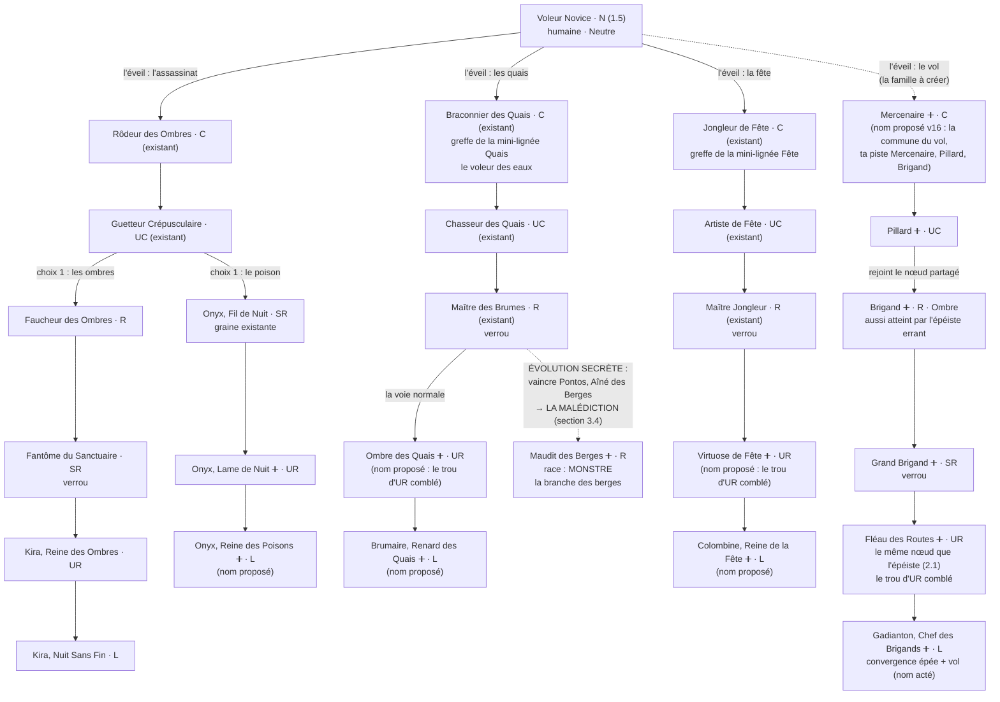

### 2.5 La table des greffes (mini-lignées et graines)

| Mini-lignée | Greffe | Statut |
| --- | --- | --- |
| Fête (Jongleur → Artiste → Maître Jongleur) | voleur · voie de la fête | acté |
| Quais (Braconnier → Chasseur → Maître des Brumes) | voleur · voie des quais | acté |
| Routes (Palefrenière Errante → Écuyère → Première Écuyère) | épéiste · voie du chevalier : l'écuyère devient chevalière | acté |
| Dunes (Éclaireur → Guide des Dunes) | épéiste · voie sylvestre (Maïa) : la branche désert | acté |
| Berges (Raboteur → Charpentier → Maître Charpentier) | **pas de greffe** | acté : reste une mini-lignée |
| Guet (Veilleuse → Capitaine du Guet) | **pas de greffe** | acté : reste une mini-lignée |

Les graines, fondues dans les arbres (acté) : chaque graine est un SR alternatif, une deuxième manière de jouer la même voie. **Et chaque graine crée sa propre voie (acté, v14 : le nom verrouille la chaîne, 1.4)** : une graine nommée ne rejoint jamais le sommet nommé de sa famille, elle monte jusqu'à SA L. Yuki (la parade, 2.1 : Yuki, Contre-Ciel) et Onyx (le poison, 2.4 : Onyx, Reine des Poisons) avaient déjà leurs sommets propres ; Naïa (la source pure) monte vers sa L de l'eau ➕, Aïna (l'inspiration) vers sa L de l'aube ➕, Roc (l'épaule du monde) vers sa L du bouclier ➕, Ember (les zones) vers sa L de braise ➕, Sylve (les entraves) vers sa L du bosquet ➕ : chacune à nommer (10.1). Une famille peut donc porter deux L : la nommée de la voie et celle de sa graine.

### 2.6 Les invocations : la carte qui appelle

Tracé v13 (le principe, à valider) : l'invocation est un rôle à part entière. La carte ne se bat pas seule : **elle appelle**. Les présences invoquées ne sont pas des cartes (rien à collectionner) : des esprits temporaires qui combattent à ses côtés, frappent ou gênent, puis se dissipent. Quatre écoles, une par grande branche :

| L'école | La branche | Ce qu'elle appelle |
| --- | --- | --- |
| céleste | l'Invocatrice de l'Aube (le zèle, 2.3) | les esprits de lumière : la frappe sacrée, le jugement |
| de braise | l'Invocateur de Fournaise (mage feu, 2.2, existant) | les élémentaux de braise : les dégâts de zone |
| sylvestre | les Sylvains (mage terre, 2.2) | les esprits des bois : les entraves, les soins, la garde |
| funèbre | l'Évocatrice du Caveau (la nécromancie, 2.3) | les défunts : le drain, la mort qui travaille |

L'Invocateur de Fournaise existant en est le doyen : la v13 généralise son rôle aux trois autres écoles. Et l'école sépare le prêtre du mage : le mage raffine son élément ; le prêtre prie, et la lumière (ou la mort) répond. Le détail des invocations (leur nombre, leur durée, leurs stats) est une donnée d'équilibrage.

## 3. Le système de régression (chiffré, acté)

**On ne va jamais directement d'un sommet mortel à un sommet divin ou mystique. On redescend dans la nouvelle race, on garde ce qu'on a appris, et on la remonte.**

| Règle | Détail (acté) |
| --- | --- |
| Le déclencheur | un point de blocage : l'UR d'une lignée scellée (l'Archimage), ou une L mortelle qui a une destinée post-L |
| L'entrée | **le palier R de la nouvelle race** |
| Les sorts | **100 % conservés** (la règle des sorts cumulés fait le travail) |
| Les stats | **10 % des stats déjà gagnées**, en plus des stats de base de la nouvelle race (+10/+20/+30 % selon le rang) |
| Ce qu'on gagne | des étages d'évolution en plus : chaque palier de la nouvelle race cumule encore stats et sorts |
| Le déblocage | **l'Éclat de régression ➕ (nom acté)** : il ne droppe **qu'à partir des donjons en difficulté Difficile, jamais avant** (aucun intérêt à régresser avant les donjons en mode difficile) ; le taux grimpe ensuite à chaque cran ; **sauf exceptions** : des mécanismes secrets peuvent activer des régressions plus tôt |
| La collection | la régression crée une nouvelle carte, l'ancienne reste : la règle « aucune rétrogradation » est respectée |
| Qui y a droit | les lignages humains vers les mystiques et les divines. **Pas les monstres** |
| Les L mortelles | **au cas par cas** : certaines L sont des sommets finaux, d'autres ont une destinée post-L ; **des M mortels peuvent exister** |

### 3.1 L'exemple d'Alix : les deux chemins, deux L (v14)

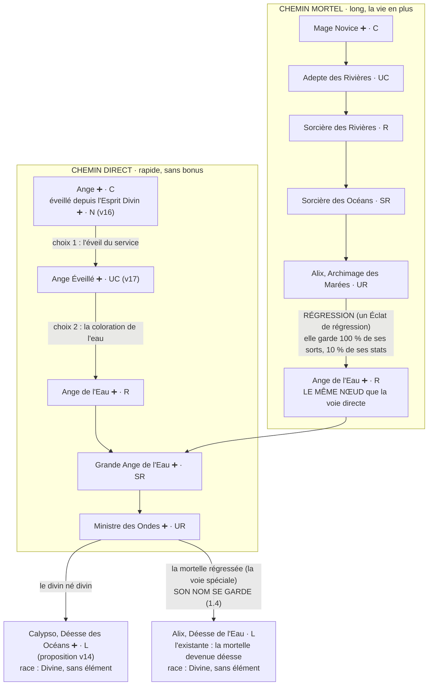

- **Deux L pour l'eau (acté, v14)** : la coloration divine finit deux fois. Le divin né divin devient **Calypso, Déesse des Océans ➕** ; la mortelle régressée garde son nom et devient **Alix, Déesse de l'Eau** (le nom se garde, 1.4). Le doublon de L est permis : c'est la voie à deux visages.

### 3.2 Les destinées post-L (au cas par cas)

Premières décisions (actées), le reste au fil des fiches :

- **Kenji, Sabre Céleste : OUI** : régression divine (**Ange du Sabre ➕ · R → Ministre du Sabre ➕ · UR → Kenji, Dieu du Sabre ➕ · L**) et conversion funèbre (**Kenji, l'Éternel Revenant ➕**, l'Au-delà).
- **Léna, Aube Éternelle : OUI** : régression divine (**Ange de l'Aube ➕ · R → Ministre de l'Aube ➕ · UR → Léna, Déesse de l'Aube ➕ · L**, nom proposé, symétrie avec Alix).
- **Alix, Archimage des Marées : OUI** : par construction (section 3.1).
- **Solen, Roi des Braises : NON** : L mortelle finale (acté) ; des M mortels pourront aussi exister.
- **Maïa, Déesse du Bosquet : NON** : « Déesse » reste un titre mortel, pas une entrée dans la race Divine.
- **Le duel de la Mort (proposition v15)** : face à la Mort, les deux fins. **La vaincre** : celui qui bat la Mort gagne la plus haute destinée, une carte L ou M qui peut donner la vie à tous (il a vaincu la mort, il peut la rendre). **Perdre** : le tombé devient un mort-vivant, ou pire (la chute au combat, 2.3 et 7.1). Qui a droit au duel et ce que la victoire donne exactement : à trancher (10.1).

### 3.3 La chute : la régression descendante (l'ange déchu)

Acté dans le principe : un divin peut **tomber**. Symétrique de la montée : une nouvelle carte (l'ancienne reste), il garde **100 % de ses sorts et 10 % de ses stats**, il entre au palier R du web d'accueil. Il perd les stats de base de sa race (il n'est plus divin), il garde sa vie.

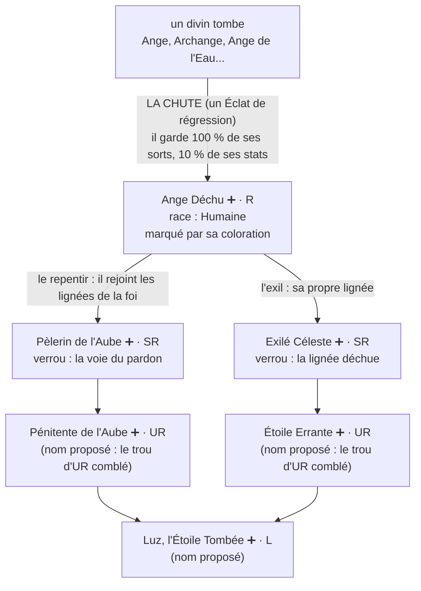

- **L'ange déchu** : faible de naissance désormais (stats de base humaines), riche de sorts (sa vie céleste). Le contre-miroir exact de l'humain régressé.
- **Battre l'Astre Capiteux le fait tomber (proposition v14)** : vaincu au Zénith Ardent (la difficulté exigée à trancher), le dieu qui n'était pas gentil tombe à son tour : il rejoint la collection comme **l'Ange Déchu**, la carte du boss tombé. Le premier sommet du jeu qui s'obtient en le frappant. Restent à trancher : son nom propre (un nom spécial, pas seulement « l'Ange Déchu » ; piste v15 : **l'Exilé**, à dédoublonner d'avec l'Exilé Céleste), sa fiche (les nombres de la chute : 100 % des sorts, 10 % des stats) et la difficulté exigée (10.1).
- **Et la chute se scénarise (proposition v15)** : la chute n'est pas seulement la régression du joueur, elle devient une histoire du monde : un ange L qui en bat un autre, par événement scénarisé, tombe aussi (le vaincu devient un ange déchu, une carte par événement, pas à chaque duel : quelques-uns suffisent, deux par exemple). Les duels retenus et leurs vaincus : à trancher (10.1).
- **Le démon déchu** et la chute vers une race mystique plutôt qu'humaine : le mécanisme s'y prête, à trancher (section 10.1).

### 3.4 La malédiction des quais : la première conversion humain → monstre

Ta proposition, actée et affinée : **la carte se transforme elle-même**. Ce n'est pas une nouvelle carte : le Maître des Brumes qui a vaincu Pontos, Aîné des Berges, est **transformé**, sans le choix du joueur, sans retour possible. Il ne fallait pas défier l'Aîné avec cette carte-là ; maintenant c'est verrouillé. C'est le seul cas du jeu où une carte existante change de race : la règle « aucune rétrogradation » vaut pour les évolutions choisies, la malédiction n'est pas choisie, c'est une punition.

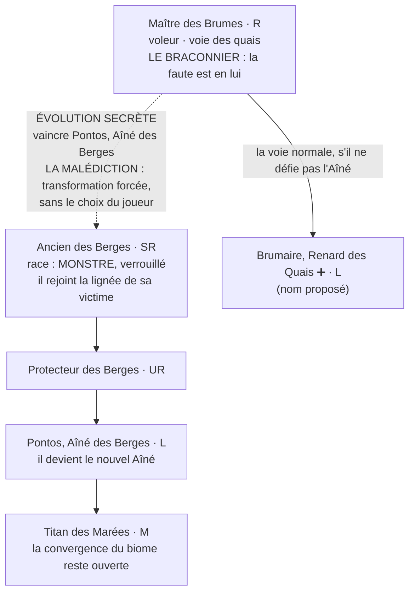

**Le gabarit de la malédiction** : une faute portée par la carte (le braconnage, ici), un sommet à vaincre, une transformation forcée dans la lignée du vaincu. Les maudits suivants :

- **Le mage du feu (tranché, affiné v13)** : le gardien est **le Cœur du Bosquet ➕**, le sommet du web du Vivant. **Une carte de la lignée de Solen** qui combat le Cœur du Bosquet et le tue est transformée en **membre de la famille du Cœur du Bosquet** : monstre du Vivant, une plante, un gardien de la forêt. Une malédiction humaine : tu as voulu brûler le cœur de la forêt, maintenant tu le gardes. **La transformation n'arrive qu'une seule fois** : il n'y a qu'un Cœur ; une fois remplacé, plus personne ne peut commettre la faute.
- **Le paladin : repris en 7.1** : la mort du héros (Isaure) remplace la malédiction du paladin ; la punition devient un destin.
- Chaque malédiction a sa propre condition (acté) : la faute de la carte + le boss à vaincre.

### 3.5 L'événement Morzak : le premier humain mythique

Ta proposition, actée dans le principe : les deux L qui ne régressent pas (Solen et Maïa) ont la plus grande destinée mortelle du jeu. **Si Solen et Maïa vainquent ensemble l'Astre Capiteux, en difficulté Enfer, et survivent tous les deux au combat**, l'événement se déclenche : ils ont protégé l'humanité d'un dieu qui n'était pas gentil, ils finissent ensemble, et une nouvelle carte naît, leur fils.

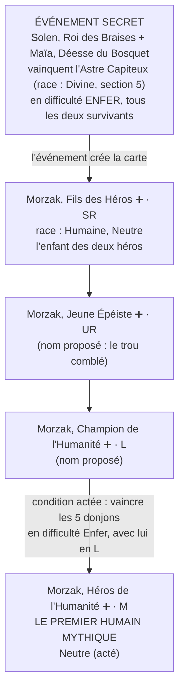

- **Le palier d'arrivée (tranché, v12)** : des étages : SR (Morzak, Fils des Héros) → UR ➕ (Morzak, Jeune Épéiste, nom proposé) → L ➕ (Morzak, Champion de l'Humanité, nom proposé) → la condition actée : **vaincre les 5 donjons en difficulté Enfer, avec lui en L** → M (Morzak, Héros de l'Humanité). Et Morzak est **Neutre** (acté), comme la M de l'Équilibre (7.1).
- Les L qui ne régressent pas ne sont pas des culs-de-sac : Solen et Maïa, qui n'ont pas de destinée divine, ont un enfant mythique.
- C'est le modèle des **événements de héros** : deux L, un boss divin, une condition de survie, une carte enfant. D'autres couples pourront suivre.

## 4. La race monstre : les Embryons

Le monde bestial : des êtres monstrueux (crabes, léviathans, phénix, mycoses, gardiens des bosquets), intelligents parfois, mais jamais des conscients au sens des mystiques. **Le Bestiau générique disparaît (acté)** : les communes bestiales sont **les 5 affinités elles-mêmes**, Embryon des Eaux, Embryon des Flammes, Embryon du Vivant, Embryon des Ténèbres, Embryon des Cieux (les ex-Bestiaux, toutes cinq en jeu, audit 11.1), tirées au hasard de la naissance (1.2). **Et elles passent rang N et changent de nom (acté v15)** : la bête embryonnaire devient l'**Embryon** : Embryon des Eaux, Embryon des Flammes, Embryon du Vivant, Embryon des Ténèbres, Embryon des Cieux. La carte N qui n'a pas encore choisi ce qu'elle devient : le nom dit exactement ce que le rang fait ; le renommage s'appliquera au dist, les liens des fiches ne bougent pas (11.1). **Un gobelin reste toujours commun** : le Bestiau des Eaux ne devient jamais « Gobelin des Marées », il rejoint les nœuds du web des Flots par ses choix, en partage avec les naissances du biome.

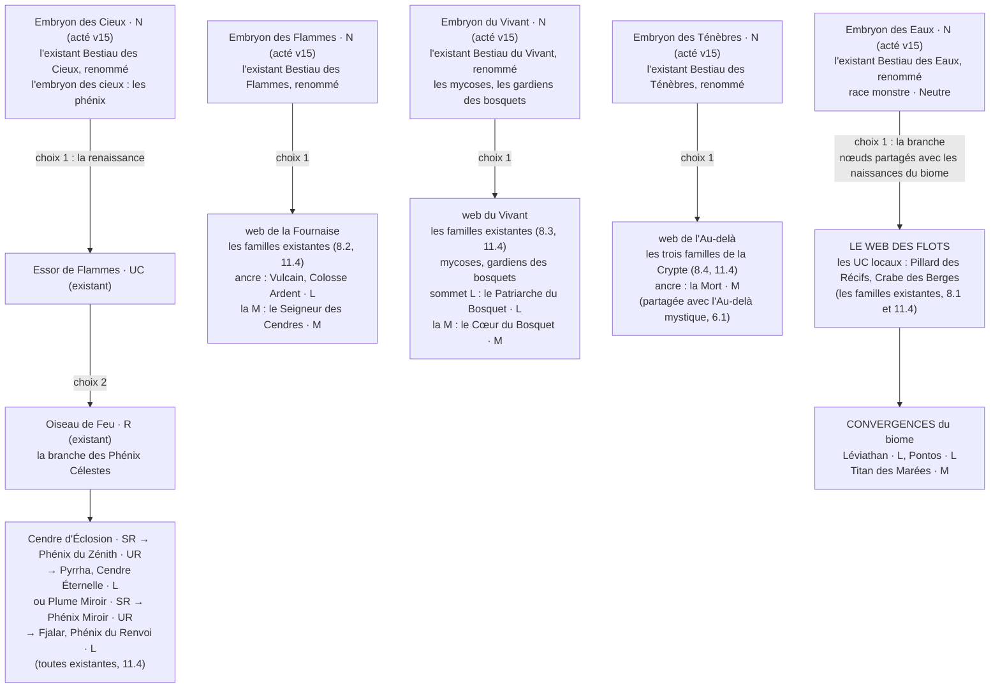

- **On ne naît pas phénix** : on naît du bon Embryon, et on le devient. Le joueur qui visait les cieux et qui a reçu le vivant ne crée pas de phénix tout de suite : il rejoue le défi pour tenter l'Embryon des Cieux.
- **Le Zénith a une face humaine (acté)** : la Légion Solaire et le Clergé du Plein Jour sont des familles humaines (les croyants fourvoyés, 11.4) ; le bestiau des cieux, lui, reste les Phénix.
- **Les 5 affinités sont les 5 portes des webs** : chaque web a sa commune raciale ; les naissances locales (gobelin, moqueur, sirène pour les Flots) restent des entrées directes du biome, en nœuds partagés dès le palier UC.
- **L'Embryon n'atteint jamais les races nobles** : sirènes et dryades sont des mystiques.
- **Les webs de la Fournaise, du Vivant et de l'Au-delà sont tracés v13 (section 8)**, sur le gabarit des Flots, avec les familles existantes comme branches : l'audit des cartes existantes du biome remplace les noms proposés (les existantes d'abord, acté). **La règle de la rareté (1.3) s'y applique** : chaque branche complète ses paliers, C → UC → R → SR → UR → L, puis M.
- **Les humains peuvent entrer par malédiction** (section 3.4) ; les monstres, eux, n'ont pas la régression : c'est l'équilibre des deux mondes.
- **Des monstres que les dieux craignent** (ton principe, acté) : le Titan, la Mort... les M des biomes peuvent être aussi forts ou plus forts que des dieux. La force n'est pas le monopole de la race noble, et la Mort reste la Mort directement, pas une déesse de la mort (acté).

## 5. La race noble : divine, sans élément Divin

Acté : **l'élément Divin disparaît**. Divin est une race, rien d'autre. La règle « hors oppositions » devient une propriété de la race. **Et la race divine naît d'un N unique (v16, tes retours)** : l'Esprit Divin ➕ · N (**nom acté v16** : l'Essence Divine reste en réserve), qui s'éveille en Ange ➕ · C (camp Lumière), Démon ➕ · C (camp Ombre) ou Éveillé du Seuil ➕ · C (le neutre, celui qui ne choisit pas de camp). Le camp tombe à l'éveil (1.2) : on ne naît pas ange quand on visait le démon, on rejoue le défi. Et **l'Ange Gardien ➕ meurt (v16)** ; **l'UC de l'ange est l'Ange Éveillé ➕ (acté v17, ta proposition)** : le choix 1 est l'éveil du service, puis les trois portes (la coloration, la voie céleste, la mauvaise volonté) ; le nom reste à dédoublonner d'avec l'Éveillé du Seuil (10.1-5).

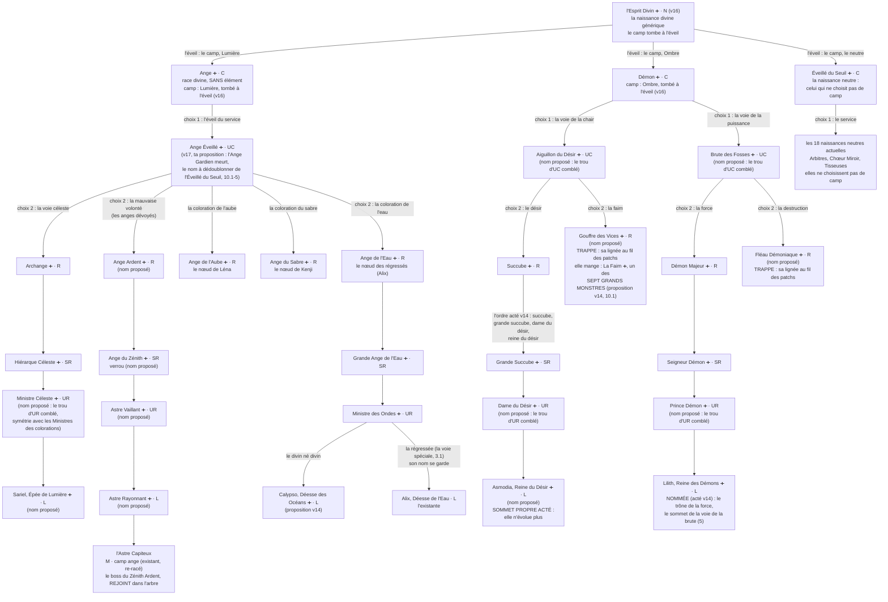

- **Les divines complètent leurs paliers (v12, acté ; v16 : l'Ange Gardien ➕ meurt)** : le choix 1 donne **l'UC du rang** (l'Ange Éveillé ➕, acté v17 ; Aiguillon du Désir ➕, Brute des Fosses ➕), le choix 2 le palier R ; les UR manquants sont comblés (Ministre Céleste ➕, Grande Succube ➕, Prince Démon ➕) ; et les démons doublent leurs R par voie (Gouffre des Vices ➕, Fléau Démoniaque ➕ : des trappes, leurs lignées se dessineront au fil des patchs). Et l'Éveillé du Seuil change de rôle : il n'est plus la base générique de la race, il est **la commune de la troisième famille**, celle qui ne choisit pas de camp.
- **Les colorations sont les portes des régressés** : de l'Eau (Alix), de l'Aube (Léna), du Sabre (Kenji), chacune avec son Ministre ➕ · UR vers sa L divine. Les autres colorations s'ouvriront au fil des déités (l'Ange de la Braise attend une déité du feu : personne ne l'emprunte aujourd'hui, Solen ne régresse pas).
- **Le camp dans les oppositions, acté en principe** : ange = Lumière, démon = Ombre (le mécanisme exact à définir au moteur). Les neutres du Seuil restent hors oppositions.
- **Le défi du jour (acté)** : il débloque **une carte commune de n'importe quelle race**, aux taux **50 % humaine, 30 % monstre, 15 % mystique, 5 % divine**. Les 5 % divines, c'est l'Esprit Divin ➕ · N (v16) : le camp tombe à l'éveil au hasard (Ange, Démon ou Éveillé du Seuil C, 1.2), on ne choisit pas sa naissance divine. **Pour l'instant, uniquement des naissances N** (v16 : les N sont des drops, 1.5) : des jetons plus rares (uncommon, rare, une race ciblée) viendront avec l'avancement du jeu, ça montrera aussi que le jeu prend son temps à évoluer.
- **L'Astre Capiteux rejoint la race Divine, camp ange, et l'arbre des anges (acté, v13)** : le boss du Zénith Ardent n'est pas un monstre, c'est **un dieu qui n'était pas gentil**. Un astre est quelque chose de brillant : c'est un ange méchant, mais un ange quand même. **Sa branche, la mauvaise volonté** (les anges dévoyés) : depuis l'Ange Éveillé ➕ · UC (v17), un deuxième choix s'ouvre : Ange Ardent ➕ · R → Ange du Zénith ➕ · SR → Astre Vaillant ➕ · UR → Astre Rayonnant ➕ · L → **l'Astre Capiteux, M** (la carte existante, re-racée). La branche pourrait rester secrète jusqu'au Zénith Ardent vaincu : à trancher (section 10.1). Et c'est lui que Solen et Maïa affrontent dans l'événement Morzak (section 3.5) : l'humanité protégée d'un ange dévoyé. Et **battre le fait tomber (proposition v14)** : vaincu au Zénith Ardent, il devient l'Ange Déchu, obtenable (3.3) ; son nom propre reste à trouver (10.1).
- **Les formes spéciales, acté** : la **Légion Solaire** = formes spéciales du **soldat et du paladin** (plusieurs formes de paladins), le **Clergé du Plein Jour** = formes spéciales du **prêtre** (Apolline, la M du Clergé). Le mécanisme : fusion d'éclats gravés, la carte se re-style dans sa case.
- **Le bonus d'équipe des divines** (1 par famille, 3 par équipe, +10 % dégâts et +10 % soins) reste, porté par la race.

## 6. La race supérieure : les mystiques (unifiée)

Ta remarque était juste : trop de branches uniques, pas assez de communalité. La race mystique suit désormais **exactement la même grammaire que les trois autres** : les essences deviennent les naissances N (1.5), tirées à la naissance ; la forme est l'éveil : il mène à la commune C de la famille d'accueil, puis à son UC (v16 : le trou de C refermé), puis au R (la règle de la rareté, 1.3) ; puis les familles existantes comme lignées d'accueil.

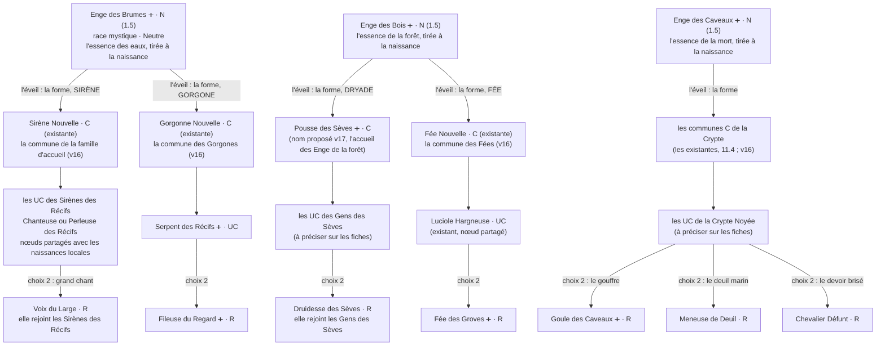

- **Trois naissances, trois essences, sept formes (acté, v16 : les Enge passent N)** : l'Enge générique disparaît, les essences deviennent les N (1.5), **tirées à la naissance (1.2)** ; la forme est l'éveil, elle mène à **la commune C de la famille d'accueil**, puis à son UC (v16 : le trou de C refermé), puis au R : les nœuds sont partagés avec les naissances locales, et les conversions entrent au R directement. Les familles existantes (Sirènes des Récifs, Gens des Sèves, Gorgones, Fées, les trois familles de la Crypte) sont **les lignées d'accueil**, comme les compagnons côté humain et les naissances nommées côté monstre.
- **Les Enges (actés)** : les créatures féeriques primitives, de petits êtres d'essence, pas encore formés ; leurs trois essences sont actées (les eaux, la forêt, la mort), et **le feu et la lumière restent en réserve** : deux communes futures qui ouvriront d'autres formes plus tard (trappes).
- **Trois accès coexistent** (règle d'accès universel) : les **3 Enge N** (le hasard de la naissance, leur éveil passe par la commune C de la famille d'accueil, v16), les **naissances C** en raccourci (Sirène Nouvelle, Lueur Bienveillante, Gorgonne Nouvelle, Fée Nouvelle, les communes de la Crypte), et les **conversions ou régressions** de mortels, qui entrent toujours au palier R. Jamais les monstres.
- **La succube** reste à part : par le camp démon (section 5) ou par régression d'une mortelle de l'ombre.
- Chaque forme continue ensuite dans sa famille : les voies au SR, les L, certaines M (la Mort, l'Ancien Naufragé).

### 6.1 Le carrefour des morts : l'Au-delà (l'essence de la mort, complète)

Tout mortel peut rejoindre les morts : la conversion funèbre crée une nouvelle carte, qui choisit sa mort. Les trois familles existantes de la Crypte Noyée sont les formes de l'essence de la mort (l'Enge des Caveaux y naît mystique, le mortel y tombe par conversion).

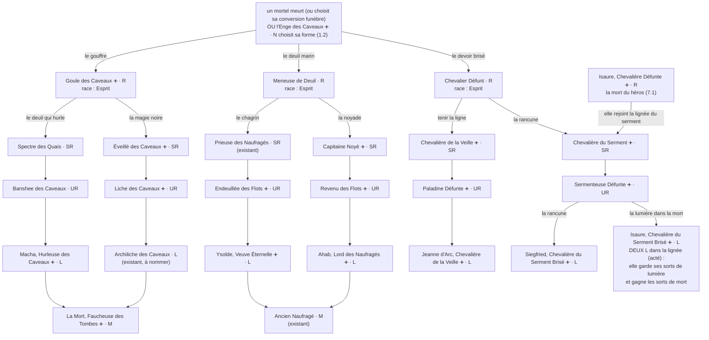

Les conversions funèbres déjà dessinées s'y raccrochent : la Prêtresse Noire → banshee, Kenji → l'Éternel Revenant, le marin noyé → Naufragé, le pont Méliane → Revenu des Flots, et la Grande Nécromancienne (2.3) qui choisit sa conversion au sommet de la nécromancie vivante (sa mort : le gouffre, sa voie : la magie noire).

### 6.2 Les gorgones et les fées (les formes de l'eau et de la forêt)

```mermaid
flowchart TD
  subgraph GORG["Gorgones · l'essence des eaux"]
    GO1["Gorgonne Nouvelle ➕ · C<br/>naissance raccourcie"] --> GO2["Serpent des Récifs ➕ · UC"]
    GO2 --> GO3["Fileuse du Regard ➕ · R<br/>l'entrée des Enges et des conversions"]
    GO3 -->|"le regard pétrifiant"| GO4["Petrifiante des Écueils ➕ · SR<br/>verrou"] --> GO5["Gorgonne Immaculée ➕ · UR"] --> GO6["Méduse, Reine des Écueils ➕ · L"]
    GO3 -->|"les serpents"| GO7["Mère des Serpents ➕ · SR<br/>verrou"] --> GO8["Grande Serpentine ➕ · UR"] --> GO9["Euryale, Nourrice des Serpents ➕ · L"]
  end
  subgraph FEES["Fées · l'essence de la forêt"]
    FE1["Fée Nouvelle ➕ · C<br/>naissance raccourcie"] --> FE2["Luciole Hargneuse · UC<br/>(existant, re-classé)"]
    FE2 --> FE3["Fée des Groves ➕ · R<br/>l'entrée des Enges et des conversions"]
    FE3 -->|"les jeux"| FE4["Fée des Jeux ➕ · SR<br/>verrou : illusions, buffs"] --> FE5["Souveraine des Jeux ➕ · UR"] --> FE6["Mab, Souveraine des Jeux ➕ · L<br/>(nom proposé)"]
    FE3 -->|"les ronces"| FE7["Fée des Ronces ➕ · SR<br/>verrou : féérie sombre, entraves"] --> FE8["Reine des Ronces ➕ · UR"] --> FE9["Aubépine, Reine des Ronces ➕ · L<br/>(nom proposé)"]
  end
```

- **Gorgones** : le regard (contrôle dur, gel → Méduse) contre les serpents (venins persistants → Euryale). Sthéno en réserve si une troisième voie s'ouvre.
- **Fées** : les jeux (illusions, buffs → Mab) contre les ronces (féérie sombre → Aubépine). La Luciole Hargneuse existante re-sert de palier UC.
- **Dryades** : les Gens des Sèves existants (Clairières → Adriel / Sous-Bois → Vesna), l'entrée à Druidesse des Sèves · R, **et la voie du Bosquet (tracée v13) : la fusion du Bosquet (7.1) y met Maïa, Déesse des Sèves ➕ · L**, la troisième voie de la famille (ses paliers SR et UR se dessineront avec elle). **Sirènes** : les Sirènes des Récifs existantes (→ Méliane / Thalassa), l'entrée à Voix du Large · R.

### 6.3 Mystique vers divine

- La hiérarchie autorise le deuxième saut (une L mystique qui régresse vers le divin, par exemple une déesse née sirène) : à dessiner au cas par cas, comme pour les L mortelles.

## 7. Le verrou variable et les évolutions secrètes

- **Verrou SR** (le standard) : la lignée se scelle au SR.
- **Verrou à la conversion / régression** : pour les races mystiques et divines, le scellement EST l'entrée dans la nouvelle race.
- Jamais de verrou après L.
- **Jamais de verrou à froid (acté)** : au moins un choix, souvent deux, entre la commune C et la porte, **et l'éveil N → C ne compte pas (acté : c'est un préalable, la naissance prend sa famille)** ; le joueur a toujours décidé au moins une fois dans sa progression, souvent la spécialité au palier R, avant de rencontrer son premier verrou.
- **Les évolutions secrètes** : une évolution qui existe dans le jeu mais que le joueur ne voit pas encore (floutée « ?? »). **Chaque évolution secrète a sa propre condition** (acté). La malédiction des quais (section 3.4) est la première tracée : **vaincre Pontos, Aîné des Berges**. L'ouverture d'un donjon ou d'un étage peut aussi débloquer des évolutions qui n'étaient pas là avant.
- **Trappes de la matrice** (les cases vides, ex. une future lignée pas encore dessinée) et formes spéciales des L : inchangés. Les deux trappes du prêtre deviennent des lignées tracées en v13 (le zèle et la nécromancie, 2.3).

### 7.1 Le livre des liens : les destins croisés

Des liens secrets entre les familles, révélés au fil du jeu. Chaque lien a sa propre condition, comme les évolutions secrètes : des ponts qui traversent les races et les webs.

1. **Le pont des sirènes (tracé)** : le chant envoie par le fond. Posséder une L des Sirènes ouvre le pont vers les Naufragés de la Crypte (section 8) : le Revenu des Flots ➕ · UR.
2. **La mort du héros (tranchée, première : Isaure)** : l'inverse exact de l'événement Morzak (3.5). Le triomphe crée l'enfant des héros ; **l'échec crée la défunte**. Isaure, Égide de l'Aube, le meilleur paladin, perd face à **l'Archiliche des Caveaux** (acté, v13 : c'est lui qui ressuscite, la Mort reste au-dessus des jeux) : elle est ressuscitée en chevalière défunte. **Isaure, Chevalière Défunte ➕ · R** entre dans la lignée du serment (6.1), remonte Chevalière du Serment → Sermenteuse Défunte, et la lignée s'ouvre sur **deux L (acté)** : Siegfried, Chevalière du Serment Brisé (la rancune) et **Isaure, Chevalière du Serment Brisé ➕ · L** (la lumière dans la mort : des sorts de lumière ET des sorts de mort, une chevalière défunte un peu différente de sa sœur d'armes). Une nouvelle carte naît de l'échec : l'Égide de l'Aube reste.
3. **L'événement d'équilibre (tracé dans le principe)** : le modèle Morzak ouvert aux couples ennemis. **Un ange L et un démon L** (la condition à trancher : vaincre ensemble un sommet qui menace les deux camps, ou s'affronter et survivre ?) créent la carte qui n'est ni ange ni démon : **la M de l'Équilibre ➕** (nom proposé : l'Équinoxe, ou la Balance), les deux camps en elle, le texte : « toujours l'équilibre entre les deux ». **Son statut : Neutre (acté, v12)** : sans faiblesse ni force, la neutralité même de sa puissance ; et Morzak, le fils des héros, est neutre aussi (acté).
4. **La fusion du Bosquet (tracée v13)** : le sommet partagé obtenu deux fois fusionne. Si tu possèdes **Maïa, Déesse du Bosquet par la lame** (2.1) **ET Maïa, Déesse du Bosquet par la racine** (2.2), les deux cartes se consomment (la fusion prend, comme la mort) et une nouvelle carte naît : **Maïa, Déesse des Sèves ➕ · L, race : MYSTIQUE (dryade)**, la tête de **la voie du Bosquet** dans la famille des Gens des Sèves (6.2) : Clairières (Adriel), Sous-Bois (Vesna), et le Bosquet (Maïa). La déesse du bosquet devient la dryade souveraine : celle qui a gardé la forêt par les deux voies rejoint la forêt elle-même, et son nom se garde (1.4). Rien à voir avec la fusion d'éclats gravés des formes spéciales (Légion Solaire, Clergé du Plein Jour) : ici, ce sont deux cartes qui se consomment.
5. **Les pistes (à nourrir au fil des patches)** : les mages de l'eau (un lien avec les noyés de la Crypte : le mage des marées qui échoue sur l'eau ?), les gorgones (le regard qui fige : des cartes pétrifiées ?), les fées et les jongleurs (la fête éternelle ?), et la fusion généralisée (Isaure a deux voies désormais, le paladin et le zèle : sa fusion ouvrirait quoi ?). Le principe acté : **des liens, pas des usines à cartes** : chaque lien doit raconter quelque chose que les deux familles seules ne racontent pas.

## 8. Les webs de biomes (côté créatures)

Les cinq biomes ont chacun leur web de créatures : les cieux ont la branche des phénix (section 4), les quatre autres suivent le même gabarit. Le web des Flots est le validé ; les trois autres sont tracés v13 : leurs nœuds ➕ sont des propositions, et **l'audit des cartes existantes du biome les remplace** (les existantes d'abord, acté).

### 8.1 Le web des Flots (le gabarit, validé)

C'est la branche « eaux » du monde bestial, et le gabarit des trois autres webs. **L'Embryon des Eaux · N (v15), la commune raciale, y entre au palier UC par son choix 1 (la branche), en nœud partagé avec les naissances du biome** (gobelin, moqueur, sirène) : jamais en doublon d'une carte locale, toujours par les nœuds. La Sirène Nouvelle y reste la race noble du biome : une mystique.

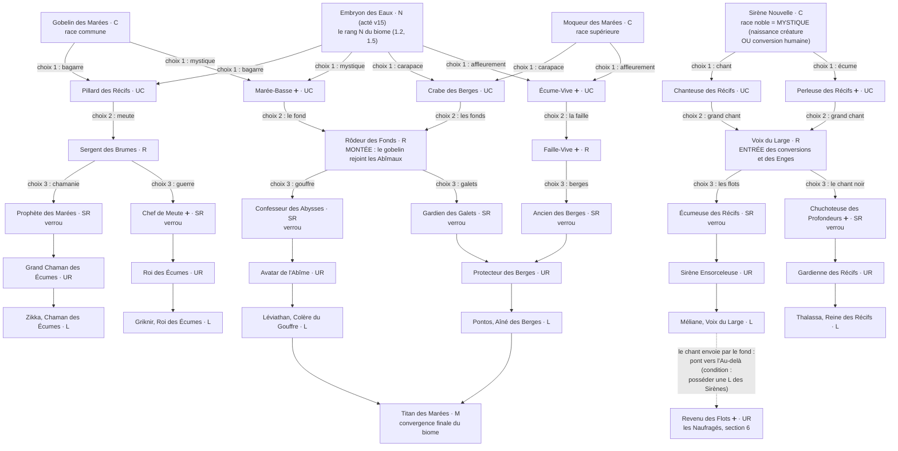

### 8.2 Le web de la Fournaise (tracé v13 ; les noms proposés cèdent devant l'audit, 11.4)

La branche « flammes » du monde bestial : la braise, la meute, et les colosses de pierre-chaude. Ancre du biome : **Vulcain, Colosse Ardent · L** (existant). L'Enge de la Fournaise (actée, à dessiner plus tard) y aura sa famille d'accueil : sa forme et sa branche se traceront avec elle.

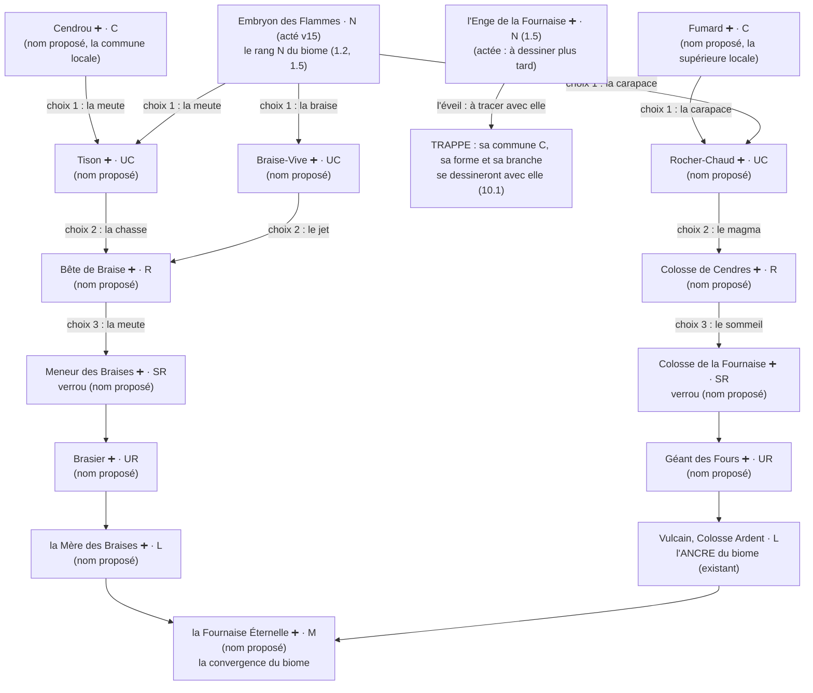

- **Le dragon de la Fournaise (proposition v15)** : quelque chose, dans ce web, devient un **dragon** : une bête de braise qui prend ses ailes et monte jusqu'à un dragon mythique, le M dragon du biome, à côté du Seigneur des Cendres. Où il se greffe (la meute ? la braise ? une branche à lui depuis le palier R ?), son nom, sa lignée : à tracer (10.1). Et l'Ange de la Fournaise (ta mention v15) : une mystique C, une autre chose, à placer (10.1).

### 8.3 Le web du Vivant (tracé v13 ; les noms proposés cèdent devant l'audit, 11.4)

La branche « vivant » : les mycoses et les gardiens des bosquets, les deux familles existantes du biome, re-classées en branches. Ancre et sommet : **le Cœur du Bosquet ➕ · L** (3.4), dont la famille reçoit le maudit de la lignée de Solen. L'Enge du Bois y naît dans les nœuds partagés des dryades (6.2). Et c'est le biome de **la fusion** : Maïa, Déesse du Bosquet obtenue par la lame et par la racine (2.1, 2.2) devient Maïa, Déesse des Sèves (7.1).

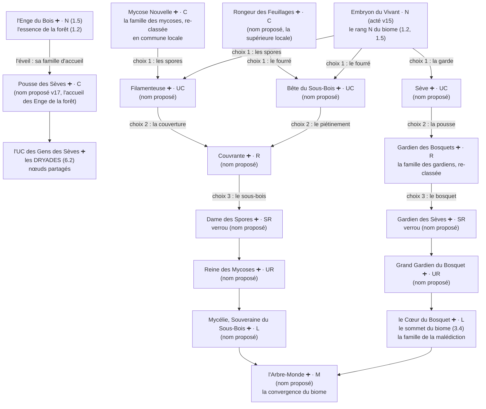

### 8.4 Le web de l'Au-delà bestial (tracé v13 ; remplacé par les trois familles de la Crypte, 11.4)

La face bestiale des ténèbres : les rongeurs et les bêtes des caveaux. L'Au-delà mystique (6.1 : goules, deuils, chevaliers défunts, race Esprit) reste la référence des morts ; ce web est son contre-jour animal : les deux faces partagent le biome et le sommet, jamais les nœuds. Ancre : **la Mort · M**, le sommet que même les dieux craignent.

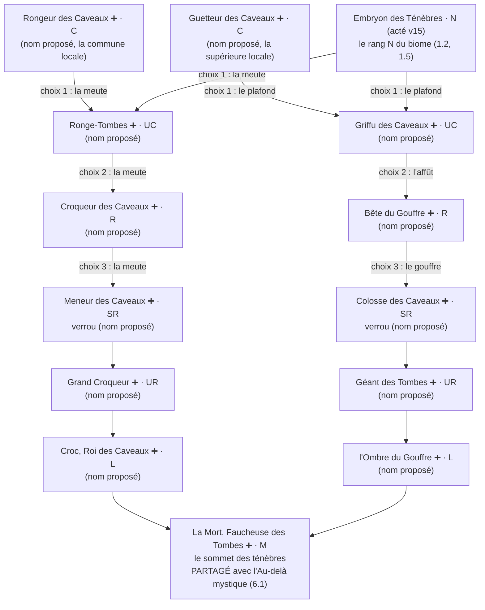

- **Le sommet partagé des deux faces** : la Mort reçoit les L des deux côtés, la bête et l'esprit ; elle reste la Mort, au-dessus des jeux (acté).
- **L'audit d'abord** (les trois webs) : chaque nœud ➕ est une proposition ; les cartes existantes du biome ont priorité et remplacent les noms proposés, la règle des paliers (1.3) s'applique à l'arrivée de chaque famille existante.

## 9. Migration et volume (l'audit du catalogue réel : section 11)

1. **Catalogue intact** : toutes les cartes restent, les noms actés restent. Les familles compagnons deviennent les lignées nommées des arbres (re-classement d'un cran, acté), les mini-lignées se greffent (table 2.5, Berges et Guet exceptées), les solos restent des recrues. Les familles de la Crypte, les Gens des Sèves, les Sirènes deviennent les lignées d'accueil mystiques.
2. **Moteur, six changements** : (a) suppression de l'élément Divin, oppositions portées par la race et le camp (lumière/ombre, acté en principe) ; (b) la régression : l'Éclat de régression (donjons en difficulté Difficile et au-delà, jamais avant, sauf mécanismes secrets ; taux par cran), entrée R, 100 % des sorts, 10 % des stats, nouvelle carte ; (c) le verrou devient une donnée de fiche ; (d) les stats de base par race : humain référence, monstre +10 %, mystique +20 %, divin +30 % (acté, répartition fine à l'équilibrage) ; (e) le défi du jour débloque une naissance de n'importe quelle race (50/30/15/5, acté ; v16 : les N sont des drops, 1.5) : il tire la race, puis la naissance N au hasard dans la race, le joueur ne choisit pas sa naissance (1.2) ; et le tirage est borné par les déblocages : jamais une naissance d'un biome dont le donjon n'est pas débloqué (acté) ; (f) la malédiction : le seul cas où une carte existante se transforme (humain → monstre, verrouillé, sans le choix du joueur), les événements de héros (deux L + un boss divin + survie → une carte enfant : Morzak), avec leurs variantes du livre des liens (la mort du héros, l'événement d'équilibre : section 7.1), et la conversion funèbre (2.3) : le sacrifice choisi d'une carte vivante, consommée, dont naît une défunte de l'Au-delà (entrée au palier R, 100 % des sorts traduits en sorts de mort, 10 % des stats gagnées) ; et la fusion (7.1) : deux exemplaires d'un sommet partagé, obtenus par ses deux voies, se consomment en une nouvelle carte qui ouvre une voie dans une autre famille (la première : Maïa, Déesse des Sèves).
3. **À créer (recalculé par l'audit du catalogue, 11.6)** : les naissances, les sept familles humaines et les six webs **existent déjà dans le jeu** (l'audit 11 les passe en revue) ; reste : les nœuds de classe des arbres (les branches nouvelles de 2.1 à 2.4 : le paladin, le chevalier, le brigand, les élues du mage, les Sylvains, le prêtre d'ombre, le zèle, la nécromancie), l'UR des Arbitres, la lignée déchue, les anges dévoyés, les destinées post-L, l'Éclat de régression, les webs gorgones et fées, la malédiction des quais (le Maudit des Berges ➕, la chaîne existe), la M de l'Équilibre, les étages de Morzak et les deux cartes d'Isaure la défunte (les liens, 7.1), et **Maïa, Déesse des Sèves** (la fusion, 7.1). **Volume restant : environ 85-95 cartes** (le détail en 11.6), dont une quinzaine en réserve ou à valider ; étalables par patch, trappes d'abord vides.
4. Harnas avant publication, comme toujours. Itérations courtes, tu réagis, je corrige.

## 10. Le carrefour, rangé en deux (v15, ta demande)

Tout ce qui attend ta décision est en 10.1, tout ce qui est derrière nous est en 10.2 ; les autres sections pointent ici en fin de phrase. Quand un point de 10.1 se tranche, il descend en 10.2.

### 10.1 À trancher

1. **Les maudits et destins à venir** : après le mage du feu (le Cœur du Bosquet, porteur tranché : la lignée de Solen, acté v13) et la mort d'Isaure, quels suivants ?
2. **Le duel de la Mort (proposition v15)** : face à la Mort, les deux fins. La vaincre : une carte L ou M qui donne la vie à tous (il a vaincu la mort, il peut la rendre). Perdre : le tombé devient un mort-vivant, ou pire. Qui a droit au duel (des L ?), et que donne exactement la victoire ?
3. **La chute scénarisée (proposition v15)** : un ange L qui en bat un autre, par événement, tombe en ange déchu ; quelques duels suffisent (deux par exemple), pas à chaque fois. Lesquels, et leurs vaincus ?
4. **Le nom propre de l'Astre tombé (3.3)** : un nom spécial, pas seulement « l'Ange Déchu » ; piste v15 : **l'Exilé** (à dédoublonner d'avec l'Exilé Céleste de la lignée déchue). Et la difficulté exigée du Zénith Ardent.
5. **La branche des anges dévoyés** : son nœud d'origine est réglé (v17 : la mauvaise volonté part de l'Ange Éveillé ➕ · UC) ; reste sa condition d'apparition (secrète jusqu'au Zénith Ardent vaincu ?).
6. **Le dragon de la Fournaise (proposition v15)** : quelque chose devient un dragon, un M de dragon à côté du Seigneur des Cendres ; où il se greffe (la meute ? la braise ? une branche à lui depuis le palier R ?), son nom, sa lignée (8.2).
7. **L'Ange de la Fournaise (ta mention v15)** : une mystique C, une autre chose ; où elle vit (le Zénith ? la Fournaise ? une famille à elle ?) : à placer.
8. **Les sommets partagés restants** : le zèle vers Isaure (2.3 : la Croisée de l'Aube rejoint-elle Isaure, ou le zèle finit-il dans sa propre L ?) et les Sylvains vers Maïa (2.2 : même question). La fusion du Bosquet en dépend (7.1).
9. **Les élus de la terre (2.2)** : l'élection lumière/ombre est actée pour tous les éléments, mais la terre n'a pas encore ses élus : convergent-ils vers les lignées du prêtre, ou la terre reste-t-elle sans élection ?
10. **La fusion, ses suites (7.1)** : la fusion du Bosquet est posée (Maïa, Déesse des Sèves) ; restent les paliers SR et UR de la voie du Bosquet à dessiner, et la généralisation aux autres sommets partagés (Isaure ?).
11. **Mystique → divine** : toujours pas d'idée (v15 : on prendra ça plus tard), à voir au cas par cas.
12. **Le chantier des solos et du RPG de capture (v15, tes pistes)** : tu n'aimes pas les solos ; une carte seule finit par ne plus servir, sauf si elle mène à quelque chose (des sorts transmis, une session unique, un niveau limité). Pistes sur la table : (a) l'évolution tous les 10 niveaux, bloqué jusqu'à l'évolution, puis 10 niveaux de plus (les solos monteraient alors sans fin, ou une seule évolution par palier de rareté) ; (b) les niveaux 1 à 100 à la Pokémon, si le jeu passe vraiment en mode beaucoup plus RPG ; (c) le vrai RPG de capture : lever le système de jetons, un personnage qui combat, le monstre vaincu demande à rejoindre l'équipe (oui/non, des objets qui donnent envie), le choix de départ entre trois créatures, les communes dans la nature, les rares dans les donjons de plus en plus durs, le combat auto laissé mais à XP réduite. Ça refait la méta entière : la direction à trancher avant tout câblage.
13. **Les réglages fins** : le coût de l'éveil N → C et ses jetons ; la fréquence de drop de l'Éclat par cran ; la répartition des stats (+10/+20/+30, acté en principe) ; le rythme de drop exact et le resserrage éventuel des pools de donjon sur leurs familles ; le nom de la commune du zèle (nom proposé v17 : Fidèle du Jour ➕ · C) ; le maillon d'entrée du zèle (leur commune C, Chantre du Zénith et Écuyer du Zénith, ou directement leur UC, Chapelain du Jour et Arbalétrier Doré) ; la place du choix du paladin (R ou SR) ; les communes nouvelles : Novice du Crépuscule ➕ (le prêtre d'ombre), Mercenaire ➕ (le vol), Pousse des Sèves ➕ (les Gens des Sèves, nom proposé v17).
14. **Les échelles sans choix avant le verrou** : le Chœur Miroir et les Tisseuses du Pont sont des lignes droites, les Sirènes ne fourchent qu'après le verrou : leur choix avant le SR reste à dessiner.
15. **La typologie des sorts (chantier v14)** : documenter chaque sort (rôle, ciblage, taux), puis câbler moteur, puis équilibrer ; les renommages de sorts L sont appliqués au dist en v0.47 (10.2-10) ; reste le sort L d'Argus (« Argus : Forteresse Vivante » répète le nom de sa carte), à renommer (22).
16. **Les divergences de l'audit (11.5)** : le Cœur du Bosquet M (le sommet L du Vivant est le Patriarche du Bosquet : 3.4 et 8.3 à réaligner) ; l'UR des Arbitres du Seuil (le seul trou du catalogue divin, une proposition ➕ à faire) ; le Gobelin des Fumées (deux cartes seulement : compléter la famille ou la fondre dans les Cendrels) ; les gorgones et les fées (~17 cartes, 6.2 : à tracer).
17. **La conversion funèbre : validation et élargissement** : les deux portes sont posées (2.3) ; à valider, et l'élargissement de la porte du sacrifice aux autres arbres que la voie de l'ombre du prêtre (le principe « tout mortel » reste acté, 6.1).
18. **Le démon déchu** et la chute vers une race mystique plutôt qu'humaine (3.3) : le mécanisme s'y prête.
19. **Les paliers H (HUC, HSR)** : des variantes futures en réserve, on les tracera quand l'idée arrive. Et les essences futures (actées, v13) : l'Enge de la Fournaise et l'Enge de la Lumière, leurs formes à dessiner quand le contenu s'élargira ; le nom de la naissance neutre divine reste Éveillé du Seuil (acté).
20. **Les jetons riches du défi du jour** : plus tard, avec l'avancement du jeu.
21. **La refonte divine (v16, tes retours)** : le N des divines est **l'Esprit Divin ➕** (**nom acté v16** ; l'Essence Divine reste en réserve), qui s'éveille en Ange, Démon ou Éveillé du Seuil · C (le camp) ; **l'Ange Gardien ➕ meurt** : l'UC de l'ange est **l'Ange Éveillé ➕** (acté v17, ta proposition ; le nom à dédoublonner d'avec l'Éveillé du Seuil) ; les familles neutres gardent leurs communes (Garde du Seuil, Lame Miroir, Fileuse du Pont).
22. **L'audit des communes manquantes (v16, ta remarque)** : chaque famille commence à C (1.3). Refermés en v16 : le prêtre d'ombre (Novice du Crépuscule ➕ · C), le vol (Mercenaire ➕ · C, puis Pillard ➕ · UC, puis le Brigand ➕ · R), les Enge (leur éveil passe par la commune C de la famille d'accueil : Sirène Nouvelle, Gorgonne Nouvelle, Fée Nouvelle, les communes de la Crypte ; une commune à nommer pour les Gens des Sèves : **Pousse des Sèves ➕ · C**, nom proposé v17). Repéré au passage : le sort L du Bouclier (« Argus : Forteresse Vivante ») répète le nom de sa carte, comme Kenji et Kira avant leur renommage : le nouveau nom à proposer. L'audit continue famille par famille, **délégué à Vibe (v17)** : chaque manquant tombe dans la refonte des sorts, le nom posé en même temps.
23. **La refonte des sorts (v17, ta demande)** : le design doc dédié est créé (le canvas « Refonte des sorts ») : la typologie (rôle, ciblage, taux), les cinq couches (commun, race, classe, lignée, signature), quand et pourquoi chaque sort se débloque, l'arbre complet des familles, et le plan de la grosse mise à jour (les races, les sorts, le mode RPG avec l'agilité et l'intelligence, les zones d'errance : une zone, un donjon, une zone, un donjon...).

### 10.2 Acté et validé

1. **Le nom verrouille la chaîne (v14)** : un nommé ne rejoint jamais la chaîne d'un autre nommé ; deux voies qui se rejoignent finissent en deux L distincts, chacun avec son nom ; exceptions : les mythiques (M) et les maillons non nommés. Et le nom se garde à travers tout (régression, chute, transformation) ; le doublon de L est permis.
2. **Les graines ont leur propre voie et leur propre L (v14)** : Naïa, Aïna, Roc, Ember, Sylve ; leurs UR ➕ et L ➕ à nommer, une famille peut porter deux L.
3. **Le chevalier a sa propre L (v14)** : la double convergence vers Argus meurt ; et la voie mécanique existe déjà : elle s'affiche entière jusqu'à Argus, Forteresse Vivante (v15).
4. **L'eau finit en deux L (v14)** : Calypso, Déesse des Océans (le divin né divin) et Alix, Déesse de l'Eau (la régressée garde son nom, la voie spéciale).
5. **Le prêtre perd la garde et gagne le zèle (v14)** : plus de Gardien-Mécanique chez le prêtre (il reste à l'épéiste) ; l'éveil du zèle ouvre sa commune ➕ puis le choix Clergé du Plein Jour / Légion Solaire ; le paladin a son choix du zèle (la dévotion vers Isaure, ou la croisade).
6. **L'éveil du mage perd la foi et les assassins (v15)** : plus de Novice de l'Aube ni de Rôdeur des Ombres chez le mage ; la loyauté lumière/ombre se joue au choix 1, avec ses convergences au SR (2.2).
7. **La Légion Solaire s'arrête à Aurorine, Lance de l'Aube (v15)** : l'Astre Capiteux est une carte divine, autre part dans l'arbre des anges ; les croisés ne montent pas jusqu'à lui (2.1, 2.3).
8. **Les cinq Bestiau deviennent les cinq Embryons, rang N (v15)** : Embryon des Eaux, des Flammes, du Vivant, des Ténèbres, des Cieux ; la carte N qui n'a pas encore choisi ce qu'elle devient ; à appliquer au dist au prochain patch (4, 11.1).
9. **Le rang N des 15 naissances (v13, v16)** : sous C, hors lignée ; **des drops avant tout (v16, précisé v17)** : chaque donjon en droppe à des taux très bas, la nature en donne aussi (les zones d'errance), le début du jeu en offre une ou deux (le premier choix entier, dès le départ), le défi du jour et les événements aussi ; et c'est l'intérêt du rang : le N va partout (le choix entier de la voie), une commune a déjà un premier choix fait ; l'éveil N → C est un préalable, pas un choix ; le tirage est borné par les déblocages (v12) ; le genre reste libre.
10. **Les renommages de sorts (v14, validés v15, appliqués au dist en v0.47)** : un sort signature ne répète pas le nom de sa carte ; le sort L de Kenji devient Tranche-Monde (« Kenji : Zénith Tranchant » reste) ; le sort L de Kira devient Nuit Éternelle (Fin du Jour reste en réserve) ; le sort L de Léna devient Aube Éternelle (l'exception assumée) ; reste le sort L d'Argus, à renommer (10.1-22).
11. **La typologie des sorts, la direction (v14)** : chaque sort = un RÔLE (dégâts, soin, invocation, boost, malédiction, contrôle) + un CIBLAGE (mono/multi/zone) + des TAUX (chance de stun, chance d'y résister) ; le ×6 de l'Aube est un soin, pas un dégât.
12. **Les caractéristiques (v14)** : la vitesse d'abord (l'ordre des tours ; le retrait d'initiative des Arbitres y gagnerait une vraie mécanique), l'intelligence ensuite avec la typologie (résister aux contrôles) ; deux stats de plus, pas quatre d'un coup.
13. **La direction RPG (v14)** : les zones d'errance (les « hautes herbes » : rencontres aléatoires, les C et UC du biome) pour les premières cartes, les donjons pour les rares, et le monde à traverser devient la couche au-dessus de la méta actuelle, pas une refonte ; phasing acté : d'abord une zone d'errance par biome, puis la carte du monde qui les relie.
14. **L'Astre Capiteux passe divine, camp ange (v13)** : la mauvaise volonté, la branche des anges dévoyés, monte jusqu'à lui ; la Légion Solaire et le Clergé du Plein Jour restent des familles humaines (v13), et le Clergé porte Apolline, un M humain ; l'ange = Lumière, le démon = Ombre, les neutres hors oppositions (acté). Et battre l'Astre le fait tomber : il devient l'Ange Déchu, obtenable (proposition v14 ; le nom propre à trancher, 10.1-4).
15. **Les noms proposés sont validés (v15)** : au pire tu les modifieras, un nom n'est pas le plus dur à changer sur une carte.
16. **La régression chiffrée (v12)** : nouvelle carte au palier R, 100 % des sorts, 10 % des stats gagnées ; l'Éclat de régression ne droppe qu'en Difficile et au-delà, sauf mécanismes secrets ; la chute est la même règle, descendante (3.3).
17. **Morzak à étages, neutre (v13)** : l'événement des deux héros, jusqu'au premier humain mythique ; et la mort du héros (Isaure) par l'Archiliche (v13).
18. **Les malédictions et les conversions actées** : les quais (la transformation forcée, le gabarit de la malédiction), le Bosquet (la lignée de Solen, une seule transformation : il n'y a qu'un Cœur) ; la conversion funèbre à deux portes (le sacrifice et la chute au combat) ; et la fusion du Bosquet posée (7.1).

## 11. L'audit du catalogue v0.43.1 : les 238 cartes existantes, mappées

Le catalogue réel du jeu (v0.43.1, **238 cartes**) est passé en revue ci-dessous, naissance par naissance, famille par famille. La règle, actée : **les existantes d'abord** ; chaque proposition du design cède devant une carte en jeu, ce qui manque reste ➕. Le décompte : **15 naissances, 42 familiales, 21 solos, 7 archives, 135 monstres, 18 divines**.

Et le constat qui change le volume : **le jeu avait déjà la moitié du rework en place**. Les naissances existent avec leurs liens d'évolution, les sept familles humaines sont complètes jusqu'au L, les six webs de biomes sont en place avec leurs sept mythiques (le Titan des Marées, le Seigneur des Cendres, le Cœur du Bosquet, l'Ancien Naufragé, la Mort, Apolline, l'Astre Capiteux). Ce qui reste au rework : les règles de passage (la régression, la malédiction, la conversion funèbre, la fusion, les verrous), les branches nouvelles des arbres, les webs gorgones et fées, et les trous.

### 11.1 Les naissances (15) : toutes en jeu, leurs liens déjà posés

| La naissance | Ses voies réelles (le champ « évolue vers » du jeu) |
| --- | --- |
| Épéiste Novice | Spadassin Vigilant UC (voie du guerrier) ; Garde du Rempart UC (voie de la protection : la Famille du Bouclier) ; Pisteur du Bosquet UC (voie sylvestre : la Famille du Bosquet) |
| Mage Novice | Adepte des Rivières UC (les flots) ; Veilleur de Braise UC (la fournaise) ; Pisteur du Bosquet UC (la Terre : les Sylvains) ; Servante de l'Aube UC (la lumière, élue) ; Guetteur Crépusculaire UC (l'ombre, élue) |
| Prêtre Novice | Servante de l'Aube UC (la lumière : la foi) ; Garde du Rempart UC (la garde : la Famille du Bouclier) |
| Voleur Novice | Guetteur Crépusculaire UC (voie de l'assassinat : la Famille de l'Ombre) ; Braconnier des Quais C (voie des quais) ; Jongleur de Fête C (voie de la fête) |
| Bestiau des Eaux | Pillard des Récifs UC (le pillage) ; Crabe des Berges UC (les berges) |
| Bestiau des Flammes | Écorcheur de Suie UC (la suie) ; Semeur de Fournaise UC (la fournaise) ; Gobelin de Suie UC (le goblin) |
| Bestiau du Vivant | Sanglier de Mousse UC (la mousse) ; Bergère des Sèves UC (les sèves) |
| Bestiau des Ténèbres | Fossoyeur Nocturne UC (le gouffre) ; Veilleuse de Bord UC (le deuil marin) ; Porte-Étendard Défunt UC (le devoir brisé) |
| Bestiau des Cieux | Arbalétrier Doré UC (la Légion Solaire) ; Essor de Flammes UC (les Phénix) ; Chapelain du Jour UC (le Clergé) |
| Enge des Brumes | Chanteuse des Récifs UC (la forme Sirène) |
| Enge des Bois | Bergère des Sèves UC (la forme Dryade) |
| Enge des Caveaux | les trois morts de la Crypte : Fossoyeur Nocturne, Veilleuse de Bord, Porte-Étendard Défunt |
| Ange | Huissier de l'Entre-Deux UC (les Arbitres du Seuil) |
| Démon | Choriste Miroir UC (le Chœur Miroir) |
| Éveillé du Seuil | Aiguille du Pont UC (les Tisseuses du Pont) |

Rien à créer ici, les quinze existent. Quatre précisions : **la Famille du Bosquet est partagée par l'épéiste et le mage** (les deux novices y entrent par le Pisteur : la convergence lame/racine de 2.2 est déjà dans les données) ; **la Famille de l'Ombre reçoit le voleur et le mage élue ombre** (le Guetteur Crépusculaire est leur nœud commun) ; **la voie de la garde existe** (aujourd'hui le prêtre y entre ; v14 : il ne la prend plus, l'éveil du zèle mène au Zénith, 2.3, et la garde reste la porte de l'épéiste) ; et **le rang N est acté (1.5)** : les liens « évolue vers » ci-dessus (les novices vers les UC) deviennent des liens N → C vers la commune de la famille choisie. **Renommage acté v15 (design cible)** : les cinq Bestiau deviennent les cinq Embryons (rang N, 1.5 : Embryon des Eaux, des Flammes, du Vivant, des Ténèbres, des Cieux) ; à appliquer au dist au prochain patch (4) ; et l'éveil du mage perd la foi et les assassins (2.2, v15) : le design cible retire la Servante de l'Aube et le Guetteur Crépusculaire de ses voies d'éveil, les données embarquées les gardent jusqu'au patch.

### 11.2 Les sept familles humaines (42) : complètes jusqu'au L, la règle des paliers y est déjà

| La famille | L'échelle réelle | Le verdict |
| --- | --- | --- |
| du Sabre (Feu, guerrier) | Épéiste en Herbe C → Spadassin Vigilant UC → Épéiste Errant R → Bretteur du Zénith SR → Kenji, Lame Éternelle UR → Kenji, Sabre Céleste L | intacte ; c'est la voie du guerrier de 2.1 |
| de l'Ombre (Ombre, assassin) | Rôdeur des Ombres C → Guetteur Crépusculaire UC → Faucheur des Ombres R → Fantôme du Sanctuaire SR → Kira, Reine des Ombres UR → Kira, Nuit Sans Fin L | intacte ; la voie de l'assassinat, nœud partagé avec le mage ombre |
| de l'Eau (Eau, mage) | Apprentie des Rivières C → Adepte des Rivières UC → Sorcière des Rivières R → Sorcière des Océans SR → Alix, Archimage des Marées UR → Alix, Déesse de l'Eau L | intacte ; **la cible de la régression (3.1) est déjà en jeu** |
| du Bouclier (Terre, tank) | Gardien-Mécanique C → Garde du Rempart UC → Sentinelle d'Acier R → Bastion Arcanique SR → Argus, Rempart Éveillé UR → Argus, Forteresse Vivante L | intacte ; **c'est la voie de la protection** : le chevalier de 2.1 part d'ici, pas d'une famille nouvelle ; **son choix avant le verrou (acté)** : au UC→R, la voie mécanique (la Sentinelle d'Acier) ou la voie du rempart (le Chevalier ➕) ; v14 : les deux voies ne convergent plus vers Argus, le chevalier finit dans sa propre L (2.1) |
| de l'Aube (Lumière, prêtre) | Novice de l'Aube C → Servante de l'Aube UC → Prêtresse de l'Aube R → Grande Prêtresse de l'Aube SR → Léna, Avatar de l'Aurore UR → Léna, Aube Éternelle L | intacte ; la voie de la foi (2.3) |
| de la Braise (Feu, mage) | Allumeur de Braises C → Veilleur de Braise UC → Mage de la Fournaise R → Invocateur de Fournaise SR → Solen, Archimage de la Braise UR → Solen, Roi des Braises L | intacte ; l'école de braise (2.6) a son doyen en jeu |
| du Bosquet (Terre, chasseur) | Traqueur du Bosquet C → Pisteur du Bosquet UC → Chasseur du Bosquet R → Prédateur Sylvestre SR → Maïa, Lame du Bosquet UR → Maïa, Déesse du Bosquet L | intacte ; **partagée épéiste + mage : c'est la famille des Sylvains** (2.2) |

Conséquences : les nœuds proposés cèdent (Spadassin Vigilant et non Soldat ➕ ; l'Épéiste Errant est R, pas UC ; le Bretteur du Zénith SR existe, le Maître Épéiste ➕ meurt ; les UC des mages sont l'Adepte des Rivières et le Veilleur de Braise). Et **la fusion Maïa (7.1) reste jouable** : les deux novices arrivent au Pisteur, donc à Maïa par la lame et par la racine.

### 11.3 Les solos, les mini-lignées et les graines (28)

- **Les 5 solos d'entrée** : Garde-Promesse C, Étincelle Vive C, Pilier Mécanique R, Médecin de Camp C, Veilleur d'Acier C. Des recrues : chacune pointe vers sa famille (le Bouclier, la Braise, le Bouclier, l'Aube, l'Ombre). Intactes ; **fondues dans les arbres (acté)** : ce sont les portes raccourcies de leurs familles, leurs liens existent déjà.
- **Les 6 mini-lignées** (la table 2.5, confirmée) : quais (Braconnier C, Chasseur UC, Maître des Brumes R), fête (Jongleur C, Artiste UC, Maître Jongleur R), routes (Palefrenière Errante C, Écuyère UC, Première Écuyère R), dunes (Éclaireur UC, Guide R), berges (Raboteur C, Charpentier UC, Maître Charpentier R), guet (Veilleuse UC, Capitaine R). Paliers réels un cran sous le tracé pour quais et fête : les sommets ➕ (Ombre des Quais, Brumaire, Virtuose de Fête, Colombine) s'installent au-dessus du R, rien d'autre ne bouge.
- **Les 7 graines (les archives)** : Yuki (le Sabre), Onyx (l'Ombre), **Naïa (l'Eau)**, Aïna (l'Aube), Roc (le Bouclier), Ember (la Braise), **Sylve (le Bosquet)**. Chaque graine appartient à sa famille d'origine : Naïa sème chez les Sorcières (2.2 et 2.5 corrigés), Sylve reste au Bosquet (la famille des Sylvains). **Toutes fondues dans les arbres (acté) : chaque graine est un SR alternatif qui monte sa propre voie jusqu'à sa L (2.5, v14 : le nom verrouille la chaîne)** ; Yuki et Onyx avaient déjà leurs sommets propres, les cinq autres les reçoivent.

### 11.4 Les six donjons (153 cartes) : les webs existent, restent les ré-racements

**Les Marées (30).** Gobelins des Écumes : Gobelin des Marées C, Tirailleur des Récifs C, Pillard des Récifs UC, Veuve des Récifs UC, Sergent des Brumes R, Matriarche des Récifs R, Prophète des Marées SR, Grand Chaman des Écumes UR, Roi des Écumes UR, Zikka, Chaman des Écumes L, Griknir, Roi des Écumes L. Intacte, deux voies (attaque et support). Abîmaux : Moqueur des Marées C, Crabe des Berges UC, Rôdeur des Fonds R, Gardien des Galets SR, Ancien des Berges SR, Confesseur des Abysses SR, Avatar de l'Abîme UR, Protecteur des Berges UR, Léviathan, Colère du Gouffre L, Pontos, Aîné des Berges L, Titan des Marées M. Intacte ; **la chaîne de la malédiction des quais existe déjà** (Ancien SR → Protecteur UR → Pontos L → Titan M) : il ne reste que le Maudit des Berges ➕ et le déclencheur (3.4). Sirènes des Récifs : Sirène Nouvelle C, Chanteuse des Récifs UC, Voix du Large R, Écumeuse des Récifs SR, Sirène Ensorceleuse UR, Gardienne des Récifs UR, Méliane, Voix du Large L, Thalassa, Reine des Récifs L. Intacte, la race noble du biome ; **à re-racer mystique** (6.2) : une migration, pas une création.

**La Forge (24).** Cendrels : Golem de Cendre C, Tisseur de Cendres C, Écorcheur de Suie UC, Souffleur de Braises UC, Traqueur de Suie R, Foreuse d'Âmes R, Champion de Cendre SR, Mailleur de Suie SR, Souffle Ardent UR, Façonneur de Cendres UR, Calcine, Dame des Cendres L, Ombeline, Tisseuse de Suie L, **Seigneur des Cendres M**. Intacte ; la M du biome est en jeu, les noms proposés en 8.2 meurent. Enfants de la Braise : Braise Errante C, Semeur de Fournaise UC, Chevalier de Braise R, Invocateur des Foyers SR, Idole de Magma SR, Colosse de Magma UR, Maître des Foyers UR, Gardien des Foyers L, **Vulcain, Colosse Ardent L**. Intacte ; **l'ancre du web (Vulcain) est déjà en jeu**, et les Invocateurs y sont deux (l'école de braise, 2.6). Gobelin des Fumées : Gobelin des Fumées C, Gobelin de Suie UC. **Le seul trou de famille du catalogue** : s'arrête à l'UC ; à compléter ou à fondre dans les Cendrels (à trancher).

**Le Bosquet (21).** Bêtes du Fougeron : Rampant du Fougeron C, Luciole Hargneuse C, Sanglier de Mousse UC, Gardien des Remparts Verts R, Prisme Vivant SR, Semeur Sylvestre SR, Mycolithe SR, Colosse Sylvestre UR, Mycélium Vivant UR, Patriarche du Bosquet L, Mycola, Reine des Spores L, **Cœur du Bosquet M (Racine-Monde)**. Intacte ; **le Cœur est la M du Vivant, pas une L** : le sommet L du web est le Patriarche du Bosquet (3.4 et 8.3 se réalignent, 11.5). C'est la famille du Cœur : la malédiction de Solen la rejoint, cohérent. Et les mycoses existent (Mycolithe → Mycélium Vivant → Mycola) : les propositions 8.3 meurent. Gens des Sèves : Lueur Bienveillante C, Bergère des Sèves UC, Druidesse des Sèves R, Oracle des Clairières SR, Dryade du Sous-Bois SR, Dryade Radieuse UR, Rôdeuse des Sous-Bois UR, Adriel, Lumignole des Clairières L, Vesna, Dryade du Sous-Bois L. Intacte ; **ce sont les dryades, à re-racer mystiques** (6.2) ; la Druidesse des Sèves y est déjà (l'école sylvestre existe donc aussi) ; la voie du Bosquet de Maïa, Déesse des Sèves (7.1) s'y greffera.

**La Crypte (30).** Spectres des Caveaux (le gouffre) : Rôdeur des Caveaux C, Fossoyeur Nocturne UC, Goule des Caveaux R, Spectre des Quais SR, Éveillé des Caveaux SR, Banshee des Caveaux UR, Liche des Caveaux UR, **Archiliche des Caveaux L**, Macha, Hurleuse des Caveaux L, **La Mort, Faucheuse des Tombes M**. Intacte ; l'Archiliche (le boss de la mort d'Isaure, acté) et la Mort sont en jeu ; **les entrées R de la conversion funèbre existent** (la Goule des Caveaux, la cible du sacrifice en 2.3) : la conversion n'a plus de défunte à créer, seulement ses vivantes (le prêtre d'ombre) et le mécanisme. Les Naufragés (le deuil marin) : Nymphe Croupie C, Servante Pâle C, Veilleuse de Bord UC, Meneuse de Deuil R, Capitaine Noyé SR, Prieuse des Naufragés SR, Revenu des Flots UR, Endeuillée des Flots UR, Ahab, Lord des Naufragés L, Ysolde, Veuve Éternelle L, Ancien Naufragé M. Intacte ; l'entrée R (la Meneuse de Deuil) existe pour la conversion. Chevalerie Défunte (le devoir brisé) : Écuyer Défunt C, Porte-Étendard Défunt UC, Chevalier Défunt R, Chevalière de la Veille SR, Chevalière du Serment SR, Paladine Défunte UR, Sermenteuse Défunte UR, Jeanne d'Arc, Chevalière de la Veille L, Siegfried, Chevalière du Serment Brisé L. Intacte ; les deux L de la même voie (Jeanne et Siegfried) confirment la règle des doublons (1.4) ; **les deux cartes d'Isaure la défunte manquent** (7.1). Et le web 8.4 meurt : ces trois familles SONT le web de l'Au-delà, les Bestiau des Ténèbres y entrent directement.

**Le Zénith (30).** Légion Solaire : Écuyer du Zénith C, Arbalétrier Doré UC, Garde-Flamme UC, Lancier Solaire R, Serre-Soleil R, Voulige d'Aube SR, Centurion Ardent UR, Lancière de l'Aube UR, Héraut du Zénith L, Aurorine, Lance de l'Aube L, **Astre Capiteux M**. **Re-racée humaine (acté)** : la lignée paladine du Zénith (2.1), des croisés fourvoyés entraînés à la suite de l'Astre Capiteux ; l'Astre, lui, **passe divine, camp ange** (acté v13) : l'ange dévoyé qu'ils ont pris pour un dieu ; v15 : leur sommet à eux est **Aurorine, Lance de l'Aube** (l'Astre reste divine, autre part : 2.1 et 2.3) ; les anges dévoyés (4 cartes ➕) rejoignent l'arbre jusqu'à lui. Phénix Célestes : Souffle-Mèche C, Essor de Flammes UC, Oiseau de Feu R, Cendre d'Éclosion SR, Plume Miroir SR, Phénix du Zénith UR, Phénix Miroir UR, Pyrrha, Cendre Éternelle L, Fjalar, Phénix du Renvoi L. Intacte ; **les bêtes célestes du biome, elles restent monstres** ; les propositions « Oisillon de Feu ➕, Cendre Vive ➕, Miroir Ardent ➕ » meurent (l'Essor de Flammes, le Phénix du Zénith et le Phénix Miroir existent) ; la branche miroir (Plume → Phénix Miroir → Fjalar) est déjà le renvoi. Clergé du Plein Jour : Chantre du Zénith C, Chapelain du Jour UC, Diacre du Plein Jour R, Prêtresse du Plein Jour SR, Inquisitrice du Jour SR, Cantatrice du Zénith UR, Justicière du Jour UR, Célestin, Apôtre du Chant L, Justine, Justicière du Jour L, Apolline, Prophétesse du Jour M. **Re-racée humaine (acté)** : la lignée sacerdotale du Zénith (2.3), la foi qui s'est fourvoyée ; Apolline en est la M, un M humain, comme Morzak.

**Le Divin (18).** Arbitres du Seuil (depuis l'Ange) : Garde du Seuil C, Servante du Sablier C, Huissier de l'Entre-Deux UC, Juge des Heures R, Maître des Sabliers SR, Kairos, Arbitre du Seuil L. **Le seul trou du catalogue divin : pas d'UR** (la règle 1.3 réclame une proposition ➕). Chœur Miroir (depuis le Démon) : Lame Miroir C, Choriste Miroir UC, Prisme du Chœur R, Miroir Antiphonique SR, Chef du Chœur UR, Écho, Voix Miroir L. Intacte, complète. Tisseuses du Pont (depuis l'Éveillé du Seuil) : Fileuse du Pont C, Aiguille du Pont UC, Brodeuse des Liens R, Tisseuse des Nœuds SR, Architecte du Pont UR, Ananké, Tisseuse du Pont L. Intacte, complète. Verdict d'ensemble : **les colorations divines du design (5) meurent** : chaque naissance divine a sa famille ; les Ministres et les noms proposés (Aiguillon du Désir, Brute des Fosses, Gouffre des Vices, Fléau Démoniaque, Grande Succube, Prince Démon, Ministre Céleste, Ange Gardien) sortent de la liste. Reste à créer du divin : les anges dévoyés, l'UR des Arbitres, la lignée déchue (3.3), les destinées post-L (3.2).

### 11.5 Les divergences à trancher (le design, corrigé par les données)

1. **Les paliers des mini-lignées** : quais et fête sont C → UC → R dans les données (le design les posait UC → SR) : les sommets ➕ s'y posent au-dessus du R.
2. **Les nœuds remplacés** : Soldat ➕ → Spadassin Vigilant ; Apprenti des Sylvains ➕ → Pisteur du Bosquet ; Apprenti Assassin ➕ → Guetteur Crépusculaire ; l'Épéiste Errant est R (l'UC est le Spadassin) ; le Bretteur du Zénith SR existe (le Maître Épéiste ➕ meurt) ; les UC des mages élémentaires sont l'Adepte des Rivières et le Veilleur de Braise, leurs R la Sorcière des Rivières et le Mage de la Fournaise.
3. **Le Bosquet partagé** : la Famille du Bosquet reçoit l'épéiste ET le mage (n1 et n2 → Pisteur UC) : les Sylvains de 2.2 en sont une branche, pas une famille parallèle ; les six cartes sylvestres se greffent-elles comme voies nouvelles de la famille (à valider) ?
4. **Le Cœur du Bosquet est la M** (pas une L) : le sommet L du Vivant est le Patriarche du Bosquet ; 3.4 et 8.3 se réalignent, la malédiction de Solen reste cohérente (sa famille = les Bêtes du Fougeron).
5. **L'élue de l'ombre du mage** : les données l'envoient au Guetteur Crépusculaire (les assassins) ; le design la converge vers la Grande Prêtresse de l'Ombre ➕ (inexistante) : à trancher.
6. **L'UR des Arbitres du Seuil** : le seul trou du catalogue divin ; proposition à faire.
7. **Le Gobelin des Fumées** : deux cartes (C, UC) ; compléter la famille ou la fondre dans les Cendrels.
8. **L'origine des anges dévoyés** : l'Ange Gardien ➕ meurt (l'UC réelle est l'Huissier de l'Entre-Deux) ; depuis quel nœud la mauvaise volonté s'ouvre-t-elle ?
9. **Les ré-racements, le vrai travail de migration** : les Sirènes et les dryades (mystiques), l'Astre Capiteux (divine, camp ange), **la Légion Solaire et le Clergé du Plein Jour (humaines : les fourvoyés du Zénith)**, la Crypte (race Esprit, 6.1) : des changements de fiche, pas des créations.
10. **L'élément Divin n'existe pas dans les données** (Ange = Lumière, Démon = Ombre, Éveillé du Seuil = Neutre) : le changement moteur (a) est déjà effectif dans le jeu.

### 11.6 Le volume, recalculé

Ce que le catalogue couvre déjà : les 15 naissances, les 42 familiales, les 21 solos, les 7 graines, les 153 cartes des six donjons, la chaîne de la malédiction des quais, l'Archiliche, la Mort, l'Astre Capiteux, la cible de la régression d'Alix. Ce qui reste :

| Le chantier | Les cartes | Nombre |
| --- | --- | --- |
| le paladin (2.1) | Paladin, Paladin Sacré, Paladine Sacrée, Isaure, Égide de l'Aube | 4 |
| le chevalier (2.1) | Chevalier, Chevalière du Rempart, Gardienne du Rempart, et sa L ➕ à nommer (plus de convergence vers Argus, v14) | 4 |
| le brigand (2.1, 2.4) | Brigand, Grand Brigand, Fléau des Routes, Gadianton, et sa commune C ➕ (l'éveil du vol, sans famille) | 5 |
| la graine Yuki | Yuki, Lame Renversée, Yuki, Contre-Ciel | 2 |
| les sommets quais et fête | Ombre des Quais, Brumaire, Virtuose de Fête, Colombine | 4 |
| la graine Onyx | Onyx, Lame de Nuit, Onyx, Reine des Poisons | 2 |
| les graines sans sommet (2.5, acté v14) | les UR ➕ et L ➕ des cinq graines Naïa, Aïna, Roc, Ember, Sylve : chacune sa propre voie, chacune à nommer | 10 |
| la malédiction des quais (3.4) | Maudit des Berges (la chaîne existe) | 1 |
| les élues du mage (2.2) | Guérisseuse des Rivières, Mage des Marées, Gardienne de Braise, Mage de la Cendre | 4 |
| les Sylvains (2.2, à valider) | Gardienne des Bosquets, Métamorphe des Bois, Gardienne des Sylvains, Grande Gardienne des Sylvains, Métamorphe des Sylvains, Grande Métamorphe des Bois | 6 |
| le prêtre d'ombre (2.3) | Servante du Crépuscule, Prêtresse Noire, Grande Prêtresse de l'Ombre, Vestale du Crépuscule, Vesperine, et sa commune C ➕ (l'éveil sans famille) | 6 |
| le zèle (2.3) | Invocatrice de l'Aube, Zélatrice de l'Aube, Croisée de l'Aube | 3 |
| la nécromancie (2.3) | Évocatrice du Caveau, Nécromancienne des Caveaux, Grande Nécromancienne | 3 |
| la fusion (7.1) | Maïa, Déesse des Sèves et les paliers SR et UR de sa voie | 3 |
| les anges dévoyés (5) | Ange Ardent, Ange du Zénith, Astre Vaillant, Astre Rayonnant | 4 |
| le trou divin | l'UR des Arbitres du Seuil | 1 |
| la chute (3.3) | Ange Déchu, Pèlerin de l'Aube, Pénitente de l'Aube, Luz, Exilé Céleste, Étoile Errante | 6 |
| les destinées post-L (3.2) | Ange du Sabre, Ministre du Sabre, Kenji Dieu du Sabre, Ange de l'Aube, Ministre de l'Aube, Léna Déesse de l'Aube | 6 |
| les gorgones et les fées (6.2) | les deux webs tracés | ~17 |
| les liens (7.1) | les étages de Morzak, les deux cartes d'Isaure, la M de l'Équilibre | ~7 |
| les mécanismes | l'Éclat de régression (objet) | 1 |
| **le total** | | **≈ 88** |