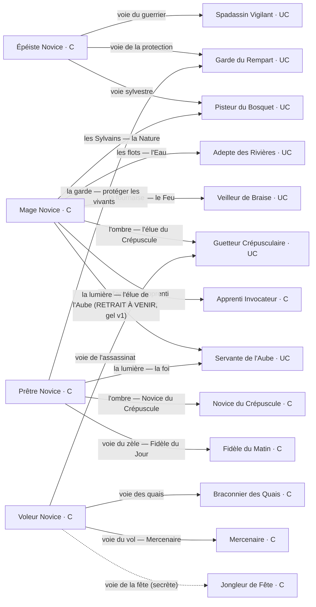
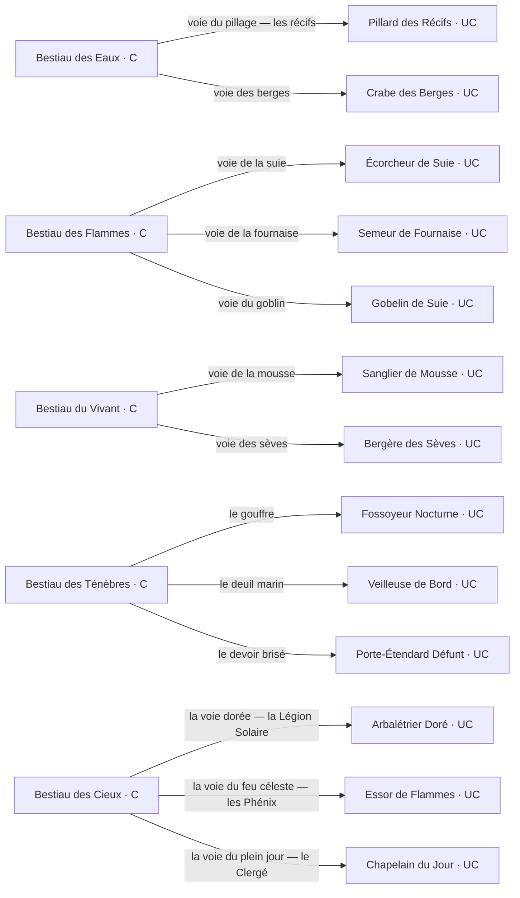
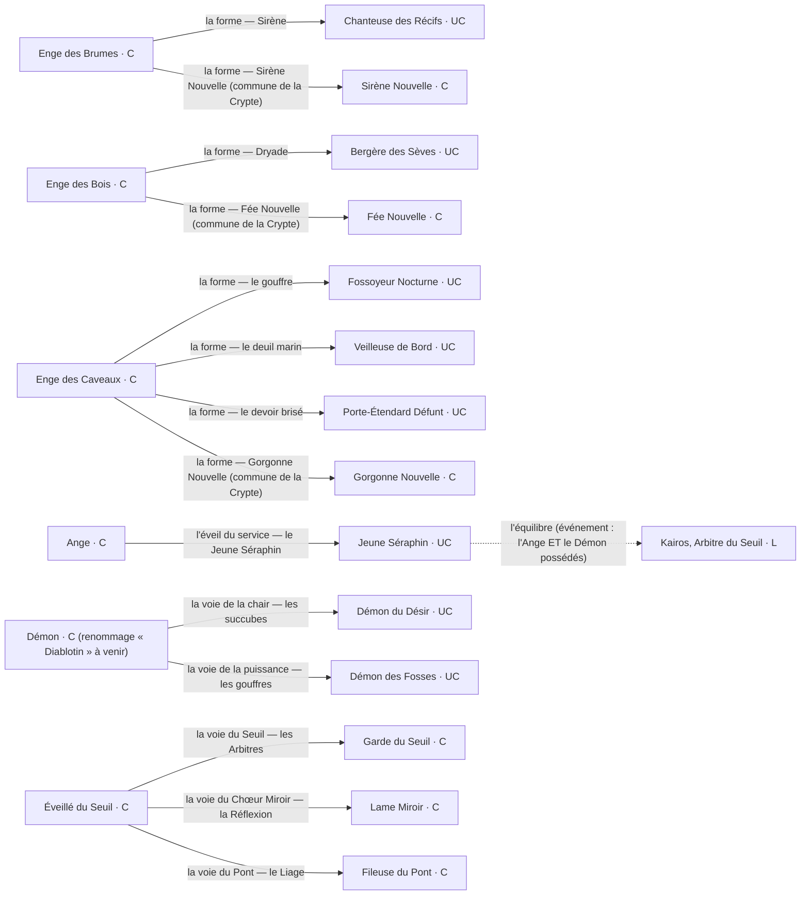
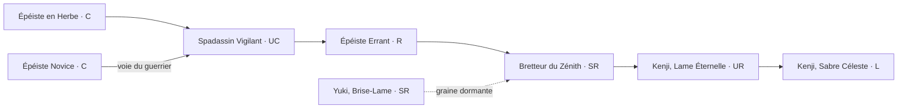
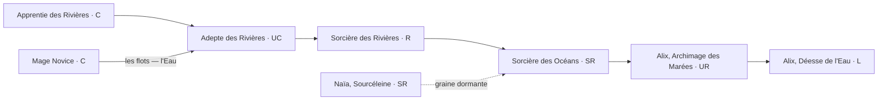
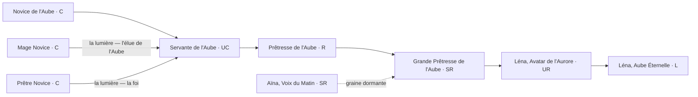
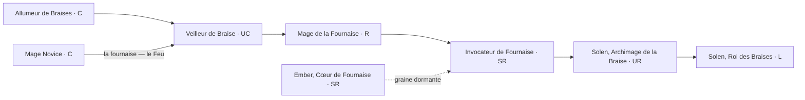
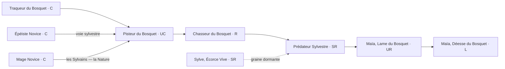
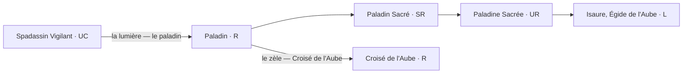
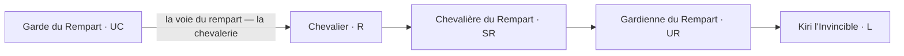

# Les arbres d'évolution

> AICG : Lignées. Le graphe d'évolution complet du jeu (356 cartes : 158 côté joueur + 198 monstres), extrait des données embarquées : chaînes des 7 familles compagnons, branches du paladin et du chevalier, familles humaines des voies (crépuscule, vol, zèle, appel), voies des 15 naissances, mini-lignées des solos, webs des 5 donjons et camp divin (le Seuil, le camp démon, les dévoyés, la chaîne céleste). Une évolution exige le **niveau 10** et des **éclats** (C→UC : 3 bruts, UC→R : 2 polis, R→SR : 4 polis, SR→UR : 2 gravés, UR→L : 4 gravés), et le choix de voie est définitif pour l'exemplaire.
>
> État : **le gel v1 est posé en data** (spec `docs/design/spec-gel-v1.md` : camp démon, dévoyés, chaîne céleste, paladin, chevalier, gorgones, fées, boss des Marées). Deux retouches restent en attente de lot et apparaissent ci-dessous avec leur note : le renommage n14 « Démon » → « Diablotin », et le retrait de l'éveil « la lumière » du mage (avec la convergence a29/a32 → s5 qui meurt avec lui).

## 1. Les voies des 15 naissances

À sa première évolution, chaque naissance choisit sa voie parmi celles ouvertes. Les cibles sont les maillons d'entrée des familles, des solos ou des webs de monstres.

### Les 4 novices humains

> Note gel v1 : l'éveil « la lumière — l'élue de l'Aube » du mage est RETIRÉ sans remplacement (spec gel §2.3) — il est encore dans le data à ce jour, avec la convergence a29/a32 → s5 (voir plus bas) qui meurt avec lui. Le mage gardera 5 éveils : flots, fournaise, Sylvains (→ Druides, recâblage v2), ombre (→ Nécromanciens, v2), appel. La voie du zèle du prêtre pointe u1 « Fidèle du Matin » (l'ancienne p4 « Fidèle du Jour » est retirée du jeu).

### Les 5 bestiaus (les webs de monstres)

### Les 3 enges et les 3 naissances divines

> L'Enge possède une **double forme** : l'entrée directe dans le web (Sirène → e24, Dryade → g12, les trois voies des Caveaux), ou sa **commune de la Crypte** : w19 Sirène Nouvelle, w20 Fée Nouvelle et w21 Gorgonne Nouvelle (les « lignées d'accueil »). w20 s'éveille en la Luciole Hargneuse (g2) qui ouvre la famille des Fées ; w21 s'éveille en le Serpent des Récifs (k33) qui ouvre les Gorgones ; w19 reste pour l'instant une commune d'accueil sans lignée propre (les Sirènes demeurent un web de monstres recrutables, pas une famille jouable).
>
> Le Démon (n14) n'a **plus accès au Chœur Miroir** (recâblé vers les voies du camp démon, suites 25/30) ; l'Éveillé du Seuil (n15) est la **source des trois familles du Seuil** (suite 31, option d). L'Ange Gardien (p2) et le Fidèle du Jour (p4) sont retirés du jeu (suites 28/30).

Deux convergences existent au palier UC : l'Adepte des Rivières (a29) et le Veilleur de Braise (a32) peuvent quitter leur élément pour la lumière et rejoindre la lignée de Léna (a29 → s5, a32 → s5). C'est le seul point du graphe où deux familles se rejoignent. **Cette convergence meurt avec le retrait de l'éveil « la lumière » du mage** (gel v1, lot à venir : encore dans le data à ce jour).

## 2. Les 7 familles compagnons

Le tronc C → UC → R → SR → UR → L, avec ses portes (naissances et solos qui y entrent) et sa graine archivée.

### Famille du Sabre

### Famille de l'Ombre

### Famille de l'Eau

### Famille de l'Aube

### Famille du Bouclier

### Famille de la Braise

### Famille du Bosquet

### Le paladin — branche lumière du Spadassin (gel v1)

Le choix se fait **au palier R** (confirmé suite 28) ; au même palier, le paladin choisit le zèle et rejoint la famille du zèle (u3 Croisé de l'Aube).

### Le chevalier — branche rempart du Bouclier (gel v1)

Kiri : longue chevelure noire lisse, armure noire intégrale, lame au repos ; son art alternatif « robe blanche immaculée » est sa version Exception (v3.4). La double convergence vers Argus meurt (v14 : le Bouclier garde sa L à lui).

### Les familles humaines des voies : crépuscule, vol, zèle, appel

Quatre familles humaines C → L complètes, entrées par les novices (livrées v1.32+v1.33) :

- **la famille du Crépuscule** (entrée : n3 Prêtre Novice, « l'ombre ») : q1 Novice du Crépuscule (C) → q2 Disciple du Crépuscule (UC) → q3 Prêtre du Crépuscule (R) → q4 Servante du Crépuscule (SR) → q5 Grande Prêtresse de l'Ombre (UR) → q6 Vesperine, Reine de la Nuit (L).
- **la famille du Vol** (entrée : n4 Voleur Novice, « voie du vol ») : t1 Mercenaire (C) → t2 Pillard (UC) → t3 Brigand (R) → t4 Grand Brigand (SR) → t5 Fléau des Routes (UR) → t6 Gadianton, Chef des Brigands (L).
- **la famille du Zèle** (entrées : n3 Prêtre Novice, « voie du zèle » ; et le paladin au palier R) : u1 Fidèle du Matin (C) → u2 Écuyer Fervent (UC) → u3 Croisé de l'Aube (R) → u4 Chapelain du Jour (SR) → u5 Arbalétrier Doré (UR) → u6 Lémion, Chef de la Légion Solaire (L). La Légion Solaire et le Clergé du Plein Jour sont des familles **humaines** (suites 30/31) : u4/u5 restent obtenables ET peuplent le donjon du Zénith (principe des 4 races).
- **l'école des invocations** (entrée : n2 Mage Novice, « l'appel ») : v1 Apprenti Invocateur (C) → v2 Conjurateur (UC) → v3 Évocateur (R) → v4 Maître des Esprits (SR) → v5 Seigneur des Élémentaires (UR) → v6 Archimage de l'Appel (L).

## 3. Les mini-lignées des solos et les greffes

- **les quais** : a34 Braconnier des Quais (C) → a40 Chasseur des Quais (UC) → a41 Maître des Brumes (R)
- **les routes** : a35 Palefrenière Errante (C) → a42 Écuyère des Routes (UC) → a43 Première Écuyère (R)
- **les dunes** : a36 Éclaireur des Dunes (UC) → a44 Guide des Dunes (R)
- **la fête** : a37 Jongleur de Fête (C) → a45 Artiste de Fête (UC) → a46 Maître Jongleur (R)
- **les berges** : a38 Raboteur de Berges (C) → a47 Charpentier des Berges (UC) → a48 Maître Charpentier (R)
- **le guet** : a39 Veilleuse du Guet (UC) → a49 Capitaine du Guet (R)

Les 5 solos d'origine sont des portes raccourcies : Garde-Promesse (a3) → Garde du Rempart (Bouclier), Étincelle Vive (a4) → Veilleur de Braise (Braise), Pilier Mécanique (a9) → Bastion Arcanique (Bouclier), Médecin de Camp (s2) → Servante de l'Aube (Aube), Veilleur d'Acier (s3) → Guetteur Crépusculaire (Ombre). Et un pont latéral existe chez les Cendrels : l'Écorcheur de Suie (f3, cousin) évolue en Foreuse d'Âmes (f8). La malédiction des quais (a34 → e3, événement) et la fusion du Bosquet (a27 ×2 → a28) complètent les greffes.

## 4. Les webs des 5 donjons

Chaque famille de monstres a jusqu'à trois lignes d'évolution (une par maillon), des cousins sans évolution et souvent un mythe (M). Les bestiaus, les enges et les naissances du Zénith y entrent par leurs voies.

### Antre des Marées

**Gobelins des Écumes**

- e1 Gobelin des Marées (C) → e3 Pillard des Récifs (UC) → e4 Sergent des Brumes (R) → e5 Prophète des Marées (SR)
- e16 Grand Chaman des Écumes (UR) → e17 Zikka, Chaman des Écumes (L)
- e18 Roi des Écumes (UR) → e19 Griknir, Roi des Écumes (L)
- cousins : e2 Tirailleur des Récifs (C) · e10 Veuve des Récifs (UC) · e8 Matriarche des Récifs (R)

**Abîmaux**

- e7 Moqueur des Marées (C) → e11 Crabe des Berges (UC) → e20 Rôdeur des Fonds (R)
- e9 Confesseur des Abysses (SR) → e6 Avatar de l'Abîme (UR) → e13 Léviathan, Colère du Gouffre (L)
- e15 Ancien des Berges (SR) → e21 Protecteur des Berges (UR) → e22 Pontos, Aîné des Berges (L) — **la chaîne berges QUITTE les Abîmaux** (suite 30 : la famille doit être des purs monstres) ; à ce jour encore dans la famille, son sort se règle à la spec du donjon des Abîmes (arts conservés, hors périmètre v1)
- cousins : e12 Gardien des Galets (SR)
- mythe : e14 Titan des Marées (M), hors chaîne
- **la lignée des boss (gel v1)** : e31 Hydre des Marées (L, boss du palier 5) et e32 Souverain des Marées (L, boss du palier 10) — cartes dédiées mappées dans `dungeons.json` (le boss n'est plus une carte tirée au hasard renommée, correctif suite 16), hors lignes de la famille

**Sirènes des Récifs**

- e23 Sirène Nouvelle (C) → e24 Chanteuse des Récifs (UC) → e25 Voix du Large (R) → e26 Écumeuse des Récifs (SR)
- e27 Sirène Ensorceleuse (UR) → e28 Méliane, Voix du Large (L)
- e29 Gardienne des Récifs (UR) → e30 Thalassa, Reine des Récifs (L)

### Forge Cendrée

**Cendrels**

- f1 Golem de Cendre (C) → f10 Souffleur de Braises (UC) → f11 Traqueur de Suie (R)
- f16 Mailleur de Suie (SR) → f17 Façonneur de Cendres (UR) → f18 Ombeline, Tisseuse de Suie (L)
- f19 Champion de Cendre (SR) → f20 Souffle Ardent (UR) → f21 Calcine, Dame des Cendres (L)
- cousins : f7 Tisseur de Cendres (C) · f3 Écorcheur de Suie (UC) · f8 Foreuse d'Âmes (R) (f3 évolue en f8)
- mythe : f13 Seigneur des Cendres (M), hors chaîne

**Enfants de la Braise**

- f14 Braise Errante (C) → f15 Semeur de Fournaise (UC) → f4 Chevalier de Braise (R)
- f9 Idole de Magma (SR) → f6 Colosse de Magma (UR) → f22 Vulcain, Colosse Ardent (L)
- f5 Invocateur des Foyers (SR) → f23 Maître des Foyers (UR) → f12 Gardien des Foyers (L)

**Gobelins des Fumées**

- f2 Gobelin des Fumées (C) → f24 Gobelin de Suie (UC)

### Bosquet Profond

**Bêtes du Fougeron**

- g1 Rampant du Fougeron (C) → g3 Sanglier de Mousse (UC) → g4 Gardien des Remparts Verts (R)
- g13 Semeur Sylvestre (SR) → g6 Colosse Sylvestre (UR) → g7 Patriarche du Bosquet (L)
- g14 Mycolithe (SR) → g15 Mycélium Vivant (UR) → g16 Mycola, Reine des Spores (L)
- cousins : g2 Luciole Hargneuse (C, aussi l'UC des Fées, voir plus bas) · g5 Prisme Vivant (SR)
- mythe : g8 Cœur du Bosquet (M), hors chaîne

**Dryades** (ex « Gens des Sèves », vitrine renommée suite 33)

- g9 Lueur Bienveillante (C) → g12 Bergère des Sèves (UC) → g10 Druidesse des Sèves (R)
- g11 Oracle des Clairières (SR) → g17 Dryade Radieuse (UR) → g18 Adriel, Lumignole des Clairières (L)
- g19 Dryade du Sous-Bois (SR) → g20 Rôdeuse des Sous-Bois (UR) → g21 Vesna, Dryade du Sous-Bois (L)

**Gobelins des Mousses**

- g31 Gobelin des Mousses (C) → g32 Gobelin des Racines (UC)

**Fées** (gel v1 — lignée d'accueil de l'Enge des Bois)

- entrée : w20 Fée Nouvelle (C) → g2 Luciole Hargneuse (UC, existante) → g33 Fée des Groves (R)
- la voie des jeux (verrou SR) : g34 Fée des Jeux (SR) → g35 Souveraine des Jeux (UR) → g36 Mab, Souveraine des Jeux (L)
- la voie des ronces (verrou SR) : g37 Fée des Ronces (SR) → g38 Reine des Ronces (UR) → g39 Aubépine, Reine des Ronces (L)

### Crypte Oubliée

**Spectres des Caveaux**

- k1 Rôdeur des Caveaux (C) → k3 Fossoyeur Nocturne (UC) → k13 Goule des Caveaux (R)
- k5 Spectre des Quais (SR) → k6 Banshee des Caveaux (UR) → k14 Macha, Hurleuse des Caveaux (L)
- k15 Éveillé des Caveaux (SR) → k16 Liche des Caveaux (UR) → k7 Archiliche des Caveaux (L)
- mythe : k17 La Mort, Faucheuse des Tombes (M), hors chaîne

**Les Naufragés**

- k2 Nymphe Croupie (C) → k12 Veilleuse de Bord (UC) → k10 Meneuse de Deuil (R)
- k11 Prieuse des Naufragés (SR) → k18 Endeuillée des Flots (UR) → k19 Ysolde, Veuve Éternelle (L)
- k20 Capitaine Noyé (SR) → k21 Revenu des Flots (UR) → k22 Ahab, Lord des Naufragés (L)
- cousins : k9 Servante Pâle (C)
- mythe : k8 Ancien Naufragé (M), hors chaîne

**Chevalerie Défunte**

- k23 Écuyer Défunt (C) → k24 Porte-Étendard Défunt (UC) → k4 Chevalier Défunt (R)
- k25 Chevalière de la Veille (SR) → k26 Paladine Défunte (UR) → k27 Jeanne d'Arc, Chevalière de la Veille (L)
- k28 Chevalière du Serment (SR) → k29 Sermenteuse Défunte (UR) → k30 Siegfried, Chevalière du Serment Brisé (L)

**Gobelins des Caveaux**

- k31 Gobelin des Caveaux (C) → k32 Gobelin des Ossements (UC)

**Gorgones** (gel v1 — lignée d'accueil de l'Enge des Caveaux)

- entrée : w21 Gorgonne Nouvelle (C) → k33 Serpent des Récifs (UC) → k34 Fileuse du Regard (R)
- la voie du regard (verrou SR) : k35 Pétrifiante des Écueils (SR) → k36 Gorgonne Immaculée (UR) → k37 Méduse, Reine des Écueils (L)
- la voie des serpents (verrou SR) : k38 Mère des Serpents (SR) → k39 Grande Serpentine (UR) → k40 Euryale, Nourrice des Serpents (L)

### Zénith Ardent

**Légion Solaire**

- z1 Écuyer du Zénith (C) → z3 Arbalétrier Doré (UC) → z4 Lancier Solaire (R) → z5 Voulige d'Aube (SR)
- z13 Centurion Ardent (UR) → z7 Héraut du Zénith (L)
- z14 Lancière de l'Aube (UR) → z15 Aurorine, Lance de l'Aube (L)
- cousins : z12 Garde-Flamme (UC) · z10 Serre-Soleil (R)
- mythe : z8 Astre Capiteux (M), hors chaîne — re-race divine camp ange (gel v1, suite 31 : élément Lumière, canon D&D solar ailé)

**Phénix Célestes**

- z2 Souffle-Mèche (C) → z16 Essor de Flammes (UC) → z17 Oiseau de Feu (R)
- z18 Cendre d'Éclosion (SR) → z6 Phénix du Zénith (UR) → z19 Pyrrha, Cendre Éternelle (L)
- z20 Plume Miroir (SR) → z21 Phénix Miroir (UR) → z22 Fjalar, Phénix du Renvoi (L)

**Clergé du Plein Jour**

- z9 Chantre du Zénith (C) → z23 Chapelain du Jour (UC) → z24 Diacre du Plein Jour (R) → z11 Prêtresse du Plein Jour (SR)
- z25 Cantatrice du Zénith (UR) → z26 Célestin, Apôtre du Chant (L)
- z27 Inquisitrice du Jour (SR) → z28 Justicière du Jour (UR) → z29 Justine, Justicière du Jour (L)
- mythe : z30 Apolline, Prophétesse du Jour (M), hors chaîne

**Gobelins Célestes**

- z31 Gobelin des Nuages (C) → z32 Gobelin du Soleil (UC)

## 5. Le camp divin (le Seuil, le camp démon, les dévoyés, la chaîne céleste)

Le Seuil : deux lignes par famille, reliées par un pont (le sommet d'une ligne devient le pied de la suivante). **n15 Éveillé du Seuil est la source des trois familles** (suite 31) : Arbitres (d1), Chœur (d7), Tisseuses (d13) — les chaînes sont recâblées SANS leurs UC d8 Choriste Miroir et d14 Aiguille du Pont (retirées des familles joueur, suite 30 ; les w8/w14 côté monstre restent). Le Démon (n14) n'entre plus au Chœur : il ouvre le **camp démon** (la chair d19, la puissance d24), avec le choix de trappe au palier R. L'Ange (n13) s'éveille en le **Jeune Séraphin (p1)**, qui porte les trois portes : la coloration (dormante, v2), la **voie céleste** (p5 → p7 → p8 → p6) et la **mauvaise volonté** (les dévoyés, d37 → d40, porte vivante). L'événement d'équilibre (posséder l'Ange ET le Démon) mène à Kairos, Arbitre du Seuil (d6).

**Arbitres du Seuil**

- d1 Garde du Seuil (C) → d2 Servante du Sablier (C) → d3 Huissier de l'Entre-Deux (UC)
- d4 Juge des Heures (R) → d5 Maître des Sabliers (SR) → d6 Kairos, Arbitre du Seuil (L)
- pont : d3 (l'Huissier de l'Entre-Deux) → d4 (le Juge des Heures)

**Chœur Miroir** (recâblée sans sa UC)

- d7 Lame Miroir (C) → d9 Prisme du Chœur (R)
- d10 Miroir Antiphonique (SR) → d11 Chef du Chœur (UR) → d12 Écho, Voix Miroir (L)
- pont : d9 (le Prisme du Chœur) → d10 (le Miroir Antiphonique)

**Tisseuses du Pont** (recâblée sans sa UC)

- d13 Fileuse du Pont (C) → d15 Brodeuse des Liens (R)
- d16 Tisseuse des Nœuds (SR) → d17 Architecte du Pont (UR) → d18 Ananké, Tisseuse du Pont (L)
- pont : d15 (la Brodeuse des Liens) → d16 (la Tisseuse des Nœuds)

**La Chair — le camp démon, le Vice** (gel v1)

- la voie : d19 Démon du Désir (UC) → d20 Succube (R) → d21 Grande Succube (SR) → d22 Dame du Désir (UR) → d23 Asmodia, Reine du Désir (L)
- la trappe (choix au palier R) : d29 Gouffre des Vices (R) → d30 Grand Gouffre (SR) → d31 Gueule de l'Abîme (UR) → d32 Famine (L, bestiale : une gueule du gouffre, jamais de figure humanoïne)

**La Puissance — le camp démon, la Fureur** (gel v1)

- la voie : d24 Démon des Fosses (UC) → d25 Démon Majeur (R) → d26 Seigneur Démon (SR) → d27 Prince Démon (UR) → d28 Belzébuth, Roi des Démons (L, roi seul au sommet)
- la trappe (choix au palier R) : d33 Fléau Démoniaque (R) → d34 Grand Fléau (SR) → d35 Porte-Peste (UR) → d36 Peste, Mère des Fléaux (L)

**Les Dévoyés — le camp ange, l'Orgueil** (gel v1, porte « mauvaise volonté » de p1)

- d37 Ange Ardent (R, Feu) → d38 Ange du Zénith (SR) → d39 Astre Vaillant (UR) → d40 Astre Rayonnant (L, signature « Lumière Noire »)

**La chaîne céleste — le camp ange** (gel v1, porte « voie céleste » de p1)

- p1 Jeune Séraphin (UC) → p5 Séraphin, Porteur de Lumière (R, re-palieré) → p7 Ange de Lumière (SR) ➕ → p8 Archange (UR) ➕ → p6 Séraphin, Archange Ultime (L, renommée — six ailes, canon D&D solar)

Le nom « Luz » reste réservé à la lignée déchue (v2) ; Lilith quitte le sommet du camp démon et revient en v2 (suite 31). p3 Pousse des Sèves (C, prêtre de la voie sylvestre — les Dryades) est la carte d'accueil humaine du Bosquet, sans évolution.

---

*La chronologie d'acquisition des sorts le long de ces arbres : `arbres-sorts.md`.*
