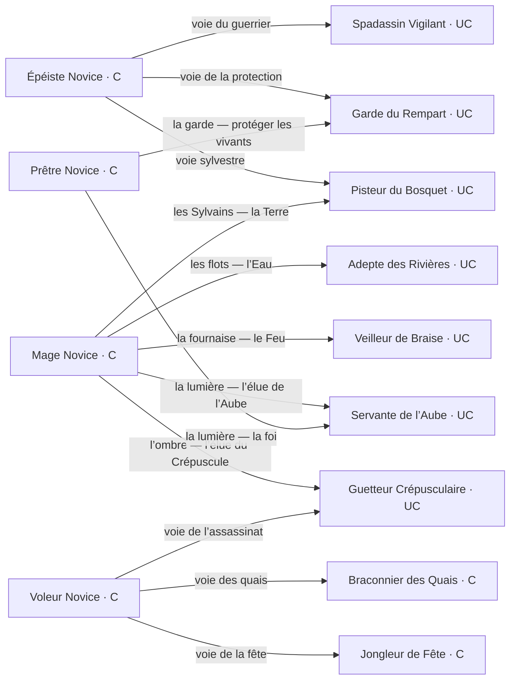
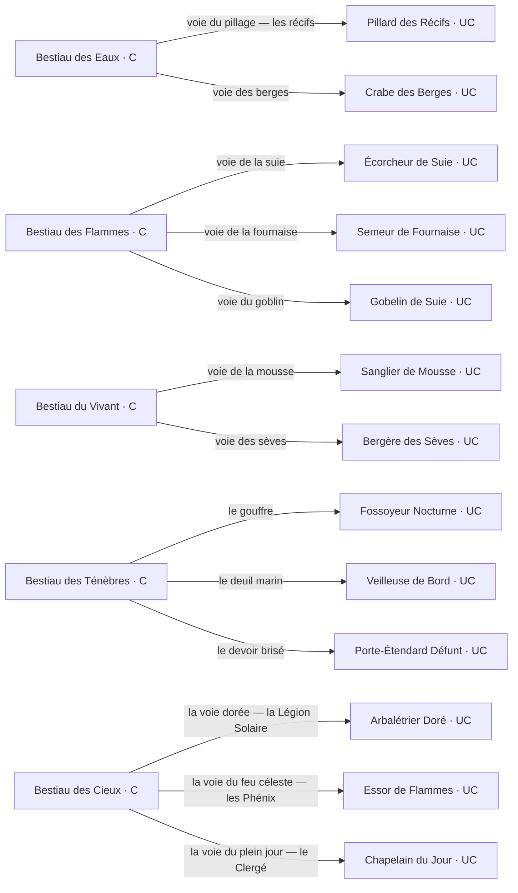
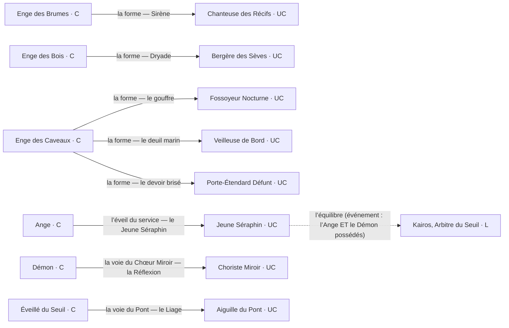
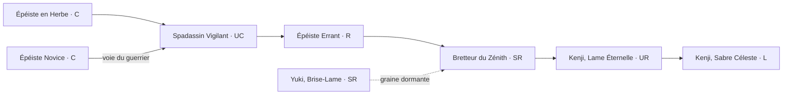
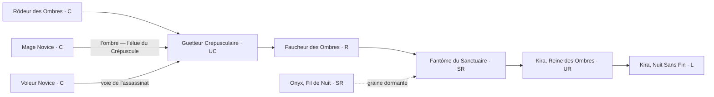
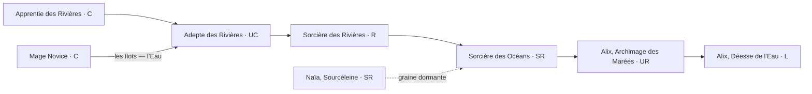
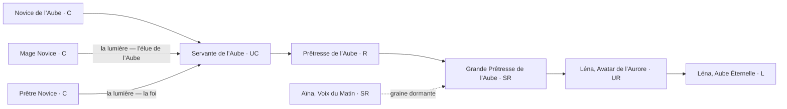
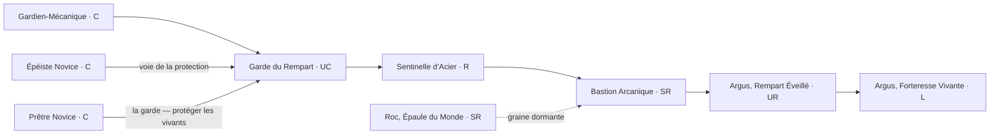
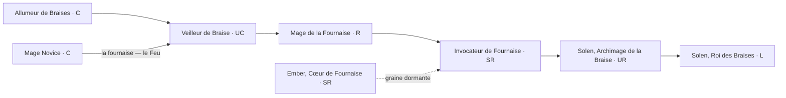
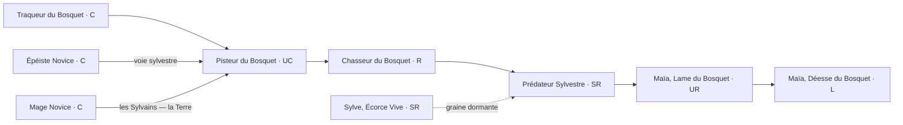

# Les arbres d'évolution

> AICG : Lignées. Le graphe d'évolution complet du jeu (238 cartes), extrait des données embarquées : chaînes des 7 familles compagnons, voies des 15 naissances, mini-lignées des solos, webs des 5 donjons et familles divines. Une évolution exige le **niveau 10** et des **éclats** (C→UC : 3 bruts, UC→R : 2 polis, R→SR : 4 polis, SR→UR : 2 gravés, UR→L : 4 gravés), et le choix de voie est définitif pour l'exemplaire.

## 1. Les voies des 15 naissances

À sa première évolution, chaque naissance choisit sa voie parmi celles ouvertes. Les cibles sont les maillons d'entrée des familles, des solos ou des webs de monstres.

### Les 4 novices humains

### Les 5 bestiaus (les webs de monstres)

### Les 3 enges et les 3 naissances divines

Deux convergences existent au palier UC : l'Adepte des Rivières (a29) et le Veilleur de Braise (a32) peuvent quitter leur élément pour la lumière et rejoindre la lignée de Léna (a29 → s5, a32 → s5). C'est le seul point du graphe où deux familles se rejoignent.

## 2. Les 7 familles compagnons

Le tronc C → UC → R → SR → UR → L, avec ses portes (naissances et solos qui y entrent) et sa graine archivée.

### Famille du Sabre

### Famille de l’Ombre

### Famille de l’Eau

### Famille de l’Aube

### Famille du Bouclier

### Famille de la Braise

### Famille du Bosquet

## 3. Les mini-lignées des solos et les greffes

- **les quais** : a34 Braconnier des Quais (C) → a40 Chasseur des Quais (UC) → a41 Maître des Brumes (R)
- **les routes** : a35 Palefrenière Errante (C) → a42 Écuyère des Routes (UC) → a43 Première Écuyère (R)
- **les dunes** : a36 Éclaireur des Dunes (UC) → a44 Guide des Dunes (R)
- **la fête** : a37 Jongleur de Fête (C) → a45 Artiste de Fête (UC) → a46 Maître Jongleur (R)
- **les berges** : a38 Raboteur de Berges (C) → a47 Charpentier des Berges (UC) → a48 Maître Charpentier (R)
- **le guet** : a39 Veilleuse du Guet (UC) → a49 Capitaine du Guet (R)

Les 5 solos d'origine sont des portes raccourcies : Garde-Promesse (a3) → Garde du Rempart (Bouclier), Étincelle Vive (a4) → Veilleur de Braise (Braise), Pilier Mécanique (a9) → Bastion Arcanique (Bouclier), Médecin de Camp (s2) → Servante de l'Aube (Aube), Veilleur d'Acier (s3) → Guetteur Crépusculaire (Ombre). Et un pont latéral existe chez les Cendrels : l'Écorcheur de Suie (f3, cousin) évolue en Foreuse d'Âmes (f8).

## 4. Les webs des 5 donjons

Chaque famille de monstres a jusqu'à trois lignes d'évolution (une par maillon), des cousins sans évolution et souvent un mythe (M). Les bestiaus, les enges et les naissances du Zénith y entrent par leurs voies.

### Antre des Marées

**Gobelins des Écumes**

- e1 Gobelin des Marées (C) → e3 Pillard des Récifs (UC) → e4 Sergent des Brumes (R) → e5 Prophète des Marées (SR)
- e16 Grand Chaman des Écumes (UR) → e17 Zikka, Chaman des Écumes (L)
- e18 Roi des Écumes (UR) → e19 Griknir, Roi des Écumes (L)
- cousins : e2 Tirailleur des Récifs (C) · e10 Veuve des Récifs (UC) · e8 Matriarche des Récifs (R)

**Abîmaux**

- e7 Moqueur des Marées (C) → e11 Crabe des Berges (UC) → e20 Rôdeur des Fonds (R)
- e9 Confesseur des Abysses (SR) → e6 Avatar de l’Abîme (UR) → e13 Léviathan, Colère du Gouffre (L)
- e15 Ancien des Berges (SR) → e21 Protecteur des Berges (UR) → e22 Pontos, Aîné des Berges (L)
- cousins : e12 Gardien des Galets (SR)
- mythe : e14 Titan des Marées (M), hors chaîne

**Sirènes des Récifs**

- e23 Sirène Nouvelle (C) → e24 Chanteuse des Récifs (UC) → e25 Voix du Large (R) → e26 Écumeuse des Récifs (SR)
- e27 Sirène Ensorceleuse (UR) → e28 Méliane, Voix du Large (L)
- e29 Gardienne des Récifs (UR) → e30 Thalassa, Reine des Récifs (L)

### Forge Cendrée

**Cendrels**

- f1 Golem de Cendre (C) → f10 Souffleur de Braises (UC) → f11 Traqueur de Suie (R)
- f16 Mailleur de Suie (SR) → f17 Façonneur de Cendres (UR) → f18 Ombeline, Tisseuse de Suie (L)
- f19 Champion de Cendre (SR) → f20 Souffle Ardent (UR) → f21 Calcine, Dame des Cendres (L)
- cousins : f7 Tisseur de Cendres (C) · f3 Écorcheur de Suie (UC) · f8 Foreuse d’Âmes (R) (f3 évolue en f8)
- mythe : f13 Seigneur des Cendres (M), hors chaîne

**Enfants de la Braise**

- f14 Braise Errante (C) → f15 Semeur de Fournaise (UC) → f4 Chevalier de Braise (R)
- f9 Idole de Magma (SR) → f6 Colosse de Magma (UR) → f22 Vulcain, Colosse Ardent (L)
- f5 Invocateur des Foyers (SR) → f23 Maître des Foyers (UR) → f12 Gardien des Foyers (L)

**Gobelin des Fumées**

- f2 Gobelin des Fumées (C) → f24 Gobelin de Suie (UC)

### Bosquet Profond

**Bêtes du Fougeron**

- g1 Rampant du Fougeron (C) → g3 Sanglier de Mousse (UC) → g4 Gardien des Remparts Verts (R)
- g13 Semeur Sylvestre (SR) → g6 Colosse Sylvestre (UR) → g7 Patriarche du Bosquet (L)
- g14 Mycolithe (SR) → g15 Mycélium Vivant (UR) → g16 Mycola, Reine des Spores (L)
- cousins : g2 Luciole Hargneuse (C) · g5 Prisme Vivant (SR)
- mythe : g8 Cœur du Bosquet (M), hors chaîne

**Gens des Sèves**

- g9 Lueur Bienveillante (C) → g12 Bergère des Sèves (UC) → g10 Druidesse des Sèves (R)
- g11 Oracle des Clairières (SR) → g17 Dryade Radieuse (UR) → g18 Adriel, Lumignole des Clairières (L)
- g19 Dryade du Sous-Bois (SR) → g20 Rôdeuse des Sous-Bois (UR) → g21 Vesna, Dryade du Sous-Bois (L)

### Crypte Oubliée

**Spectres des Caveaux**

- k1 Rôdeur des Caveaux (C) → k3 Fossoyeur Nocturne (UC) → k13 Goule des Caveaux (R)
- k5 Spectre des Quais (SR) → k6 Banshee des Caveaux (UR) → k14 Macha, Hurleuse des Caveaux (L)
- k15 Éveillé des Caveaux (SR) → k16 Liche des Caveaux (UR) → k7 Archiliche des Caveaux (L)
- mythe : k17 La Mort, Faucheuse des Tombes (M), hors chaîne

**Les Naufragés**

- k2 Nymphe Croupie (C) → k12 Veilleuse de Bord (UC) → k10 Meneuse de Deuil (R)
- k11 Prieuse des Naufragés (SR) → k18 Endeuillée des Flots (UR) → k19 Ysolde, Veuve Éternelle (L)
- k20 Capitaine Noyé (SR) → k21 Revenu des Flots (UR) → k22 Ahab, Lord des Naufragés (L)
- cousins : k9 Servante Pâle (C)
- mythe : k8 Ancien Naufragé (M), hors chaîne

**Chevalerie Défunte**

- k23 Écuyer Défunt (C) → k24 Porte-Étendard Défunt (UC) → k4 Chevalier Défunt (R)
- k25 Chevalière de la Veille (SR) → k26 Paladine Défunte (UR) → k27 Jeanne d’Arc, Chevalière de la Veille (L)
- k28 Chevalière du Serment (SR) → k29 Sermenteuse Défunte (UR) → k30 Siegfried, Chevalière du Serment Brisé (L)

### Zénith Ardent

**Légion Solaire**

- z1 Écuyer du Zénith (C) → z3 Arbalétrier Doré (UC) → z4 Lancier Solaire (R) → z5 Voulige d’Aube (SR)
- z13 Centurion Ardent (UR) → z7 Héraut du Zénith (L)
- z14 Lancière de l’Aube (UR) → z15 Aurorine, Lance de l’Aube (L)
- cousins : z12 Garde-Flamme (UC) · z10 Serre-Soleil (R)
- mythe : z8 Astre Capiteux (M), hors chaîne

**Phénix Célestes**

- z2 Souffle-Mèche (C) → z16 Essor de Flammes (UC) → z17 Oiseau de Feu (R)
- z18 Cendre d’Éclosion (SR) → z6 Phénix du Zénith (UR) → z19 Pyrrha, Cendre Éternelle (L)
- z20 Plume Miroir (SR) → z21 Phénix Miroir (UR) → z22 Fjalar, Phénix du Renvoi (L)

**Clergé du Plein Jour**

- z9 Chantre du Zénith (C) → z23 Chapelain du Jour (UC) → z24 Diacre du Plein Jour (R) → z11 Prêtresse du Plein Jour (SR)
- z25 Cantatrice du Zénith (UR) → z26 Célestin, Apôtre du Chant (L)
- z27 Inquisitrice du Jour (SR) → z28 Justicière du Jour (UR) → z29 Justine, Justicière du Jour (L)
- mythe : z30 Apolline, Prophétesse du Jour (M), hors chaîne

## 5. Les familles divines (Le Seuil)

Deux lignes par famille, reliées par un pont : le sommet d'une ligne devient le pied de la suivante. Le Démon (n14) et l'Éveillé du Seuil (n15) y entrent par leurs voies. L'Ange (n13) est l'exception : il ne rejoint pas un web, il s'éveille en le Jeune Séraphin (p1, ex-Ange Éveillé, id inchangé), qui porte les trois portes (la coloration, la voie céleste, la mauvaise volonté) et remplace l'Ange Gardien (p2, archivé). L'événement d'équilibre (posséder l'Ange ET le Démon) le mène à Kairos, Arbitre du Seuil (d6) ; les trois portes attendent leurs maillons.

**Arbitres du Seuil**

- d1 Garde du Seuil (C) → d2 Servante du Sablier (C) → d3 Huissier de l’Entre-Deux (UC)
- d4 Juge des Heures (R) → d5 Maître des Sabliers (SR) → d6 Kairos, Arbitre du Seuil (L)
- pont : d3 (l’Huissier de l’Entre-Deux) → d4 (le Juge des Heures)

**Chœur Miroir**

- d7 Lame Miroir (C) → d8 Choriste Miroir (UC) → d9 Prisme du Chœur (R)
- d10 Miroir Antiphonique (SR) → d11 Chef du Chœur (UR) → d12 Écho, Voix Miroir (L)
- pont : d9 (le Prisme du Chœur) → d10 (le Miroir Antiphonique)

**Tisseuses du Pont**

- d13 Fileuse du Pont (C) → d14 Aiguille du Pont (UC) → d15 Brodeuse des Liens (R)
- d16 Tisseuse des Nœuds (SR) → d17 Architecte du Pont (UR) → d18 Ananké, Tisseuse du Pont (L)
- pont : d15 (la Brodeuse des Liens) → d16 (la Tisseuse des Nœuds)

La chaîne complète de chaque famille : Arbitres, Garde du Seuil → Servante du Sablier → Huissier de l'Entre-Deux → Juge des Heures → Maître des Sabliers → Kairos ; Chœur, Lame Miroir → Choriste → Prisme → Miroir Antiphonique → Chef du Chœur → Écho ; Tisseuses, Fileuse → Aiguille → Brodeuse → Tisseuse des Nœuds → Architecte → Ananké.

---

*La chronologie d'acquisition des sorts le long de ces arbres : `arbres-sorts.md`.*