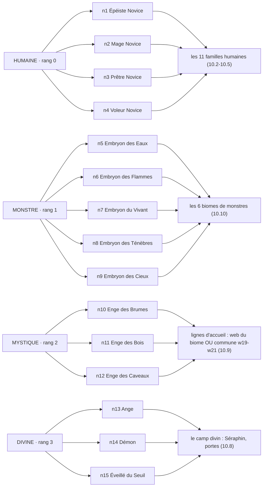
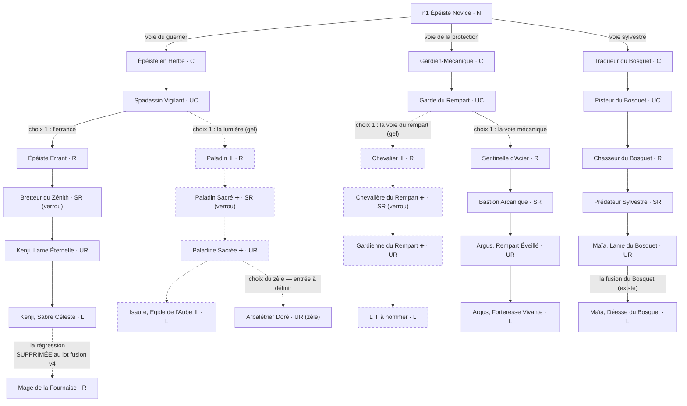
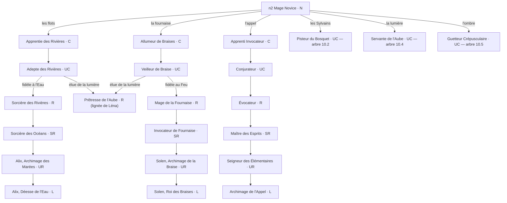
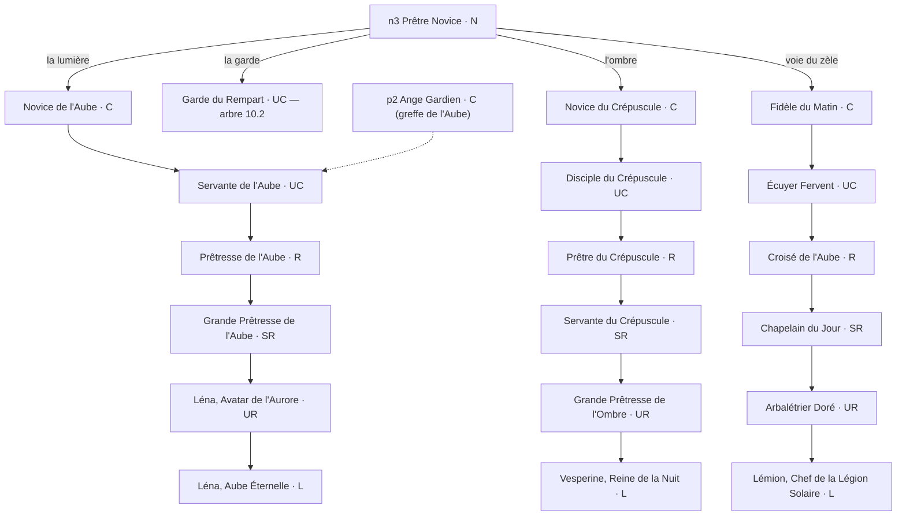
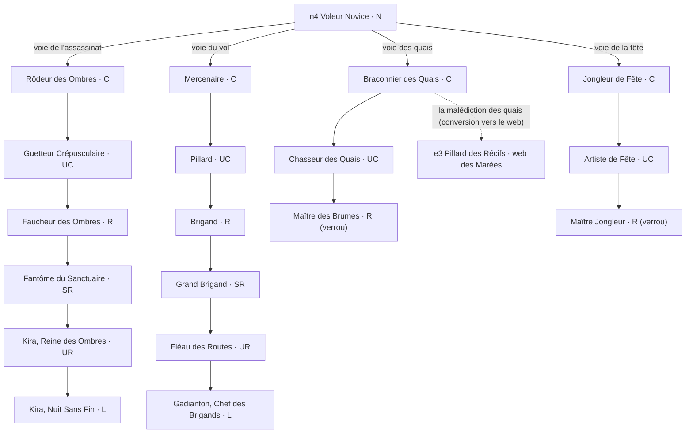
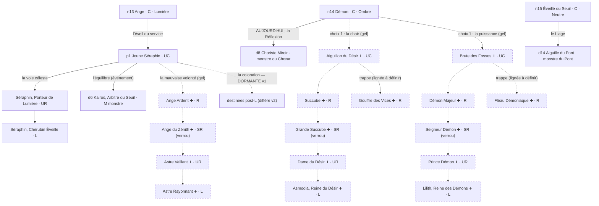
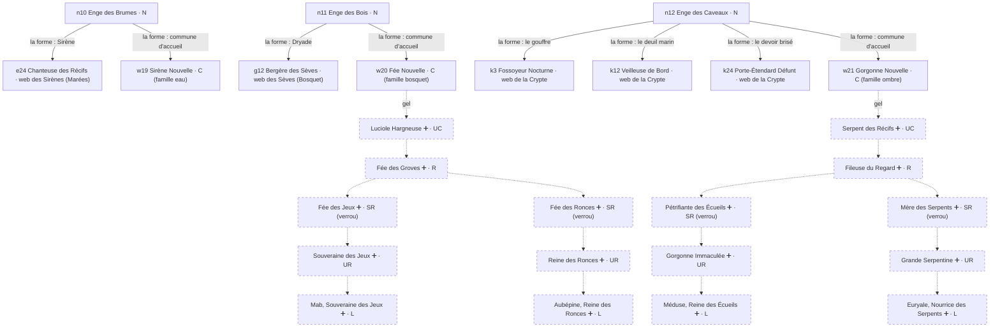
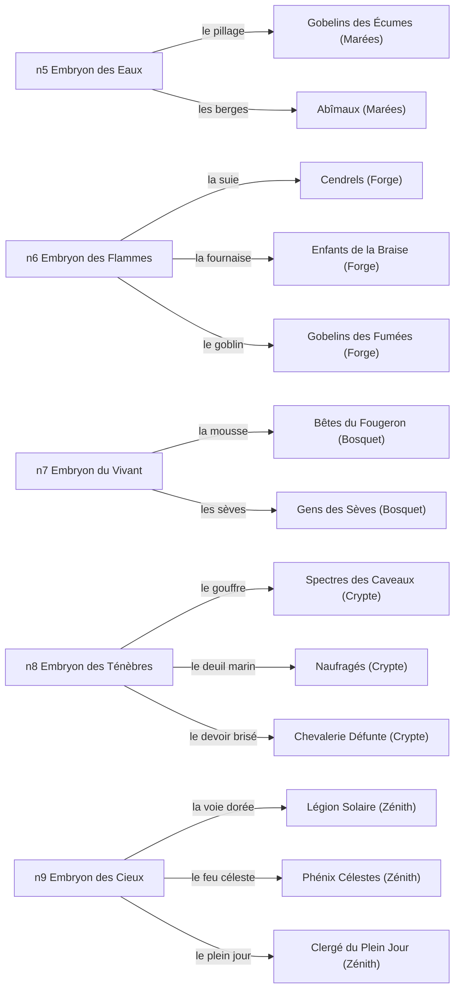
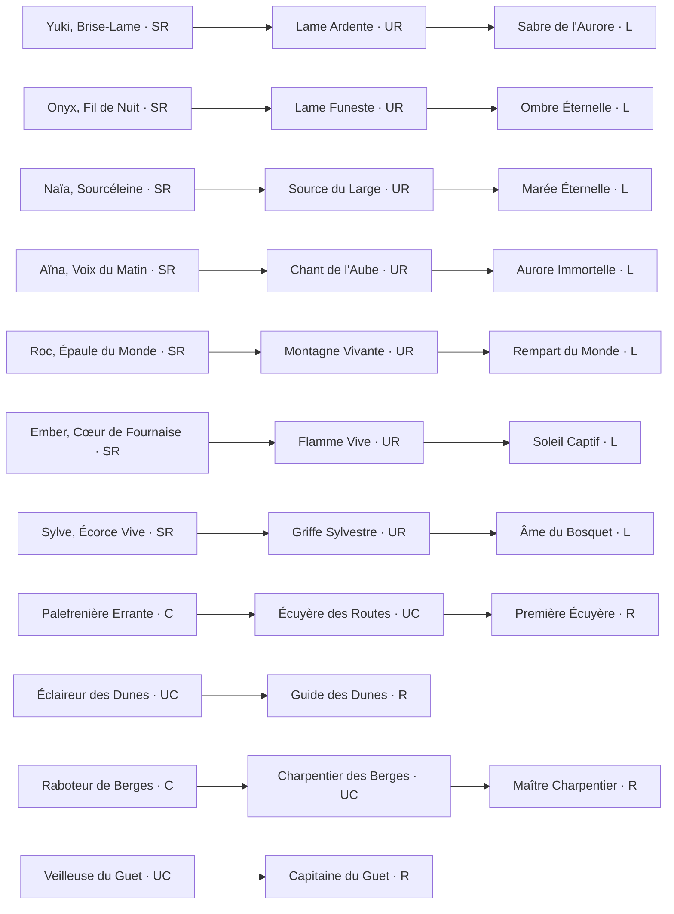

# Les arbres v18 — l'inventaire exhaustif de l'arbre du jeu

> **Référence courante du design des arbres** (13/11/2026, établi depuis les data v1.51 : 150 cartes, 159 monstres, 14 familles, 15 naissances, 6 biomes — plus le gel v1 tranché le même jour). Remplace `docs/historique/design-arbres-v17.md` (archive) comme document de repérage : chaque carte y est localisée par famille, race et biome. Quatre usages : (1) se repérer dans l'arbre ; (2) voir les trous restants pour valider la v1 (anges et démons en tête) ; (3) poser la table de synthèse de la fusion DQM v4 ; (4) trancher les lignées uniques du début de jeu — et **(5) les diagrammes §10 pour se projeter : l'état du jeu et le gel, arbre par arbre**. Le détail des tranchages du gel : `docs/design/audit-arbres-design-vs-jeu.md` + arbitrages du 13/11.

## 0. La grammaire (tout acté, rappel)

- **Quatre races, quatre rangs** : humaine (rang 0), monstre (1), mystique (2), divine (3) ; le rang N (sous C) est la naissance hors lignée, éveillée par la pierre d'éveil. Règle d'accès : 3 accès coexistent (la naissance N, la commune C en raccourci, la conversion/régression au palier R).
- **Paliers** : C → UC → R → SR → UR → L ; M = mythique (boss de biome, jamais jouable par montée). Toute lignée complète respecte tous les paliers : un saut est un trou, pas un style (règle 1.3 du v17, reprise par le validateur).
- **Classes** : Guerrier, Mage, Prêtre, Assassin, Occultiste. **Éléments** : Feu, Eau, Nature, Ombre, Lumière ; les cartes joueurs sont Neutres (SCHOOL_ELEMENT : l'élément porte l'ÉCOLE du sort, tranché 13/11), les monstres portent l'élément de leur biome.
- **Écoles** (`FAM_SCHOOL`, une par famille) : lame (eau, lame, ombre), baume (aube), rempart (bouclier, miroir), mauvais-oeil (braise, crepuscule), entrave (bosquet, seuil), ruse (vol), ferveur (zele), appel (appel, pont). Chaque famille porte 6 sorts de lignée (coûts 2/3/5/9/14/20 ✦) + son/ses signature(s) L.
- **Règles de nommage** : le nom verrouille la chaîne (un nommé ne rejoint jamais la chaîne d'un autre) ; le doublon de L est permis ; une nommée = un nom complet unique (garde du validateur EXI-DATA-3) ; un sort signature ne répète pas le nom de sa carte (exceptions assumées : Aube Éternelle).

## 1. Les 15 naissances et leurs voies (état du jeu, `data/trees.json`)

### Race humaine (rang 0) — 4 novices

| Naissance | Voies (éveil N → maillon d'entrée) |
| --- | --- |
| n1 Épéiste Novice | guerrier → a30 Spadassin Vigilant (lame) · protection → s14 Garde du Rempart (bouclier) · sylvestre → a33 Pisteur du Bosquet (bosquet) |
| n2 Mage Novice | l'Eau → a29 Adepte des Rivières (eau) · le Feu → a32 Veilleur de Braise (braise) · les Sylvains → a33 Pisteur du Bosquet (bosquet, nœud partagé) · la lumière → s13 Servante de l'Aube (aube) · l'ombre → a31 Guetteur Crépusculaire (ombre) · l'appel → v1 Apprenti Invocateur (appel) |
| n3 Prêtre Novice | la foi → s13 Servante de l'Aube (aube) · la garde → s14 Garde du Rempart (bouclier) · l'ombre → q1 Novice du Crépuscule (crepuscule) · le zèle → u1 Fidèle du Matin (zele) |
| n4 Voleur Novice | l'assassinat → a31 Guetteur Crépusculaire (ombre) · les quais → a34 Braconnier des Quais (mini-lignée Quais) · la fête → a37 Jongleur de Fête (mini-lignée Fête) · le vol → t1 Mercenaire (vol) |

Convergences vivantes (`data/evolutions.json`) : l'**Adepte des Rivières (a29)** et le **Veilleur de Braise (a32)** peuvent rejoindre, au palier R, la **Prêtresse de l'Aube (s5)** (« élue de la lumière », la lignée de Léna) ; le **Braconnier des Quais (a34)** peut basculer vers le web des Marées (« la malédiction des quais », conversion e3). Les convergences du v17 non câblées (ex. Épéiste Errant → Brigand) restent des PROPOSITIONS.

### Race monstre (rang 1) — 5 Embryons

| Naissance | Voies |
| --- | --- |
| n5 Embryon des Eaux | le pillage → e3 Pillard des Récifs (Gobelins des Écumes) · les berges → e11 Crabe des Berges (Abîmaux) |
| n6 Embryon des Flammes | la suie → f3 Écorcheur de Suie (Cendrels) · la fournaise → f15 Semeur de Fournaise (Enfants de la Braise) · le goblin → f24 Gobelin de Suie (Gobelin des Fumées) |
| n7 Embryon du Vivant | la mousse → g3 Sanglier de Mousse (Bêtes du Fougeron) · les sèves → g12 Bergère des Sèves (Gens des Sèves) |
| n8 Embryon des Ténèbres | le gouffre → k3 Fossoyeur Nocturne (Spectres des Caveaux) · le deuil marin → k12 Veilleuse de Bord (Naufragés) · le devoir brisé → k24 Porte-Étendard Défunt (Chevalerie Défunte) |
| n9 Embryon des Cieux | la voie dorée → z3 Arbalétrier Doré (Légion Solaire) · le feu céleste → z16 Essor de Flammes (Phénix Célestes) · le plein jour → z23 Chapelain du Jour (Clergé du Plein Jour) |

### Race mystique (rang 2) — 3 Enge, l'éveil choisit la forme

| Naissance | Formes (→ lignée d'accueil) |
| --- | --- |
| n10 Enge des Brumes | la forme Sirène → e24 Chanteuse des Récifs (Sirènes des Récifs, Marées) OU la commune d’accueil → w19 Sirène Nouvelle (famille eau) |
| n11 Enge des Bois | la forme Dryade → g12 Bergère des Sèves (Gens des Sèves, Bosquet) OU la commune d’accueil → w20 Fée Nouvelle (famille bosquet) |
| n12 Enge des Caveaux | le gouffre → k3 · le deuil marin → k12 · le devoir brisé → k24 (les 3 familles de la Crypte) OU la commune d’accueil → w21 Gorgonne Nouvelle (famille ombre) |

### Race divine (rang 3) — le camp tombe à l'éveil

| Naissance | Éveil (état actuel → état visé par le gel v1) |
| --- | --- |
| n13 Ange (C, Lumière) | p1 Jeune Séraphin (UC, effet « remplace », fait disparaître p2 Ange Gardien) ; les 3 portes : **la coloration** (l'eau, l'aube, le sabre — DORMANTE en v1, maillons = destinées post-L différées v2), **la voie céleste** (p5 Séraphin, Porteur de Lumière UR → p6 Séraphin, Chérubin Éveillé L), **la mauvaise volonté** (ANGES DÉVOYÉS à construire, cf. §6.2) |
| n14 Démon (C, Ombre) | aujourd'hui → d8 Choriste Miroir (la Réflexion) ; **visé par le gel : les voies de la chair et de la puissance** (cf. §6.1) |
| n15 Éveillé du Seuil (C, Neutre) | d14 Aiguille du Pont (le Liage, Tisseuses du Pont) |

## 2. Les 14 familles jouables (carte par carte, `data/families.json`)

Toutes complètes C → L (6 maillons), 84 sorts de lignée au total. Les 4 familles v3 et les 3 divines s'atteignent aussi depuis les novices (q1, t1, u1, v1 sont des maillons d'entrée greffés).

### Les 7 familles humaines (compagnons)

| Famille | Classe | Chaîne C → L | Entrées |
| --- | --- | --- | --- |
| **lame** (école lame) | Guerrier | Épéiste en Herbe → Spadassin Vigilant → Épéiste Errant → Bretteur du Zénith → Kenji, Lame Éternelle → Kenji, Sabre Céleste | n1 |
| **eau** (lame) | Mage | Apprentie des Rivières → Adepte des Rivières → Sorcière des Rivières → Sorcière des Océans → Alix, Archimage des Marées → Alix, Déesse de l'Eau | n2 |
| **aube** (baume) | Prêtre | Novice de l'Aube → Servante de l'Aube → Prêtresse de l'Aube → Grande Prêtresse de l'Aube → Léna, Avatar de l'Aurore → Léna, Aube Éternelle | n2, n3 |
| **bouclier** (rempart) | Guerrier/Prêtre/Mage | Gardien-Mécanique → Garde du Rempart → Sentinelle d'Acier → Bastion Arcanique → Argus, Rempart Éveillé → Argus, Forteresse Vivante | n1, n3 |
| **ombre** (lame) | Assassin | Rôdeur des Ombres → Guetteur Crépusculaire → Faucheur des Ombres → Fantôme du Sanctuaire → Kira, Reine des Ombres → Kira, Nuit Sans Fin | n2, n4 |
| **braise** (mauvais-oeil) | Mage | Allumeur de Braises → Veilleur de Braise → Mage de la Fournaise → Invocateur de Fournaise → Solen, Archimage de la Braise → Solen, Roi des Braises | n2 |
| **bosquet** (entrave) | Assassin | Traqueur du Bosquet → Pisteur du Bosquet → Chasseur du Bosquet → Prédateur Sylvestre → Maïa, Lame du Bosquet → Maïa, Déesse du Bosquet | n1, n2 |

### Les 4 familles v3 (contenu v3, entrées depuis les novices)

| Famille | Classe | Chaîne C → L | Entrée |
| --- | --- | --- | --- |
| **crepuscule** (mauvais-oeil) | Occultiste | Novice du Crépuscule → Disciple du Crépuscule → Prêtre du Crépuscule → Servante du Crépuscule → Grande Prêtresse de l'Ombre → Vesperine, Reine de la Nuit | n2 (ombre), q1 |
| **vol** (ruse) | Assassin | Mercenaire → Pillard → Brigand → Grand Brigand → Fléau des Routes → Gadianton, Chef des Brigands | n4, t1 (le nœud partagé « Brigand ↔ Épéiste Errant » du v17 est une PROPOSITION non câblée) |
| **zele** (ferveur) | Prêtre | Fidèle du Matin → Écuyer Fervent → Croisé de l'Aube → Chapelain du Jour → Arbalétrier Doré → Lémion, Chef de la Légion Solaire | n3 (zèle), u1 |
| **appel** (appel) | Mage | Apprenti Invocateur → Conjurateur → Évocateur → Maître des Esprits → Seigneur des Élémentaires → Archimage de l'Appel | v1 |

### Les 3 familles divines joueur (miroirs des webs du Divin)

| Famille | Chaîne C → L (série w) | Monstres miroirs (série d) | Éveil |
| --- | --- | --- | --- |
| **seuil** (Arbitres du Seuil) | Garde du Seuil → Servante du Sablier → Huissier de l'Entre-Deux → Juge des Heures → Maître des Sabliers → Kairos, Juge Éternel | d1-d6 (L : Kairos, Arbitre du Seuil) | (l'Ange y va par l'événement d'équilibre p1 → d6) |
| **miroir** (Chœur Miroir) | Lame Miroir → Choriste Miroir → Prisme du Chœur → Miroir Antiphonique → Chef du Chœur → Écho, Refrain Absolu | d7-d12 (L : Écho, Voix Miroir) | n14 (aujourd'hui) |
| **pont** (Tisseuses du Pont) | Fileuse du Pont → Aiguille du Pont → Brodeuse des Liens → Tisseuse des Nœuds → Architecte du Pont → Ananké, Gardienne des Rives | d13-d18 (L : Ananké, Tisseuse du Pont) | n15 |

## 3. Les mini-lignées, greffes et graines (série a, b, c)

### Mini-lignées (C → UC → R, sommets UR/L différés v2)

| Mini-lignée | Chaîne | Greffe éventuelle |
| --- | --- | --- |
| Quais | Braconnier des Quais → Chasseur des Quais → Maître des Brumes (verrou) | depuis n4 |
| Fête | Jongleur de Fête → Artiste de Fête → Maître Jongleur (verrou) | depuis n4 |
| Palefrenière | Palefrenière Errante → Écuyère des Routes → Première Écuyère | — |
| Dunes | Éclaireur des Dunes → Guide des Dunes | — |
| Charpentiers | Raboteur de Berges → Charpentier des Berges → Maître Charpentier | — |
| Guet | Veilleuse du Guet → Capitaine du Guet | — |

### Greffes de commune (les recrues rejoignent une famille)

Garde-Promesse → Garde du Rempart (bouclier) · Étincelle Vive → Veilleur de Braise (braise) · Pilier Mécanique → Bastion Arcanique (bouclier) · Médecin de Camp → Servante de l'Aube (aube) · Veilleur d'Acier → Guetteur Crépusculaire (ombre).

### Les 7 graines (SR → UR → L, leur propre voie, acté v14)

Yuki, Brise-Lame → Lame Ardente → **Sabre de l'Aurore** · Onyx, Fil de Nuit → Lame Funeste → **Ombre Éternelle** · Naïa, Sourcéleine → Source du Large → **Marée Éternelle** · Aïna, Voix du Matin → Chant de l'Aube → **Aurore Immortelle** · Roc, Épaule du Monde → Montagne Vivante → **Rempart du Monde** · Ember, Cœur de Fournaise → Flamme Vive → **Soleil Captif** · Sylve, Écorce Vive → Griffe Sylvestre → **Âme du Bosquet**.

## 4. Les webs de monstres par biome (les 6 biomes, `data/monster-families.json`)

**Marées** (13e famille ajoutée : Sirènes) — 34 monstres : Gobelins des Écumes (2 lignes vers Zikka et Griknir, L ; side Tirailleur/Veuve/Matriarche) · Abîmaux (2 lignes vers Léviathan et Pontos ; M : Titan des Marées) · Sirènes des Récifs (2 lignes vers Méliane et Thalassa).
**Forge** — Cendrels (2 lignes vers Ombeline et Calcine ; M : Seigneur des Cendres) · Enfants de la Braise (2 lignes vers Vulcain et Gardien des Foyers) · Gobelin des Fumées (2 cartes, la seule famille courte du jeu, tolérée).
**Bosquet** — Bêtes du Fougeron (2 lignes vers Patriarche du Bosquet et Mycola ; M : Cœur du Bosquet) · Gens des Sèves (2 lignes vers Adriel et Vesna) · Gobelins des Mousses (2 cartes).
**Crypte** (le web de l'Au-delà) — Spectres des Caveaux (2 lignes vers Macha et l'Archiliche ; M : La Mort) · Naufragés (2 lignes vers Ysolde et Ahab ; M : Ancien Naufragé) · Chevalerie Défunte (2 lignes vers Jeanne d'Arc et Siegfried) · Gobelins des Caveaux (2 cartes).
**Zénith** — Légion Solaire (2 lignes vers Héraut du Zénith et Aurorine ; M : Astre Capiteux, à re-racer divine) · Phénix Célestes (2 lignes vers Pyrrha et Fjalar) · Clergé du Plein Jour (2 lignes vers Célestin et Justine ; M : Apolline) · Gobelins Célestes (2 cartes).
**Divin** — Arbitres du Seuil (d1-d6) · Chœur Miroir (d7-d12) · Tisseuses du Pont (d13-d18), sans M ni donjon à ce jour (3 donjons divins TRANCHÉS le 12/11, non construits).

## 5. Le Séraphin et les lignées d'accueil des Enge (séries p et w)

- **p1 Jeune Séraphin** (UC) : l'éveil de l'Ange ; trois portes (cf. §1 divine) ; la voie céleste mène à p5/p6 ; p2 **Ange Gardien** (C) existe encore comme greffe de l'Aube (l'éveil n13 → p1 le fait disparaître) — statut assumé à consigner, le design v16 le déclarait mort.
- **p3 Pousse des Sèves** (C, bosquet) : la commune des Gens des Sèves, accueil des Enge des Bois. **p4 Fidèle du Jour** (C, zele) : la commune du zèle.
- **Lignées d'accueil des Enge** (w19-w21, communes C) : **w19 Sirène Nouvelle** (tag famille eau) pour l'Enge des Brumes, **w20 Fée Nouvelle** (bosquet) pour l'Enge des Bois, **w21 Gorgonne Nouvelle** (ombre) pour l'Enge des Caveaux. **Nota du gel** : quand les familles gorgones et fées seront posées (§6.5), w20/w21 devront probablement changer de tag famille vers elles — à décider en spec, avec le sort du tag eau de w19 (qui ne peut pas devenir famille sirène jouable sans travail ; les Sirènes restent un web de monstres recrutables).

## 6. Le gel v1 : les trous à combler pour valider la première version

Tout ce qui suit est TRANCHÉ (arbitrages du 13/11) et reste à construire côté data : **≈ 39 cartes**. Les contours exacts : audit §2-§3.

### 6.1 Le camp démon (12 cartes) — le trou principal

- **Deux voies depuis n14 Démon (C, Ombre)**, choix 1 : la chair (Aiguillon du Désir UC) ou la puissance (Brute des Fosses UC) ; choix 2 au R.
- **Voie de la chair** : Succube R → Grande Succube SR → Dame du Désir UR → **Asmodia, Reine du Désir L** (ordre acté v14) ; trappe : Gouffre des Vices R (lignée au fil des patchs, La Faim en piste).
- **Voie de la puissance** : Démon Majeur R → Seigneur Démon SR → Prince Démon UR → **Lilith, Reine des Démons L** (nommée actée v14) ; trappe : Fléau Démoniaque R.
- **À définir en spec** : le recâblage de n14 (aujourd'hui vers d8 Chœur Miroir) ; **l'accès au Chœur Miroir après recâblage** (options : une porte du Démon, une naissance dédiée, ou l'événement du miroir) ; les communes éventuelles des deux voies (règle 1.3 : toute famille commence à C — n14 EST le C ici, à valider) ; les sorts de lignée (2×6) et signatures ; les espèces des arts (diables humanoïdes, `species-map.json`).
- **Les donjons divins** (tranchés 12/11, 3 donjons Démons/Anges/Équilibre) s'appuieront sur ces lignées pour leurs sous-bosses et leur roi.

### 6.2 Les anges dévoyés (4 cartes + re-racement)

Ange Ardent R → Ange du Zénith SR → Astre Vaillant UR → Astre Rayonnant L, depuis la porte **mauvaise volonté** de p1 (posée dans trees.json, sans maillons). L'**Astre Capiteux (z8)** est re-racé divine camp ange (fiche : race divine, élément Lumière, courbe inchangée). La porte **coloration** reste dormante en v1 (ses maillons sont les destinées post-L, différées v2).

### 6.3 Le paladin (4 cartes)

Depuis le Spadassin Vigilant (UC, lame), choix « la lumière » : Paladin R → Paladin Sacré SR (verrou) → Paladine Sacrée UR → **Isaure, Égide de l'Aube L**. Plus le **choix du zèle** du paladin (acté v14 : la dévotion vers Isaure, ou la croisade qui rejoint la Légion Solaire) : le maillon d'entrée dans la Légion reste à définir (10.1 du v17).

### 6.4 Le chevalier (4 cartes)

Depuis le Garde du Rempart (UC, bouclier), choix « la voie du rempart » : Chevalier R → Chevalière du Rempart SR (verrou) → Gardienne du Rempart UR → **sa L à nommer** (la double convergence vers Argus meurt, v14 : le Bouclier garde sa L à lui).

### 6.5 Gorgones (8 cartes) et fées (7 cartes)

- **Gorgones**, depuis w21 Gorgonne Nouvelle : Serpent des Récifs UC → Fileuse du Regard R → deux voies verrou SR : le regard (Pétrifiante des Écueils → Gorgonne Immaculée → **Méduse, Reine des Écueils L**) et les serpents (Mère des Serpents → Grande Serpentine → **Euryale, Nourrice des Serpents L**). Sthéno en réserve.
- **Fées**, depuis w20 Fée Nouvelle : Luciole Hargneuse UC (existante côté monstre g2) → Fée des Groves R → deux voies verrou : les jeux (Fée des Jeux → Souveraine des Jeux → **Mab, Souveraine des Jeux L**) et les ronces (Fée des Ronces → Reine des Ronces → **Aubépine, Reine des Ronces L**).

### 6.6 Checklist de validation de la v1

- [ ] les ≈ 39 cartes du gel posées, validateur vert (EXI-DATA-3 nommées uniques, paliers complets, aucune paire dominée) ;
- [ ] n14 recâblé + accès Chœur Miroir défini ; portes du Séraphin toutes vivantes ou explicitement dormantes ;
- [ ] re-racements de fiches (Astre divine ; champ race des monstres pour Sirènes/dryades/Crypte si posé en spec) ;
- [ ] tables régénérées (`node tools/gen-tables.mjs`), digest en MESURE consignée (baseline verrouillée `9faff1b9…`/`6103e7b0…`) ;
- [ ] ids définitifs → backlog arts série 3 (39 cartes, IPAdapter pour les nommées : Asmodia, Lilith, Méduse, Euryale, Mab, Aubépine, Isaure) ;
- [ ] table de synthèse fusion couvrant les nouvelles familles (§7) ;
- [ ] lignées uniques tranchées (§8).

### 6.7 La synthèse des tranchages restants pour verrouiller la v1 (périmètre arbres/fusion/lignées)

Points où la décision de Marc-Olivier est attendue (rien ne bouge sans elle) — le combat/calibrage est suivi dans le tableau de bord `docs/design/session-qa-direction.md` §0 :

1. **La L du chevalier à nommer** (Gardienne du Rempart UR → L ➕).
2. **Le recâblage de n14 Démon** (aujourd'hui vers d8 Chœur Miroir) et **l'accès au Chœur Miroir** après recâblage (options : une porte du Démon, une naissance dédiée, l'événement du miroir).
3. **La structure des communes du camp démon** : n14 est-il le C commun aux deux voies, ou deux communes séparées (règle 1.3) ; les **sorts de lignée** (2×6 + signatures) ; le sort des **trappes** (Gouffre des Vices, Fléau Démoniaque : lignée en v1 ou au fil des patchs).
4. **Le maillon d'entrée du paladin dans la Légion Solaire** (le choix du zèle, v17 10.1).
5. **Les tags des lignées d'accueil** quand gorgones/fées seront posées : w20/w21 changent-ils de famille, et le sort du tag eau de w19.
6. **Fusion, calages avant le lot 1** : les biomes cibles par paire humaine + divin (défaut proposé : biome de l'élément de la famille humaine) ; le **taux de démon** (défaut proposé : 15-20 %) ; la **migration des éclats de régression** en stock (défaut : or ou jetons) ; plus les défauts balisés de la spec fusion v4 (divines L éligibles, rareté max/surclassement, plafonds de stats, choix des sorts hérités, bâtiment Autel).
7. **Lignées uniques** : les 3 questions ouvertes du §8 (fin de la prédominance, 2e carte de départ, rôle narratif de la forme divine — et la chute : forme divine + humaine → starter démon ?).

## 7. La fusion DQM v4 : la couche race, puis la couche famille (TRANCHÉ le 13/11, suite 8 ; détails spec `docs/design/spec-fusion-v4.md`)

Rappel des tranchages de forme (spec fusion v4) : enfant niveau 1, 25 % des stats cumulées plafonnées par rareté, 2-3 sorts hérités (jamais le signature), mystère de la descendance, l'Autel des Lignées. La grammaire est désormais DEUX-ÉTAGES (tranchée le 13/11, suite 8) : **la couche RACE décide du type d'enfant (saut ou lignée parentale), la couche FAMILLE désigne la lignée d'accueil**.

### 7.1 La couche race (TRANCHÉE)

| Paire de races | Race de l'enfant | Statut |
| --- | --- | --- |
| deux mêmes races (2×H, 2×Mo, 2×My, 2×D) | pas de saut : lignée d'un des parents, 50/50 | TRANCHÉ |
| humaine + monstre | **mystique** (saut) | TRANCHÉ |
| humaine + mystique | **divine** (saut) | TRANCHÉ |
| humaine + divin | **monstre** (saut) — le vrai monstre (gobelin, aquatique, feu…) **+ une chance de démon** (taux dédié à caler, ex. 15-20 %) | TRANCHÉ (calage du taux démon À FAIRE) |
| sans humain (Mo+My, Mo+D, My+D) | **pas de saut** : lignée d'un des parents, 50/50 | TRANCHÉ |

- **Taux de saut : 55 % uniforme**, en data (`fusion.sautRate`), ajustable. Échec → règle des mêmes races (lignée d'un parent 50/50, sauf lignée prédominante qui s'impose).
- **Le cycle** : monstre → mystique → divine → monstre ; l'humain est le catalyseur (le Lieur : seul l'humain crée du neuf). Chaque saut réussi = +1 cran de `RACE_MOD` (+10/+20/+30 %), cohérent avec la hiérarchie de stats existante.
- **Les Embryons (n7-n11)**, seules cartes monstre jouables aujourd'hui, sont les ingrédients naturels du premier saut : humaine + Embryon des Eaux → sirène.
- **N et M inchangés** : deux naissances N → fusion refusée ; N + famille → la lignée de l'autre parent (palier bas) ; paire avec un M → refusée.

### 7.2 La couche famille : la table de synthèse (lignées d'accueil des paires désignées)

Quand le saut réussit (ou pour les paires sans saut), la table désigne la famille/lignée d'accueil (clé = paire triée, `data/fusion-synthese.json`) :

| Paire | Lignée d'accueil de l'enfant | Statut |
| --- | --- | --- |
| humaine + monstre aquatique (Embryon des Eaux, webs des Marées, Naufragés ?) | **sirène**, entrée w19 Sirène Nouvelle (famille eau) | cible ACTÉE (12/11), réconciliée avec le cycle |
| humaine + ent (Bêtes du Fougeron, Gens des Sèves, Gobelins des Mousses) | **dryade**, entrée p3 Pousse des Sèves (famille bosquet) | cible ACTÉE, réconciliée |
| humaine + divin (seuil/miroir/pont, Séraphin, anges dévoyés) | **monstre du biome** (par paire, à caler en spec) **+ chance de DÉMON** (famille démon du gel §6.1) | cycle TRANCHÉ, biomes et taux À CALER |
| humaine + mystique (Enge, w19-w21, gorgones/fées du gel) | famille divine (seuil/miroir/pont, hasard, plafonnée) | PROPOSÉ |
| même famille | la même famille | PROPOSÉ |
| deux familles humaines (les 11) | hasard A/B — SAUF paire avec la lignée prédominante du joueur : elle s'impose (« A » forcé) | PROPOSÉ (marge prédominante actée dans la spec) |
| deux familles divines | hasard A/B, enfant plafonné (aucune L divine créée ex nihilo) | PROPOSÉ |

- **Le demi-ange est RETIRÉ** (révision datée du tranchage du 12/11, suite 8) : humaine + ange suit le cycle (→ monstre du biome + chance de démon).
- L'ascension des héros par fusion : §8 point 3.

### 7.3 Ce que le gel v1 ajoute

Le camp démon devient une CIBLE de fusion (la chance de démon de humaine + divin) ; les gorgones/fées du gel sont des mystiques jouables, donc des parents de paires humaine + mystique (vers le divin). Recommandation inchangée : paires désignées posées en même temps que le lot d'arts du gel — la table est en data, elle se met à jour sans migration.

## 8. Les lignées uniques du début de jeu (proposition VALIDÉE dans l'esprit par Marc-Olivier le 13/11 ; questions restantes à trancher)

Tranchage d'origine (12/11) : « choix parmi 3-4 familles uniques starters prédominantes, les non-choisies très tard en fin de jeu ». La spec fusion réserve déjà la marge (paire avec la prédominante → « A » forcé).

1. **Les 4 candidates : lame, eau, aube, ombre** — une par novice (l'Épéiste → Kenji, le Mage → Alix, le Prêtre → Léna, le Voleur → Kira). Argument : le choix de lignée chevauche le choix de carte de départ déjà acté (4 propositions, une par race), et chaque candidate porte un sommet iconique.
2. **La mécanique** : à la création de partie, le joueur choisit SA lignée (elle suit sa carte de départ ou s'affirme au premier éveil) ; tant que les non-choisies ne sont pas débloquées : (a) toute fusion impliquant la lignée choisie reste dans la lignée choisie ; (b) les 10 autres familles humaines sont gated très tard (fin de jeu, déblocage lié au lore du Lieur) ; (c) les monstres recrutés et les races supérieures (mystique/divine) ne sont PAS gated : le recrutement naturel ~1 % et la capture restent la porte de sortie de la lignée unique.
3. **Les formes supérieures du starter PAR FUSION (TRANCHÉ le 13/11, suite 8)** : la L humaine du starter n'est plus une impasse — c'est le ticket d'ascension : **L humaine + monstre → forme MYSTIQUE du starter ; forme mystique + humaine → forme DIVINE.** La prédominance capture le saut (la famille s'impose, la race suit le cycle du §7) : les formes supérieures sont les seules issues des sauts pour le starter. Cartes à créer au contenu v4, arts au backlog série 3 après les ids définitifs. **Les régressions MEURENT** (« toutes les régressions meurent et passent par la fusion », Marc-Olivier) : le type d'évolution « regression » et l'Éclat de régression disparaissent au lot fusion v4 (l'entrée vivante a17 Kenji, Sabre Céleste → a20 Mage de la Fournaise est retirée ; migration des éclats en stock à caler en spec).
4. **Questions ouvertes restantes** : (a) la prédominance s'arrête-t-elle à l'ouverture des non-choisies ou plus tôt (premier donjon bouclé) ? (b) la 2e carte de départ (aléatoire) peut-elle sortir de la lignée choisie ? (défaut proposé : oui, c'est la première divergence offerte) ; (c) la forme divine du starter a-t-elle un rôle narratif (le Lieur, la fin de jeu) — et le cycle peut-il aller jusqu'à la chute (forme divine + humaine → le starter devient monstre/démon) ?

## 9. Le reste différé v2+ (rappel, liste fermée)

Destinées post-L (Ange du Sabre → Kenji Dieu du Sabre ; Ange de l'Aube → Léna Déesse de l'Aube ; Calypso), lignée déchue (Ange Déchu, Luz, Exilé Céleste, Étoile Errante), événements (Morzak, mort d'Isaure, M de l'Équilibre), nécromancie, Maudit des Berges, sommets quais/fête (Brumaire, Colombine), Sylvains, élues du mage, La Faim, paliers H, essences Enge du feu et de la lumière. Détail : audit §4. Rien ne se génère en arts pour la v1.

## 10. Les diagrammes de la v1 cible (l'état du jeu ➕ le gel)

> Convention : les nœuds pleins et les flèches pleines = **déjà dans le jeu** (v1.51) ; les nœuds **➕ en pointillé** et les flèches pointillées = **le gel v1, à créer (~39 cartes)** ; « DORMANT » = porte sans maillon en v1 (différé v2). Les convergences PROPOSÉES du v17 non câblées dans le jeu (ex. Épéiste Errant → Brigand) ne sont PAS dessinées : elles se retranchent en spec. Sources exactes : `data/trees.json` (éveils), `data/families.json` (chaînes), `data/evolutions.json` (voies exceptionnelles), gel §6.

### 10.1 La carte du monde (les 15 naissances)

### 10.2 L'arbre de l'Épéiste (n1) — lame, bouclier, bosquet ➕ paladin, chevalier (gel)

### 10.3 L'arbre du Mage (n2) — eau, braise, appel ➕ les élues de l'Aube

### 10.4 L'arbre du Prêtre (n3) — aube, crépuscule, zèle

### 10.5 L'arbre du Voleur (n4) — ombre, vol, mini-lignées Quais/Fête

### 10.6 Le camp divin (n13-n15) — Séraphin, portes, démons (gel), pont

- Note : le recâblage de n14 fera perdre l'accès au Chœur Miroir — l'entrée à redéfinir (tranchage §6.7) ; l'**Astre Capiteux (z8)** est re-racé divine camp ange (fiche seule).

### 10.7 Les 3 familles divines joueur (w1-w18) et leurs miroirs

```mermaid
flowchart TD
  subgraph SEUIL["Arbitres du Seuil (d1-d6 : Kairos Arbitre du Seuil)"]
    W1["Garde du Seuil · C"] --> W2["Servante du Sablier · UC"] --> W3["Huissier de l'Entre-Deux · R"] --> W4["Juge des Heures · SR"] --> W5["Maître des Sabliers · UR"] --> W6["Kairos, Juge Éternel · L"]
  end
  subgraph MIROIR["Chœur Miroir (d7-d12 : Écho, Voix Miroir)"]
    W7["Lame Miroir · C"] --> W8["Choriste Miroir · UC"] --> W9["Prisme du Chœur · R"] --> W10["Miroir Antiphonique · SR"] --> W11["Chef du Chœur · UR"] --> W12["Écho, Refrain Absolu · L"]
  end
  subgraph PONT["Tisseuses du Pont (d13-d18 : Ananké, Tisseuse du Pont)"]
    W13["Fileuse du Pont · C"] --> W14["Aiguille du Pont · UC"] --> W15["Brodeuse des Liens · R"] --> W16["Tisseuse des Nœuds · SR"] --> W17["Architecte du Pont · UR"] --> W18["Ananké, Gardienne des Rives · L"]
  end
```

- Accès : le miroir aujourd'hui par n14 (à recâbler) ; le pont par n15 ; le seuil par l'événement d'équilibre du Séraphin (p1 → d6). Les séries d (d1-d18) sont les monstres miroirs des donjons divins.

### 10.8 Les Enge (n10-n12) et leurs deux formes, gorgones et fées (gel)

- À trancher en spec (§6.7) : quand gorgones et fées seront posées, w20/w21 devront probablement changer de tag famille vers elles, et le sort du tag eau de w19 se statuera.

### 10.9 Les Embryons (n5-n9) vers les 6 biomes

- Chaque commune ouvre son web complet (159 monstres, les L et M par biome : §4). Les Embryons sont aussi les ingrédients du premier saut de fusion (humaine + Embryon → mystique, §7).

### 10.10 Les graines (b1-b7) et les mini-lignées

- Les graines sont des voies propres (SR → UR → L, acté v14) ; les mini-lignées Quais et Fête sont dans l'arbre du Voleur (10.5), leurs sommets UR/L restent différés v2 (§3). Les greffes de commune (Garde-Promesse, Étincelle Vive, Pilier Mécanique, Médecin de Camp, Veilleur d'Acier) rejoignent directement leur UC : §3.
