# Les arbres v18 — l'inventaire exhaustif de l'arbre du jeu

> **Référence courante du design des arbres** (13/11/2026, établi depuis les data v1.51 : 150 cartes, 159 monstres, 14 familles, 15 naissances, 6 biomes — plus le gel v1 tranché le même jour). Remplace `docs/historique/design-arbres-v17.md` (archive) comme document de repérage : chaque carte y est localisée par famille, race et biome. Quatre usages : (1) se repérer dans l'arbre ; (2) voir les trous restants pour valider la v1 (anges et démons en tête : **LOT PRIORITAIRE tranché le 14/11, spec `docs/design/spec-trappes-demon-ange-v1.md`**) ; (3) poser la table de synthèse de la fusion DQM v4 ; (4) trancher les lignées uniques du début de jeu — et **(5) les diagrammes §10 pour se projeter : l'état du jeu et le gel, arbre par arbre**. Le détail des tranchages du gel : `docs/design/audit-arbres-design-vs-jeu.md` + arbitrages du 13/11.

## 0. La grammaire (tout acté, rappel)

- **Quatre races, quatre rangs** : humaine (rang 0), monstre (1), mystique (2), divine (3) ; le rang N (sous C) est la naissance hors lignée, éveillée par la pierre d'éveil. Règle d'accès : 3 accès coexistent (la naissance N, la commune C en raccourci, la conversion/régression au palier R).
- **Paliers** : C → UC → R → SR → UR → L ; M = mythique (boss de biome, jamais jouable par montée). Toute lignée complète respecte tous les paliers : un saut est un trou, pas un style (règle 1.3 du v17, reprise par le validateur).
- **Classes** : Guerrier, Mage, Prêtre, Assassin, Occultiste. **Éléments** : Feu, Eau, Nature, Ombre, Lumière ; les cartes joueurs sont Neutres (SCHOOL_ELEMENT : l'élément porte l'ÉCOLE du sort, tranché 13/11), les monstres portent l'élément de leur biome.
- **Écoles** (`FAM_SCHOOL`, une par famille) : lame (eau, lame, ombre), baume (aube), rempart (bouclier, miroir), mauvais-oeil (braise, crepuscule), entrave (bosquet, seuil), ruse (vol), ferveur (zele), appel (appel, pont). Chaque famille porte 6 sorts de lignée (coûts 2/3/5/9/14/20 ✦) + son/ses signature(s) L.
- **Règles de nommage** : le nom verrouille la chaîne (un nommé ne rejoint jamais la chaîne d'un autre) ; le doublon de L est permis ; une nommée = un nom complet unique (garde du validateur EXI-DATA-3) ; un sort signature ne répète pas le nom de sa carte (exceptions assumées : Aube Éternelle).

## 1. Les 15 naissances et leurs voies (état du jeu, `data/trees.json`)

### Race humaine (rang 0) — 4 novices

| Naissance | Voies (éveil N → maillon d'entrée) |
| --- | --- |
| n1 Épéiste Novice | guerrier → a30 Spadassin Vigilant (lame) · protection → s14 Garde du Rempart (bouclier) · sylvestre → a33 Pisteur du Bosquet (bosquet) |
| n2 Mage Novice | l'Eau → a29 Adepte des Rivières (eau) · le Feu → a32 Veilleur de Braise (braise) · le Bosquet → a33 Pisteur du Bosquet (nœud partagé ; **SUITE 30 : les Mages Sylvains ne sont PAS le Pisteur du Bosquet — c'est la branche Druide, voie propre, différée v2 §9**) · la lumière → s13 Servante de l'Aube (aube) · l'ombre → a31 Guetteur Crépusculaire (ombre) · l'appel → v1 Apprenti Invocateur (appel) |
| n3 Prêtre Novice | la foi → s13 Servante de l'Aube (aube) · la garde → s14 Garde du Rempart (bouclier) · l'ombre → q1 Novice du Crépuscule (crepuscule) · le zèle → u1 Fidèle du Matin (zele) |
| n4 Voleur Novice | l'assassinat → a31 Guetteur Crépusculaire (ombre) · les quais → a34 Braconnier des Quais (mini-lignée Quais) · la fête → a37 Jongleur de Fête (mini-lignée Fête) · le vol → t1 Mercenaire (vol) |

Convergences vivantes (`data/evolutions.json`) : l'**Adepte des Rivières (a29)** et le **Veilleur de Braise (a32)** peuvent rejoindre, au palier R, la **Prêtresse de l'Aube (s5)** (« élue de la lumière », la lignée de Léna) ; le **Braconnier des Quais (a34)** peut basculer vers le web des Marées (« la malédiction des quais », conversion e3). Les convergences du v17 non câblées (ex. Épéiste Errant → Brigand) restent des PROPOSITIONS.

### Race monstre (rang 1) — 5 Embryons

| Naissance | Voies |
| --- | --- |
| n5 Embryon des Eaux | le pillage → e3 Pillard des Récifs (Gobelins des Écumes) · les berges → e11 Crabe des Berges (Abîmaux) |
| n6 Embryon des Flammes | la suie → f3 Écorcheur de Suie (Cendrels) · la fournaise → f15 Semeur de Fournaise (Enfants de la Braise) · le goblin → f24 Gobelin de Suie (Gobelin des Fumées) |
| n7 Embryon du Vivant | la mousse → g3 Sanglier de Mousse (Bêtes du Fougeron) · les sèves → g12 Bergère des Sèves (Gens des Sèves) |
| n8 Embryon des Ténèbres | le gouffre → k3 Fossoyeur Nocturne (Spectres des Caveaux) · le deuil marin → k12 Veilleuse de Bord (Naufragés) · le devoir brisé → k24 Porte-Étendard Défunt (Chevalerie Défunte) |
| n9 Embryon des Cieux | la voie dorée → z3 Arbalétrier Doré (Légion Solaire) · le feu céleste → z16 Essor de Flammes (Phénix Célestes) · le plein jour → z23 Chapelain du Jour (Clergé du Plein Jour) |

### Race mystique (rang 2) — 3 Enge, l'éveil choisit la forme

| Naissance | Formes (→ lignée d'accueil) |
| --- | --- |
| n10 Enge des Brumes | la forme Sirène → e24 Chanteuse des Récifs (Sirènes des Récifs, Marées) OU la commune d’accueil → w19 Sirène Nouvelle (famille eau) |
| n11 Enge des Bois | la forme Dryade → g12 Bergère des Sèves (Gens des Sèves, Bosquet) OU la commune d’accueil → w20 Fée Nouvelle (famille bosquet) |
| n12 Enge des Caveaux | le gouffre → k3 · le deuil marin → k12 · le devoir brisé → k24 (les 3 familles de la Crypte) OU la commune d’accueil → w21 Gorgonne Nouvelle (famille ombre) |

### Race divine (rang 3) — le camp tombe à l'éveil

| Naissance | Éveil (état actuel → état visé par le gel v1) |
| --- | --- |
| n13 Ange (C, Lumière) | p1 Jeune Séraphin (UC, effet « remplace », fait disparaître p2 Ange Gardien) ; les 3 portes : **la coloration** (l'eau, l'aube, le sabre — DORMANTE en v1, maillons = destinées post-L différées v2), **la voie céleste** (SUITE 31, TRANCHÉE : p5 Séraphin, Porteur de Lumière R → Ange de Lumière ➕ SR → Archange ➕ UR → p6 renommé Archange Éveillé L, §6.2), **la mauvaise volonté** (ANGES DÉVOYÉS à construire, cf. §6.2) |
| n14 Démon (C, Ombre) | aujourd'hui → d8 Choriste Miroir (la Réflexion) ; **TRANCHÉ le 14/11 (suite 25) : PAS d'accès au Chœur — l'éveil ouvre les voies de la chair et de la puissance** (cf. §6.1 ; retrait de n14 → d8 à livrer avec le nouvel accès Chœur) ; **TRANCHÉ le 15/11 (suite 30) : n14 EST RENOMMÉ « Diablotin »** (l'espèce de base du camp démon, « qui devient quelque chose d'autre ») |
| n15 Éveillé du Seuil (C, Neutre) | d14 Aiguille du Pont (le Liage, Tisseuses du Pont) — QUESTION OUVERTE (suite 26) : PROPOSITION de recâblage vers les TROIS familles divines au choix (d1/d7/d13, l'aînée commune), qui résout aussi l'accès Chœur (enquête `enquete-cartes-2026-11-14.md` §3) |

## 2. Les 14 familles jouables (carte par carte, `data/families.json`)

Toutes complètes C → L (6 maillons), 84 sorts de lignée au total. Les 4 familles v3 et les 3 divines s'atteignent aussi depuis les novices (q1, t1, u1, v1 sont des maillons d'entrée greffés).

### Les 7 familles humaines (compagnons)

| Famille | Classe | Chaîne C → L | Entrées |
| --- | --- | --- | --- |
| **lame** (école lame) | Guerrier | Épéiste en Herbe → Spadassin Vigilant → Épéiste Errant → Bretteur du Zénith → Kenji, Lame Éternelle → Kenji, Sabre Céleste | n1 |
| **eau** (lame) | Mage | Apprentie des Rivières → Adepte des Rivières → Sorcière des Rivières → Sorcière des Océans → Alix, Archimage des Marées → Alix, Déesse de l'Eau | n2 |
| **aube** (baume) | Prêtre | Novice de l'Aube → Servante de l'Aube → Prêtresse de l'Aube → Grande Prêtresse de l'Aube → Léna, Avatar de l'Aurore → Léna, Aube Éternelle | n2, n3 |
| **bouclier** (rempart) | Guerrier/Prêtre/Mage | Gardien-Mécanique → Garde du Rempart → Sentinelle d'Acier → Bastion Arcanique → Argus, Rempart Éveillé → Argus, Forteresse Vivante | n1, n3 |
| **ombre** (lame) | Assassin | Rôdeur des Ombres → Guetteur Crépusculaire → Faucheur des Ombres → Fantôme du Sanctuaire → Kira, Reine des Ombres → Kira, Nuit Sans Fin | n2, n4 |
| **braise** (mauvais-oeil) | Mage | Allumeur de Braises → Veilleur de Braise → Mage de la Fournaise → Invocateur de Fournaise → Solen, Archimage de la Braise → Solen, Roi des Braises | n2 |
| **bosquet** (entrave) | Assassin | Traqueur du Bosquet → Pisteur du Bosquet → Chasseur du Bosquet → Prédateur Sylvestre → Maïa, Lame du Bosquet → Maïa, Déesse du Bosquet | n1, n2 |

### Les 4 familles v3 (contenu v3, entrées depuis les novices)

| Famille | Classe | Chaîne C → L | Entrée |
| --- | --- | --- | --- |
| **crepuscule** (mauvais-oeil) | Occultiste | Novice du Crépuscule → Disciple du Crépuscule → Prêtre du Crépuscule → Servante du Crépuscule → Grande Prêtresse de l'Ombre → Vesperine, Reine de la Nuit | n2 (ombre), q1 |
| **vol** (ruse) | Assassin | Mercenaire → Pillard → Brigand → Grand Brigand → Fléau des Routes → Gadianton, Chef des Brigands | n4, t1 (le nœud partagé « Brigand ↔ Épéiste Errant » du v17 est une PROPOSITION non câblée) |
| **zele** (ferveur) | Prêtre | Fidèle du Matin → Écuyer Fervent → Croisé de l'Aube → Chapelain du Jour → Arbalétrier Doré → Lémion, Chef de la Légion Solaire | n3 (zèle), u1 |
| **appel** (appel) | Mage | Apprenti Invocateur → Conjurateur → Évocateur → Maître des Esprits → Seigneur des Élémentaires → Archimage de l'Appel | v1 |

### Les 3 familles divines joueur (miroirs des webs du Divin)

| Famille | Chaîne C → L (série w) | Monstres miroirs (série d) | Éveil |
| --- | --- | --- | --- |
| **seuil** (Arbitres du Seuil) | Garde du Seuil → Servante du Sablier → Huissier de l'Entre-Deux → Juge des Heures → Maître des Sabliers → Kairos, Arbitre du Seuil | d1-d6 (L : Kairos, Arbitre du Seuil) | (l'Ange y va par l'événement d'équilibre p1 → d6) |
| **miroir** (Chœur Miroir) | Lame Miroir → Choriste Miroir → Prisme du Chœur → Miroir Antiphonique → Chef du Chœur → Écho, Refrain Absolu | d7-d12 (L : Écho, Voix Miroir) | n14 (aujourd'hui) |
| **pont** (Tisseuses du Pont) | Fileuse du Pont → Aiguille du Pont → Brodeuse des Liens → Tisseuse des Nœuds → Architecte du Pont → Ananké, Gardienne des Rives | d13-d18 (L : Ananké, Tisseuse du Pont) | n15 |

## 3. Les mini-lignées, greffes et graines (série a, b, c)

### Mini-lignées (C → UC → R, sommets UR/L différés v2)

| Mini-lignée | Chaîne | Greffe éventuelle |
| --- | --- | --- |
| Quais | Braconnier des Quais → Chasseur des Quais → Maître des Brumes (verrou) | depuis n4 |
| Fête | Jongleur de Fête → Artiste de Fête → Maître Jongleur (verrou) | depuis n4 |
| Palefrenière | Palefrenière Errante → Écuyère des Routes → Première Écuyère | — |
| Dunes | Éclaireur des Dunes → Guide des Dunes | — |
| Charpentiers | Raboteur de Berges → Charpentier des Berges → Maître Charpentier | — |
| Guet | Veilleuse du Guet → Capitaine du Guet | — |

### Greffes de commune (les recrues rejoignent une famille)

Garde-Promesse → Garde du Rempart (bouclier) · Étincelle Vive → Veilleur de Braise (braise) · Pilier Mécanique → Bastion Arcanique (bouclier) · Médecin de Camp → Servante de l'Aube (aube) · Veilleur d'Acier → Guetteur Crépusculaire (ombre).

### Les 7 graines (SR → UR → L, leur propre voie, acté v14)

Yuki, Brise-Lame → Lame Ardente → **Sabre de l'Aurore** · Onyx, Fil de Nuit → Lame Funeste → **Ombre Éternelle** · Naïa, Sourcéleine → Source du Large → **Marée Éternelle** · Aïna, Voix du Matin → Chant de l'Aube → **Aurore Immortelle** · Roc, Épaule du Monde → Montagne Vivante → **Rempart du Monde** · Ember, Cœur de Fournaise → Flamme Vive → **Soleil Captif** · Sylve, Écorce Vive → Griffe Sylvestre → **Âme du Bosquet**.

## 4. Les webs de monstres par biome (les 6 biomes, `data/monster-families.json`)

**Marées** (13e famille ajoutée : Sirènes) — 34 monstres : Gobelins des Écumes (2 lignes vers Zikka et Griknir, L ; side Tirailleur/Veuve/Matriarche) · Abîmaux (2 lignes vers Léviathan et Pontos ; M : Titan des Marées) · Sirènes des Récifs (2 lignes vers Méliane et Thalassa).
**Forge** — Cendrels (2 lignes vers Ombeline et Calcine ; M : Seigneur des Cendres) · Enfants de la Braise (2 lignes vers Vulcain et Gardien des Foyers) · Gobelin des Fumées (2 cartes, la seule famille courte du jeu, tolérée).
**Bosquet** — Bêtes du Fougeron (2 lignes vers Patriarche du Bosquet et Mycola ; M : Cœur du Bosquet) · Gens des Sèves (2 lignes vers Adriel et Vesna) · Gobelins des Mousses (2 cartes).
**Crypte** (le web de l'Au-delà) — Spectres des Caveaux (2 lignes vers Macha et l'Archiliche ; M : La Mort) · Naufragés (2 lignes vers Ysolde et Ahab ; M : Ancien Naufragé) · Chevalerie Défunte (2 lignes vers Jeanne d'Arc et Siegfried) · Gobelins des Caveaux (2 cartes).
**Zénith** — Légion Solaire (2 lignes vers Héraut du Zénith et Aurorine ; M : Astre Capiteux, à re-racer divine) · Phénix Célestes (2 lignes vers Pyrrha et Fjalar) · Clergé du Plein Jour (2 lignes vers Célestin et Justine ; M : Apolline) · Gobelins Célestes (2 cartes).
**Divin** — Arbitres du Seuil (d1-d6) · Chœur Miroir (d7-d12) · Tisseuses du Pont (d13-d18), sans M ni donjon à ce jour (3 donjons divins TRANCHÉS le 12/11, non construits).

## 5. Le Séraphin et les lignées d'accueil des Enge (séries p et w)

- **p1 Jeune Séraphin** (UC) : l'éveil de l'Ange ; trois portes (cf. §1 divine) ; la voie céleste mène à p5/p6 ; p2 **Ange Gardien** (C) existe encore comme greffe de l'Aube (l'éveil n13 → p1 le fait disparaître) — statut assumé à consigner, le design v16 le déclarait mort.
- **p3 Pousse des Sèves** (C, bosquet) : la commune des Gens des Sèves, accueil des Enge des Bois. **p4 Fidèle du Jour** (C, zele) : la commune du zèle.
- **Lignées d'accueil des Enge** (w19-w21, communes C) : **w19 Sirène Nouvelle** (tag famille eau) pour l'Enge des Brumes, **w20 Fée Nouvelle** (bosquet) pour l'Enge des Bois, **w21 Gorgonne Nouvelle** (ombre) pour l'Enge des Caveaux. **Nota du gel** : quand les familles gorgones et fées seront posées (§6.5), w20/w21 devront probablement changer de tag famille vers elles — à décider en spec, avec le sort du tag eau de w19 (qui ne peut pas devenir famille sirène jouable sans travail ; les Sirènes restent un web de monstres recrutables).

## 6. Le gel v1 : les trous à combler pour valider la première version

Tout ce qui suit est TRANCHÉ (arbitrages du 13/11) et reste à construire côté data : **≈ 45 cartes** (les 6 des trappes débloquées le 14/11, suite 25). **LOT PRIORITAIRE (Marc-Olivier, 14/11) : §6.1 + §6.2 — les trappes démon et ange — AVANT le reste du gel** ; spec d'exécution : `docs/design/spec-trappes-demon-ange-v1.md`. Les contours exacts : audit §2-§3.

### 6.1 Le camp démon (18 cartes) — le trou principal, LOT PRIORITAIRE du gel (Marc-Olivier, 14/11)

- **Recâblage TRANCHÉ le 14/11 (suite 25) : n14 Démon n'a PAS accès au Chœur Miroir** — l'éveil actuel n14 → d8 part sur les deux voies ; le retrait de `n14 → d8` se livre ENSEMBLE avec le nouvel accès du Chœur (c'est son seul éveil aujourd'hui, sinon la famille devient injouable).
- **Deux voies depuis n14 (C, Ombre)**, choix 1 : la chair (Démon du Désir UC) ou la puissance (Démon des Fosses UC) ; choix 2 au R. **TRANCHÉ le 15/11 (suite 30) : n14 est RENOMMÉ « Diablotin »** — c'est l'espèce de base du camp démon, pas une commune supplémentaire ; **les UC « Démon du Désir » (la chair) et « Démon des Fosses » (la puissance) ACTÉS suite 31** (« oui, pour les UC, c'est bon »), à la place de l'Aiguillon du Désir et de la Brute des Fosses. **TRANCHÉ suite 31 : le sommet de la puissance est UN ROI DÉMON SEUL** (d28, nom à proposer) — Lilith quitte le sommet, elle se replace ailleurs dans le camp démon, différée v2 (spec trappes §2.2).
- **Voie de la chair** : Succube R → Grande Succube SR → Dame du Désir UR → **Asmodia, Reine du Désir L** (ordre acté v14) ; **trappe DÉBLOQUÉE en v1 (suite 25) : Gouffre des Vices R → Grand Gouffre SR → Gueule de l'Abîme UR → Famine L** (NOM ACTÉ suite 26, ex-« La Faim » : la nommée de la trappe, bestiale ; titre à caler).
- **Voie de la puissance** : Démon Majeur R → Seigneur Démon SR → Prince Démon UR → **Lilith, Reine des Démons L** (nommée actée v14) ; **trappe DÉBLOQUÉE en v1 : Fléau Démoniaque R → Grand Fléau SR → Porte-Peste UR → Peste, Mère des Fléaux L** (NOM ACTÉ suite 26, ex-Pestis). **QUESTION OUVERTE (suite 26)** : le sommet de la puissance, **un roi démon seul ou une reine ET un roi** (le doublon de L est permis, précédent Jeanne/Siegfried ; Lilith reste la reine, le roi serait un nommé à créer).
- **Spec d'exécution RÉDIGÉE : `docs/design/spec-trappes-demon-ange-v1.md`** (ids d19-d36 proposés, écoles le Vice / la Fureur, sorts 2×6 + signatures, 4 lots, digest inchangé attendu). **DIRECTION REÇUE (suite 26) : le camp divin travaille par ESPÈCES** (Diablotin côté démon — **TRANCHÉ suite 30 : le Diablotin RENOMME n14** ; Chérubin/Séraphin côté ange, §6.2). Restent à valider : les écoles et les sorts, **l'accès au Chœur Miroir sans n14** (options mises à jour suite 26 : **n15 l'aînée commune des trois familles RECOMMANDÉE**, l'événement du miroir, une naissance dédiée ; la coloration-eau est ÉCARTÉE, la coloration reste comme définie) ; les espèces des arts (diables humanoïdes, `species-map.json`) ; le roi démon seul ou doublé ; les UC de voie (Démon du Désir / Démon des Fosses, proposition suite 30).
- **Les donjons divins** (tranchés 12/11, 3 donjons Démons/Anges/Équilibre) s'appuieront sur ces lignées pour leurs sous-bosses et leur roi.

### 6.2 Les anges dévoyés (4 cartes + re-racement) — LOT PRIORITAIRE du gel (la trappe ange DÉBLOQUÉE en v1, suite 25)

Ange Ardent R → Ange du Zénith SR → Astre Vaillant UR → Astre Rayonnant L, depuis la porte **mauvaise volonté** de p1 (posée dans trees.json, sans maillons — la porte devient vivante : spec `docs/design/spec-trappes-demon-ange-v1.md` §3, école l'Orgueil proposée). L'**Astre Capiteux (z8)** est re-racé divine camp ange (fiche : race divine, élément Lumière, courbe inchangée). La porte **coloration** reste dormante en v1 (ses maillons sont les destinées post-L, différées v2), **CONFIRMÉE telle quelle (suite 26 : Calypso/Alix, Léna, Kenji)** — l'option d'accès Chœur « coloration-eau » est ÉCARTÉE. **DIRECTION (suite 26) : le camp ange travaille par ESPÈCES — et l'espèce est TRANCHÉE suite 31** : « les anges, ils sont les anges » — la voie céleste devient **n13 Ange → p1 Jeune Séraphin (UC) → p5 Séraphin, Porteur de Lumière (R, re-palieré depuis UR) → Ange de Lumière ➕ (SR) → Archange ➕ (UR) → L « Archange Éveillé »** (le renommage de p6 Chérubin Éveillé ; alternative citée par Marc-Olivier : « Séraphin, Archange Ultime » — nom à caler d'un mot). **Le nom « Luz » reste réservé à la lignée déchue v2 (§9)** — il n'est PAS celui du sommet ange (l'idée « Luz, l'Archange » du suite 26 est abandonnée ; « on le mettrait plus tard », côté chute).

### 6.3 Le paladin (4 cartes)

Depuis le Spadassin Vigilant (UC, lame), choix « la lumière » : Paladin R → Paladin Sacré SR (verrou) → Paladine Sacrée UR → **Isaure, Égide de l'Aube L**. Plus le **choix du zèle** du paladin (acté v14 : la dévotion vers Isaure, ou la croisade qui rejoint la Légion Solaire) : **TRANCHÉ le 14/11 (suite 24) — le choix se fait AU PALIER R, pas après** ; maillon d'entrée proposé : u3 Croisé de l'Aube (R, palier égal), à caler en spec. **CONFIRMÉ suite 28 (Marc-Olivier) : la voie du zèle commence bien AU PALIER R, pas à l'UR** — l'entrée u3 Croisé de l'Aube existe déjà en jeu (chaîne u1 Fidèle du Matin → u2 Écuyer Fervent → u3 Croisé de l'Aube → u4 Chapelain du Jour → u5 Arbalétrier Doré → u6 Lémion) ; le diagramme 10.2 était resté sur l'ancienne version (choix à l'UR) : CORRIGÉ ce tour.

### 6.4 Le chevalier (4 cartes)

Depuis le Garde du Rempart (UC, bouclier), choix « la voie du rempart » : Chevalier R → Chevalière du Rempart SR (verrou) → Gardienne du Rempart UR → **Kiri l'Invincible L (NOMMÉE le 14/11, suite 24)** : femme aux longs cheveux noirs lisses dans une armure noire ; **art alternatif : robe blanche immaculée** (la variante « Lignée d'Exception », 2 images par carte, vague 3.4). La double convergence vers Argus meurt (v14 : le Bouclier garde sa L à lui).

### 6.5 Gorgones (8 cartes) et fées (7 cartes)

- **Gorgones**, depuis w21 Gorgonne Nouvelle : Serpent des Récifs UC → Fileuse du Regard R → deux voies verrou SR : le regard (Pétrifiante des Écueils → Gorgonne Immaculée → **Méduse, Reine des Écueils L**) et les serpents (Mère des Serpents → Grande Serpentine → **Euryale, Nourrice des Serpents L**). Sthéno en réserve.
- **Fées**, depuis w20 Fée Nouvelle : Luciole Hargneuse UC (existante côté monstre g2) → Fée des Groves R → deux voies verrou : les jeux (Fée des Jeux → Souveraine des Jeux → **Mab, Souveraine des Jeux L**) et les ronces (Fée des Ronces → Reine des Ronces → **Aubépine, Reine des Ronces L**).

### 6.6 Checklist de validation de la v1

- [ ] les ≈ 45 cartes du gel posées (le lot démon+ange en tête, spec `spec-trappes-demon-ange-v1.md`), validateur vert (EXI-DATA-3 nommées uniques, paliers complets, aucune paire dominée) ;
- [ ] n14 recâblé SANS accès Chœur + nouvel accès Chœur Miroir posé le même lot (spec trappes §4) ; portes du Séraphin toutes vivantes ou explicitement dormantes ;
- [ ] re-racements de fiches (Astre divine ; champ race des monstres pour Sirènes/dryades/Crypte si posé en spec) ;
- [ ] tables régénérées (`node tools/gen-tables.mjs`), digest en MESURE consignée (baseline verrouillée `9faff1b9…`/`6103e7b0…`) ;
- [ ] ids définitifs → backlog arts série 3 (39 cartes, IPAdapter pour les nommées : Asmodia, Lilith, Méduse, Euryale, Mab, Aubépine, Isaure) ;
- [ ] table de synthèse fusion couvrant les nouvelles familles (§7) ;
- [ ] lignées uniques tranchées (§8).

### 6.7 La synthèse des tranchages restants pour verrouiller la v1 (périmètre arbres/fusion/lignées)

Tranchés le 14/11 (suite 24) : la L du chevalier (**Kiri l'Invincible**) ; le choix du zèle **au palier R** (entrée proposée : u3 Croisé de l'Aube) ; les biomes par famille humaine (fusion) ; le **taux de démon : 15 %** ; les éclats de régression → **or** ; la fin de la prédominance **à l'ouverture des non-choisies** ; la 2e carte de départ = **une carte d'une autre race au hasard** ; l'ascension/chute divine = **l'histoire d'un personnage secondaire**. Tranchés le 14/11 (suite 25) : **n14 Démon n'a PAS accès au Chœur Miroir** (recâblage vers les voies du camp démon) ; **les trappes démon et ange DÉBLOQUÉES en v1, en tête du gel** (lignées complètes des trappes + anges dévoyés ; spec `docs/design/spec-trappes-demon-ange-v1.md`). Tranchés le 14/11 (suite 26, relecture de l'arbre) : **les noms des L des trappes — Famine et Peste, Mère des Fléaux** ; **la coloration confirmée différée telle que définie** ; **direction reçue : le camp divin travaille par ESPÈCES** (Diablotin, Chérubin/Séraphin). **Tranchés le 15/11 (suite 30, 2e relecture de l'arbre)** : **le Diablotin RENOMME n14** ; **la chaîne berges (Ancien → Protecteur → Pontos) QUITTE les Abîmaux, remplacée par la lignée des boss (Hydre des Marées → Souverain des Marées), le Titan reste la M** (§6.8) ; **les Naufragés ne sont PAS la famille des nymphes ; les vraies Nymphes = 5 familles côté nature, différées v2** (§6.9) ; **la Légion Solaire et le Clergé du Plein Jour sont des familles HUMAINES** (Légion → guerriers, Clergé → prêtres, §6.9) ; **d8 Choriste Miroir et d14 Aiguille du Pont RETIRÉS des familles divines joueur** (§6.9) ; **les Mages Sylvains = la branche Druide, pas le Pisteur du Bosquet** ; **l'Ange Gardien confirmé mort (retrait de la carte p2 du data à livrer)** ; **les sommets quais/fête (Ombre des Quais, Brumaire, Virtuose de Fête, Colombine) remis au diagramme 10.5**. **Tranchés le 15/11 (suite 31, les réponses aux restes)** : **les UC Démon du Désir / Démon des Fosses ACTÉES** ; **le sommet de la puissance = UN ROI DÉMON SEUL** (Lilith quitte le sommet, remplacée ailleurs dans le camp démon, v2) ; **l'espèce ange TRANCHÉE** (Séraphin Porteur de Lumière R → Ange de Lumière SR → Archange UR → Archange Éveillé L ; Luz reste à la déchue) ; **l'accès Chœur TRANCHÉ : n15 Éveillé du Seuil, la source des trois familles** (spec trappes §4-d) ; **PAS de dédoublonnage du zèle** (les cartes humaines restent ET peuplent le donjon du Zénith) ; **le principe des 4 races et des donjons par famille reçu** (§6.10) ; **la recherche détaillée des nymphes LIVRÉE** (`recherche-nymphes-2026-11-15.md`, intégration v1 au cas par cas). Restent à trancher (le combat/calibrage est suivi dans le tableau de bord `docs/design/session-qa-direction.md` §0) :

1. **L'accès au Chœur Miroir sans n14 — TRANCHÉ suite 31** : **n15 Éveillé du Seuil, la source des trois familles divines** (« pour moi, c'est la source des trois familles »), spec trappes §4-d retenue ; la coloration-eau est ÉCARTÉE. Le lot accès se lance : n15 → {d1, d7, d13}, recâblage des chaînes sans d8/d14, PUIS retrait de n14 → d8 (garde-fou).
2. **Le camp démon, restes de la spec trappes** : la structure par espèces est TRANCHÉE (Diablotin renomme n14, UC actées suite 31, roi démon seul au sommet) ; côté ange l'espèce est TRANCHÉE (§6.2) ; **restent les sorts de lignée (2×6) et signatures** (propositions Vice/Fureur/Orgueil à valider, détails demandés suite 31) et le **nom du roi démon** (pistes : Bélial, Mammon) ; les trappes sont TRANCHÉES débloquées en v1 et leurs nommées ACTÉES (Famine, Peste).
3. **Les tags des lignées d'accueil** quand gorgones/fées seront posées : w20/w21 changent-ils de famille, et le sort du tag eau de w19.
4. **La table des biomes par famille humaine** (fusion) : les défauts thématiques sont posés (eau→Marées, braise→Forge, bosquet→Bosquet, ombre/crépuscule→Crypte, aube/zele/appel→Zénith, bouclier→Bosquet, vol→Marées, familles divines→leur web miroir) ; **le cas de l'école Neutre (lame) reste à caler** (défaut proposé : hasard des 5 biomes).
5. **Le mapping mystique → famille divine** (fusion humaine + mystique) : PROPOSITION par forme — Brumes/Sirène → le Pont ; Bois/Dryade/Fée → le Seuil ; Caveaux/Gorgonne → le Miroir.
6. **Les défauts balisés restants de la spec fusion v4** (divines L éligibles, rareté max/surclassement, plafonds de stats, choix des sorts hérités, bâtiment Autel — explication donnée à Marc-Olivier le 14/11, tranchage ou défauts).
7. **La composition finale des lignées uniques** : les 4 starters proposés (lame/eau/aube/ombre) à valider, le moment du choix, le lore du Lieur.
8. **Le web des Flots — TRANCHÉ suite 30** : la chaîne berges (e15 Ancien, e21 Protecteur, e22 Pontos) QUITTE les Abîmaux ; la famille reçoit la lignée des boss (**Hydre des Marées → … → Souverain des Marées**), le **Titan des Marées reste la M au sommet** (la question « Léviathan en M » est résolue : Léviathan garde sa chaîne en L) ; spec du donjon des Marées à rédiger (§6.8).
9. **Le zèle — TRANCHÉ suite 31 : PAS de dédoublonnage** : u4 Chapelain du Jour / u5 Arbalétrier Doré (humaines) et z23/z3 (monstres du Zénith) coexistent ; les cartes humaines restent chez les humains ET peuplent le donjon du Zénith (§6.10, le principe des 4 races). Le chantier restant est l'intégration data (race des cartes du Zénith côté humain, [IMPACT DIGEST] accepté, à mesurer).
10. **La structure espèces côté ange — TRANCHÉE suite 31** (§6.2) : n13 Ange → p1 Jeune Séraphin → p5 Séraphin, Porteur de Lumière (R) → Ange de Lumière ➕ SR → Archange ➕ UR → L Archange Éveillé (p6 renommé) ; « Luz » reste réservé à la déchue v2.

### 6.8 Le web des Flots : la restructuration TRANCHÉE (suite 30 ; question posée suite 28 — diagramme restauré 10.11)

Le web de l'eau (donjon des Marées, diagramme **10.11**) compte 3 familles : Gobelins des Écumes, **Abîmaux** (les purs monstres), Sirènes des Récifs. **TRANCHÉ le 15/11 (suite 30)** :

1. **La chaîne berges QUITTE les Abîmaux** : e15 Ancien des Berges, e21 Protecteur des Berges et e22 Pontos sont enlevés de la famille (des « berges » quasi humanoïdes, pas des abîmaux : la famille doit être des PURS monstres). La question « Léviathan en M ? » est résolue par la restructuration : **le Titan des Marées reste la M**, Léviathan garde sa chaîne (e9 → e6 → e13) en L.
2. **La lignée des boss prend la place** : **Hydre des Marées** (boss palier 5, bestiale multi-têtes) et **Souverain des Marées** (boss palier 10) entrent DANS la famille — la lignée des boss du donjon finit « avec le Titan à la fin » : Hydre des Marées → (maillons des Marées à proposer) → Souverain des Marées, puis la M Titan des Marées au sommet. Paliers à caler en spec (L pour les deux boss, proposition suite 28 confirmée suite 30).
3. **Correctif boss non aléatoire à livrer avec** : `makeWave` renomme toujours une carte tirée au hasard (`boss.name = dungeon.bossNames[stage]` — le bug « Hydre en gobelin », suite 16) ; les 8 autres boss du jeu ont déjà leur carte (f23/f13, g16/g8, k13/k17, z6/z8). **[IMPACT DIGEST]** : vagues 5/10 modifiées → re-mesure et arbitrage baseline obligatoires.
4. **Conséquences à câbler en spec** : le sort des 3 cartes berges (retrait du jeu, ou relogement — la malédiction des quais v2, le Maudit des Berges, s'appuyait sur cette chaîne : à recâbler) ; le side e12 Gardien des Galets (SR, berges lui aussi) à arbitrer avec ; la fiche du web 10.11 mise à jour.

### 6.9 Les familles humaines et la structure, tranchages suite 30 (l'arbre épuré)

1. **La Légion Solaire et le Clergé du Plein Jour sont des FAMILLES HUMAINES** (« ils font partie des hommes... plus que du donjon, c'est des cartes humaines ») : à intégrer aux humains, avec les mêmes paliers et symboles de rareté. Répartition : **la Légion Solaire avec les GUERRIERS** (l'éveil du N de l'Épéiste peut ouvrir la Légion — « le N du guerrier a un choix » : Arbalétrier Doré, Lancier Solaire cités ; chaîne actuelle du Zénith : z1 Écuyer du Zénith C → z3 Arbalétrier Doré UC → z4 Lancier Solaire R → z5 Voulige d'Aube SR → z13 Centurion Ardent UR → z7 Héraut du Zénith L / z14 Lancière de l'Aube UR → z15 Aurorine L) ; **le Clergé du Plein Jour avec les PRÊTRES** (z9 Chantre du Zénith C → z23 Chapelain du Jour UC → z24 Diacre R → z11 Prêtresse SR → z25 Cantatrice UR → z26 Célestin L ; z27 → z28 → z29 Justine L). **Et un LIEN entre les deux** : le prêtre peut rejoindre la Légion Solaire (via l'Arbalétrier Doré), le pont à tracer.
2. **UNE seule famille du zèle, pas deux — CORRIGÉ suite 31 : on ne les DÉDOUBLONNE PAS** (« le 6, on ne les dédouble pas. Juste, on les met chez les humains ») : les cartes humaines u4 Chapelain du Jour / u5 Arbalétrier Doré restent telles quelles chez les humains, et le doublon apparent avec les monstres z23 / z3 du Zénith est ASSUMÉ : le donjon du Zénith réutilise ces cartes humaines comme ennemis (le temple des humains trompés par l'Astre Capiteux, §6.10). Le chantier restant est purement data : re-racer les cartes du Zénith concernées en humaines obtenables ([IMPACT DIGEST] accepté par Marc-Olivier, à mesurer). Le choix du paladin au palier R (u3 Croisé de l'Aube) reste TRANCHÉ suite 24, confirmé suite 28.
3. **d8 Choriste Miroir et d14 Aiguille du Pont : RETIRÉS des familles divines joueur** (TRANCHÉ suite 30 : « je ne sais pas d'où ils sortent... enlève-les ») — s'ils restent un jour, ce serait côté monstres, pas côté divins. Conséquences à caler en spec : les chaînes du Chœur (d7 Lame Miroir C → d8 → d9 Prisme R) et du Pont (d13 Fileuse C → d14 → d15 Brodeuse R) se recâblent sans leur UC ; l'accès n15 (l'aînée commune, option recommandée) reste par les C d1/d7/d13 ; le garde-fou « ne pas retirer n14 → d8 avant le nouvel accès » demeure jusqu'au lot accès.
4. **Les Naufragés ne sont PAS la famille des nymphes** (TRANCHÉ suite 30) : les Naufragés (Crypte) restent eux-mêmes (Nymphe Croupie k2 peut rester en tête de chaîne, sans être « spécialement une nymphe ») ; les NYMPHES sont une autre famille, côté NATURE, **différée v2** : les 5 types à construire par recherche détaillée (noms, formats, chaînes) — **Alcéides** (nymphes des prés et des champs ; piste maison : la lumière), **Naïades** (les eaux), **Lampades** (nymphes sombres des enfers et des deuils ; piste : les Naufragés en seraient notre version), **Auréades** (les montagnes), **Dryades** (les arbres, déjà présentes au Bosquet : Dryade Radieuse, Dryade du Sous-Bois, Vesna). La Gorgonne et la Luciole (fées) s'ajoutent par ailleurs au gel (§6.5).
5. **Les Mages Sylvains = la branche Druide, pas le Pisteur du Bosquet** (suite 30) : le mage qui va au Bosquet rejoint la famille du Bosquet par le nœud partagé a33 (correct), mais les Mages Sylvains sont une voie DRUIDE propre, différée v2 avec les Sylvains ; les libellés « les Sylvains → a33 » corrigés dans les diagrammes (10.3).
6. **Les Mages Noirs = les Nécromanciens ; pas de Mages de Lumière** (suite 30) : la piste « mage noir » se résout en nécromancie (différée v2, v17 §2.3 : l'Évocatrice du Caveau) — le prêtre noir (Novice du Crépuscule) peut ouvrir la branche vers les Nécromanciens (invocations de morts-vivants) ; PAS de voie lumière du mage (confirmé v15) ; les Prêtres de l'Aube restent accessibles par l'éveil du prêtre (n3 → lumière). « Le Mage de la terre » : les élus de la terre, jamais tranchés (§9).
7. **L'Ange Gardien confirmé MORT** (suite 30 : « on l'a enlevé, il n'y a plus d'Ange Gardien ») : le design v16 le tuait (une carte à elle seule ne fait pas un palier), l'éveil n13 → p1 le fait disparaître en jeu (effet « remplace ») — MAIS la carte p2 « Ange Gardien » traîne encore dans `cards.json` : retrait à livrer en lot data (impact digest à mesurer) ; la greffe de l'Aube part de p1 (diagramme 10.4 corrigé).
8. **Les sommets quais et fête REMIS aux diagrammes** (suite 30 : « on avait déjà défini, je veux que tu les rajoutes ») : quais : Maître des Brumes R → **Ombre des Quais ➕ UR → Brumaire, Renard des Quais ➕ L** ; fête : Maître Jongleur R → **Virtuose de Fête ➕ UR → Colombine, Reine de la Fête ➕ L** (v17 §2.5, noms proposés) — différés v2 mais VISIBLES (10.5 corrigé, ils ne s'installent qu'au-dessus du R, rien d'autre ne bouge).

### 6.10 Les tranchages suite 31 : le monde à 4 races, les donjons par famille, le mage

1. **LE PRINCIPE DES 4 RACES (reçu de Marc-Olivier, à consigner partout)** : « il y a quatre races. Humaine, monstre, mystique, divine. Et tout le monde se tape dessus. On peut rencontrer tout le monde partout. » — un épéiste errant peut attaquer dans les bosquets, on peut tomber sur des pillards n'importe où ; cesser de se formaliser en « ça c'est les monstres, ça c'est des boss » : les rencontres croisées sont la règle, la race d'une carte ne l'enferme ni dans un biome ni dans un rôle.
2. **LES DONJONS PAR FAMILLE, refonte reçue (direction, v2/chantier donjons)** : les donjons seront refaits « à la DQM » — **un donjon PAR FAMILLE, tout au long du jeu**, quelques salles (3-4), un escalier de boss par paliers. Exemples reçus : le donjon des Marées devient le **DONJON DES ABÎMES** (des Moqueurs et des crabes des Berges dans les premières salles ; premier boss : Hydre des Marées ou Rôdeur des Fonds ; palier au-dessus : Hydre des Marées ; palier au sommet : Souverain des Marées) ; un donjon tardif **Léviathan** ; un **donjon des Sirènes** (Méliane, puis Thalassa) ; un **donjon des Gobelins** (Zikka, puis Griknir). La lignée des boss des Marées (§6.8) est l'échelle de ce donjon : le correctif boss non aléatoire s'y livre.
3. **Le Zénith, le temple des trompés** : le donjon du Zénith devient « un temple où travaillent des humains qui ont été trompés par l'Astre Capiteux » — les cartes HUMAINES de la Légion et du Clergé y sont affrontées comme ennemis ; elles restent obtenables par les joueurs humains (« normalement, si on est un humain, on peut les obtenir »). L'impact digest de la re-race est ACCEPTÉ, à mesurer au chantier data.
4. **Les 3 cartes berges** : Marc-Olivier travaille en parallèle sur les trois cartes des Berges (e15 Ancien, e21 Protecteur, e22 Pontos — « c'est des humanoïdes, alors que là, on est vraiment pris sur des monstres ») : leur sort (retrait du donjon, relogement v2) se règle avec la spec du donjon des Abîmes.
5. **Le mage, trois propositions reçues (à trancher d'un mot, v2 pour les nouvelles familles)** : (a) **enlever « la lumière » de l'éveil du mage** — il existe DEUX chemins vers la famille de l'Aube (l'éveil n2 → s13 Servante de l'Aube, ET les élues de la lumière a29/a32 → s5 Prêtresse de l'Aube) ; « ça ne me dérange pas, mais j'aurais bien vu quelque chose d'un peu différent... enlevé la lumière à cet endroit-là et fait autre chose » → l'Aube redevient le territoire du prêtre seul, le mage gagne un autre éveil (proposition : « la terre », les élus de la terre jamais tranchés — à trancher) ; (b) **le Bosquet → la famille des DRUIDES** (la lignée des Sylvains tracée v13/v17 §2.2 : la garde et la forme, sommet partagé Maïa, Déesse du Bosquet ; graines Sylve et Naïa ; école sylvestre des invocations v17 §2.6) — le nœud partagé a33 Pisteur du Bosquet reste l'entrée, le libellé devient la voie druide ; (c) **l'Ombre → les NÉCROMANCIENS** (v17 §2.3 : l'Évocatrice du Caveau R → Nécromancienne des Caveaux SR → Grande Nécromancienne UR, la conversion funèbre vers la Goule des Caveaux ; école funèbre des invocations) — l'éveil n2 → a31 Guetteur Crépusculaire (qui mène aujourd'hui à l'arbre du VOLEUR) se recâble vers la famille funèbre. Les trois reprennent le travail déjà fait (v17 §2.2-§2.3-§2.6, retrouvé ce tour).
6. **Les sorts de la spec trappes** : Marc-Olivier demande le DÉTAIL des écoles Vice / Fureur / Orgueil et des sorts (spec §2.3) — réponse donnée dans le fil de la suite 31, validation à suivre d'un mot.
7. **Les nymphes** : la recherche détaillée demandée est LIVRÉE (`docs/design/recherche-nymphes-2026-11-15.md` : les 5 familles, chaînes, formats, verdicts) — intégration à la v1 possible au cas par cas (« Dryades » en renommage vitrine à coût nul, Naïades à 3 cartes près), sinon tout en v2 ; à trancher d'un mot.

## 7. La fusion DQM v4 : la couche race, puis la couche famille (TRANCHÉ le 13/11, suite 8 ; détails spec `docs/design/spec-fusion-v4.md`)

Rappel des tranchages de forme (spec fusion v4) : enfant niveau 1, 25 % des stats cumulées plafonnées par rareté, 2-3 sorts hérités (jamais le signature), mystère de la descendance, l'Autel des Lignées. La grammaire est désormais DEUX-ÉTAGES (tranchée le 13/11, suite 8) : **la couche RACE décide du type d'enfant (saut ou lignée parentale), la couche FAMILLE désigne la lignée d'accueil**.

### 7.1 La couche race (TRANCHÉE)

| Paire de races | Race de l'enfant | Statut |
| --- | --- | --- |
| deux mêmes races (2×H, 2×Mo, 2×My, 2×D) | pas de saut : lignée d'un des parents, 50/50 | TRANCHÉ |
| humaine + monstre | **mystique** (saut) | TRANCHÉ |
| humaine + mystique | **divine** (saut) | TRANCHÉ |
| humaine + divin | **monstre** (saut) — le vrai monstre (gobelin, aquatique, feu…) **+ une chance de démon** (taux dédié à caler, ex. 15-20 %) | TRANCHÉ (calage du taux démon À FAIRE) |
| sans humain (Mo+My, Mo+D, My+D) | **pas de saut** : lignée d'un des parents, 50/50 | TRANCHÉ |

- **Taux de saut : 55 % uniforme**, en data (`fusion.sautRate`), ajustable. Échec → règle des mêmes races (lignée d'un parent 50/50, sauf lignée prédominante qui s'impose).
- **Le cycle** : monstre → mystique → divine → monstre ; l'humain est le catalyseur (le Lieur : seul l'humain crée du neuf). Chaque saut réussi = +1 cran de `RACE_MOD` (+10/+20/+30 %), cohérent avec la hiérarchie de stats existante.
- **Les Embryons (n7-n11)**, seules cartes monstre jouables aujourd'hui, sont les ingrédients naturels du premier saut : humaine + Embryon des Eaux → sirène.
- **N et M inchangés** : deux naissances N → fusion refusée ; N + famille → la lignée de l'autre parent (palier bas) ; paire avec un M → refusée.

### 7.2 La couche famille : la table de synthèse (lignées d'accueil des paires désignées)

Quand le saut réussit (ou pour les paires sans saut), la table désigne la famille/lignée d'accueil (clé = paire triée, `data/fusion-synthese.json`) :

| Paire | Lignée d'accueil de l'enfant | Statut |
| --- | --- | --- |
| humaine + monstre aquatique (Embryon des Eaux, webs des Marées, Naufragés ?) | **sirène**, entrée w19 Sirène Nouvelle (famille eau) | cible ACTÉE (12/11), réconciliée avec le cycle |
| humaine + ent (Bêtes du Fougeron, Gens des Sèves, Gobelins des Mousses) | **dryade**, entrée p3 Pousse des Sèves (famille bosquet) | cible ACTÉE, réconciliée |
| humaine + divin (seuil/miroir/pont, Séraphin, anges dévoyés) | **monstre du biome de la FAMILLE HUMAINE** (défauts thématiques posés : eau→Marées, braise→Forge, bosquet→Bosquet, ombre/crépuscule→Crypte, aube/zele/appel→Zénith, bouclier→Bosquet, vol→Marées, familles divines→leur web miroir, lame=Neutre à caler) **+ 15 % de DÉMON** (famille démon du gel §6.1) | TRANCHÉ le 14/11 (suite 24) : biomes par famille + taux 15 % ; le cas lame (Neutre) à caler (défaut proposé : hasard des 5 biomes) |
| humaine + mystique (Enge, w19-w21, gorgones/fées du gel) | famille divine PLAFONNÉE, **mapping par forme (PROPOSITION)** : Brumes/Sirène → le Pont ; Bois/Dryade/Fée → le Seuil ; Caveaux/Gorgonne → le Miroir | PROPOSÉ (logique demandée par Marc-Olivier le 14/11, symétrique de humaine + monstre) |
| même famille | la même famille | PROPOSÉ |
| deux familles humaines (les 11) | hasard A/B — SAUF paire avec la lignée prédominante du joueur : elle s'impose (« A » forcé) | PROPOSÉ (marge prédominante actée dans la spec) |
| deux familles divines | hasard A/B, enfant plafonné (aucune L divine créée ex nihilo) | PROPOSÉ |

- **Le demi-ange est RETIRÉ** (révision datée du tranchage du 12/11, suite 8) : humaine + ange suit le cycle (→ monstre du biome + chance de démon).
- L'ascension des héros par fusion : §8 point 3.

### 7.3 Ce que le gel v1 ajoute

Le camp démon devient une CIBLE de fusion (la chance de démon de humaine + divin) ; les gorgones/fées du gel sont des mystiques jouables, donc des parents de paires humaine + mystique (vers le divin). Recommandation inchangée : paires désignées posées en même temps que le lot d'arts du gel — la table est en data, elle se met à jour sans migration.

## 8. Les lignées uniques du début de jeu (proposition VALIDÉE dans l'esprit par Marc-Olivier le 13/11 ; questions restantes à trancher)

Tranchage d'origine (12/11) : « choix parmi 3-4 familles uniques starters prédominantes, les non-choisies très tard en fin de jeu ». La spec fusion réserve déjà la marge (paire avec la prédominante → « A » forcé).

1. **Les 4 candidates : lame, eau, aube, ombre** — une par novice (l'Épéiste → Kenji, le Mage → Alix, le Prêtre → Léna, le Voleur → Kira). Argument : le choix de lignée chevauche le choix de carte de départ déjà acté (4 propositions, une par race), et chaque candidate porte un sommet iconique.
2. **La mécanique** : à la création de partie, le joueur choisit SA lignée (elle suit sa carte de départ ou s'affirme au premier éveil) ; tant que les non-choisies ne sont pas débloquées : (a) toute fusion impliquant la lignée choisie reste dans la lignée choisie ; (b) les 10 autres familles humaines sont gated très tard (fin de jeu, déblocage lié au lore du Lieur) ; (c) les monstres recrutés et les races supérieures (mystique/divine) ne sont PAS gated : le recrutement naturel ~1 % et la capture restent la porte de sortie de la lignée unique.
3. **Les formes supérieures du starter PAR FUSION (TRANCHÉ le 13/11, suite 8)** : la L humaine du starter n'est plus une impasse — c'est le ticket d'ascension : **L humaine + monstre → forme MYSTIQUE du starter ; forme mystique + humaine → forme DIVINE.** La prédominance capture le saut (la famille s'impose, la race suit le cycle du §7) : les formes supérieures sont les seules issues des sauts pour le starter. Cartes à créer au contenu v4, arts au backlog série 3 après les ids définitifs. **Les régressions MEURENT** (« toutes les régressions meurent et passent par la fusion », Marc-Olivier) : le type d'évolution « regression » et l'Éclat de régression disparaissent au lot fusion v4 (l'entrée vivante a17 Kenji, Sabre Céleste → a20 Mage de la Fournaise est retirée ; migration des éclats en stock à caler en spec).
4. **Tranchés le 14/11 (suite 24), les ex-questions ouvertes** : (a) la prédominance s'arrête **à l'ouverture des non-choisies** ; (b) la 2e carte de départ = **une carte d'une AUTRE race au hasard** (pas humaine ; l'Embryon devient le 1er ingrédient de fusion) ; (c) l'ascension/chute divine = **l'histoire d'un PERSONNAGE SECONDAIRE**, pas du starter. **Questions encore ouvertes** : la validation finale des 4 candidates (lame/eau/aube/ombre) et de leur moment de choix ; le lore du Lieur qui débloque les non-choisies ; le devenir narratif du personnage secondaire (quelle lignée l'incarne).

## 9. Le reste différé v2+ (rappel, liste fermée)

Destinées post-L (Ange du Sabre → Kenji Dieu du Sabre ; Ange de l'Aube → Léna Déesse de l'Aube ; Calypso), lignée déchue (Ange Déchu, Luz, Exilé Céleste, Étoile Errante), événements (Morzak, mort d'Isaure, M de l'Équilibre), nécromancie, Maudit des Berges, sommets quais/fête (Brumaire, Colombine), Sylvains, élues du mage, paliers H, essences Enge du feu et de la lumière. **Famine (ex-« La Faim ») quitte cette liste le 14/11 (suite 25, nom acté suite 26)** : L de la trappe du Gouffre des Vices en v1 (spec trappes). Détail : audit §4. Rien ne se génère en arts pour la v1. **Précisions suite 28 (enquête « travaux perdus »)** : la **nécromancie** n'est pas perdue — son détail complet vit au **v17 §2.3** (l'Évocatrice du Caveau · R, la conversion funèbre et ses deux portes, l'école des invocations 2.6) ; le zèle aussi y est détaillé (l'Invocatrice de l'Aube · R, la passerelle vers Isaure). Le **Maudit des Berges** s'appuie sur la chaîne berges (Ancien → Protecteur → Pontos) : si Pontos est retiré (§6.8), la malédiction se recâble sur la nouvelle L bestiale. **Maïa n'est pas perdue** : a27 Maïa, Lame du Bosquet UR → a28 Maïa, Déesse du Bosquet L, la fusion est en jeu (règle 1.4 : le doublon de L est permis, tables `docs/tables/cartes.md`). **Précisions suite 30 (2e relecture de l'arbre)** : les **Sylvains = la branche Druide** des mages (voie propre, PAS le Pisteur du Bosquet — le mage garde l'éveil vers a33, nœud partagé du Bosquet, mais le libellé « les Sylvains » est une scorie à corriger dans les libellés d'éveil) ; les **Nymphes = 5 familles côté nature, différées v2** (Alcéides des prés/champs — piste maison : la lumière —, Naïades des eaux, Lampades des deuils — piste : les Naufragés en sont notre version —, Auréades des montagnes, Dryades des arbres, déjà au Bosquet ; recherche détaillée demandée : noms, formats, chaînes) ; l'**Ange Gardien (p2) est bien MORT** — la carte existe encore dans `data/cards.json` (effet « remplace » qui la fait disparaître à l'éveil n13→p1) : son retrait du data se livre en lot séparé (avec la scorie p4 Fidèle du Jour) ; la **malédiction des quais** se recâble sans la chaîne berges (le Maudit des Berges devient « Maudit des Marées », à caler sur la nouvelle lignée des boss, §6.8) ; les **élus de la terre** (« le Mage de la terre ») restent jamais tranchés — la question demeure ouverte. **Précisions suite 31 (réponses aux restes)** : le **sommet de la puissance = UN ROI DÉMON SEUL** (nom à proposer, pistes Bélial/Mammon) ; **Lilith quitte le sommet** et se replace ailleurs dans le camp démon, différée v2 ; **l'espèce ange est TRANCHÉE** (§6.2 : Séraphin Porteur de Lumière R → Ange de Lumière SR → Archange UR → Archange Éveillé L ; le nom « Luz » reste réservé à la lignée déchue) ; **l'accès Chœur est TRANCHÉ** (n15 Éveillé du Seuil, la source des trois familles, spec trappes §4-d) ; **la recherche des nymphes est LIVRÉE** (`docs/design/recherche-nymphes-2026-11-15.md`, intégration v1 possible au cas par cas) ; **le mage se restructure en v2** (lumière retirée de son éveil, Bosquet → Druides, Ombre → Nécromanciens, §6.10.5) — les druides et les nécromanciens reprennent le tracé v13/v17 §2.2-§2.3-§2.6 ; les **donjons par famille** (donjon des Abîmes, refonte à la DQM) deviennent le cadre v2 des rencontres, le Zénith restant le temple des humains trompés par l'Astre Capiteux (§6.10).

## 10. Les diagrammes de la v1 cible (l'état du jeu ➕ le gel)

> Convention : les nœuds pleins et les flèches pleines = **déjà dans le jeu** (v1.51) ; les nœuds **➕ en pointillé** et les flèches pointillées = **le gel v1, à créer (~39 cartes)** ; « DORMANT » = porte sans maillon en v1 (différé v2). Les convergences PROPOSÉES du v17 non câblées dans le jeu (ex. Épéiste Errant → Brigand) ne sont PAS dessinées : elles se retranchent en spec. Sources exactes : `data/trees.json` (éveils), `data/families.json` (chaînes), `data/evolutions.json` (voies exceptionnelles), gel §6.

### 10.1 La carte du monde (les 15 naissances)

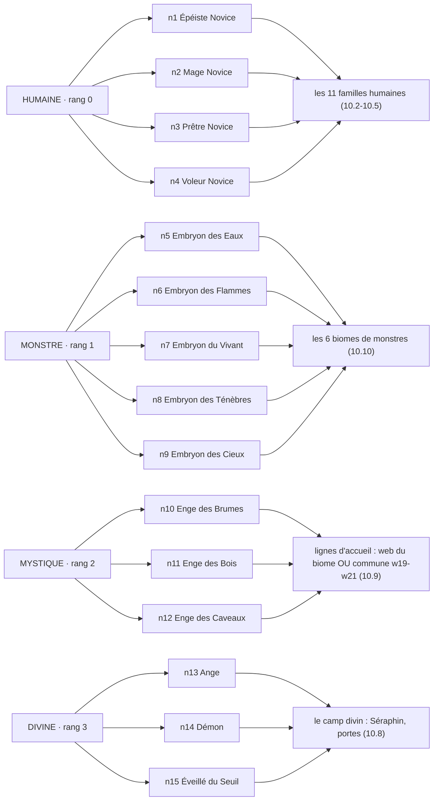

### 10.2 L'arbre de l'Épéiste (n1) — lame, bouclier, bosquet ➕ paladin, chevalier (gel)

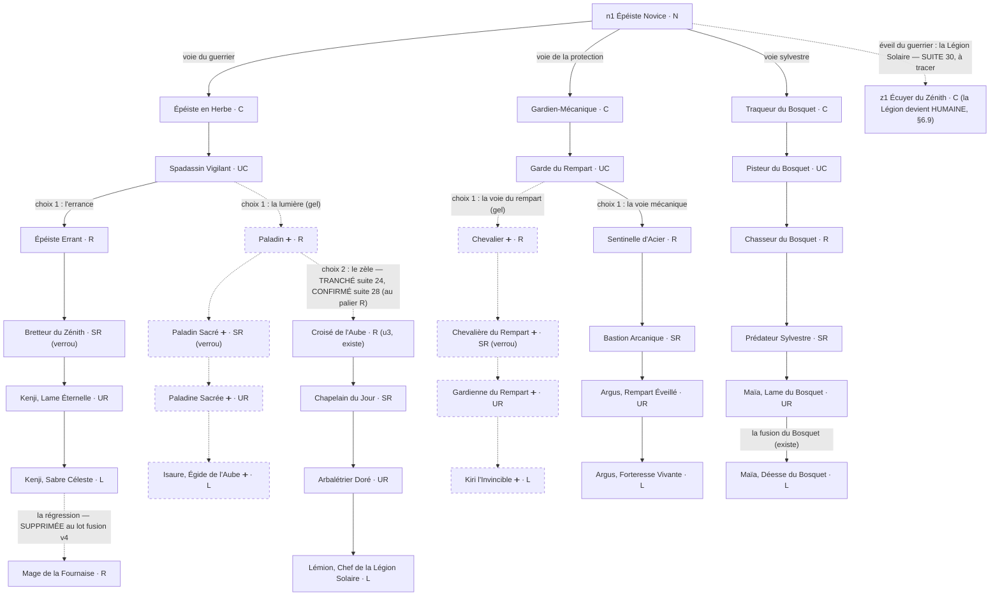

### 10.3 L'arbre du Mage (n2) — eau, braise, appel ➕ les élues de l'Aube

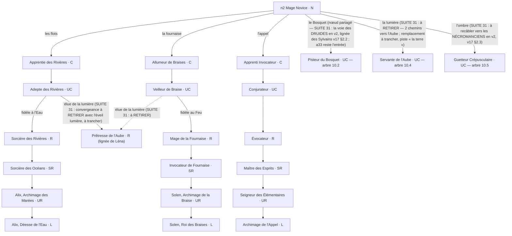

- Note SUITE 31 (les trois propositions du mage, §6.10.5, v2) : **la lumière se retire de l'éveil du mage** (deux chemins vers l'Aube aujourd'hui : l'éveil n2 → s13 et les élues a29/a32 → s5 ; l'Aube redevient le territoire du prêtre, remplacement à trancher — piste : « la terre », les élus jamais tranchés) ; **le Bosquet devient la voie des Druides** (lignée des Sylvains tracée v13 : la garde / la forme, sommet partagé Maïa, graines Sylve/Naïa, école sylvestre des invocations) ; **l'Ombre se recâble vers les Nécromanciens** (v17 §2.3 : l'Évocatrice du Caveau, la conversion funèbre, école funèbre des invocations). Rien ne bouge en v1 : à trancher d'un mot, puis spec.

### 10.4 L'arbre du Prêtre (n3) — aube, crépuscule, zèle

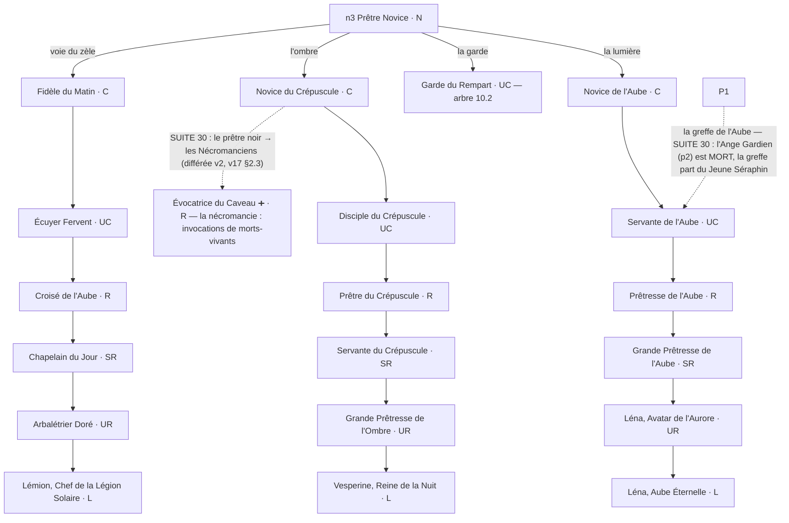

- **SUITE 30** : le Clergé du Plein Jour rejoint les PRÊTRES et la Légion Solaire les GUERRIERS (§6.9) — le dédoublonnage de la famille du zèle (u4/u5 doublonnent z23/z3) est à tracer ; la branche u1-u6 ci-dessus reste la trace actuelle du jeu. Les Mages Noirs = les Nécromanciens (branche du prêtre noir, différée v2) ; PAS de Mages de Lumière (confirmé v15).

### 10.5 L'arbre du Voleur (n4) — ombre, vol, mini-lignées Quais/Fête

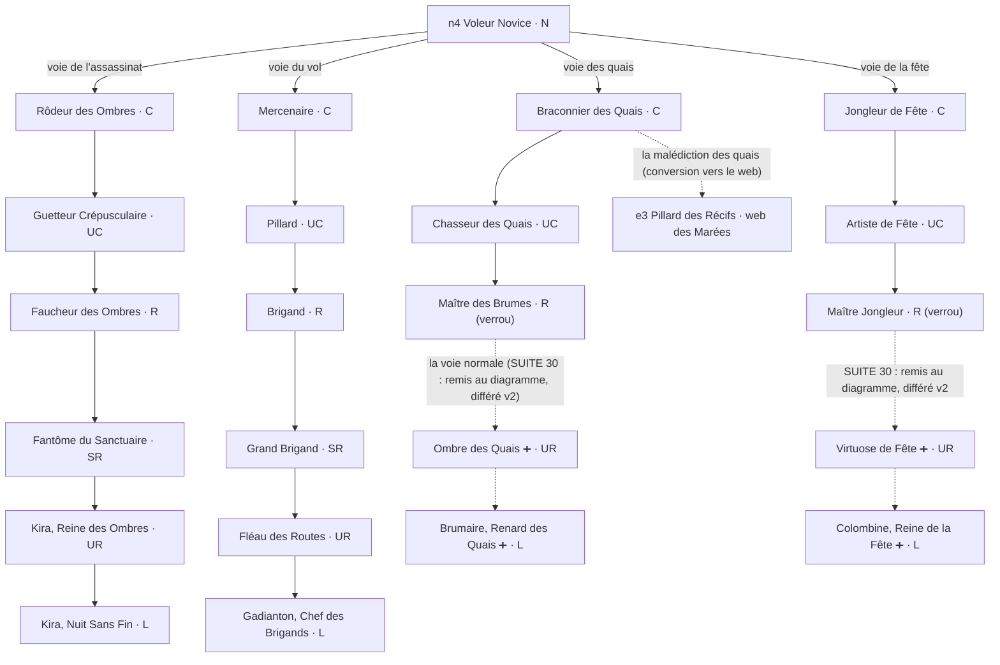

### 10.6 Le camp divin (n13-n15) — Séraphin, portes, démons (gel), pont

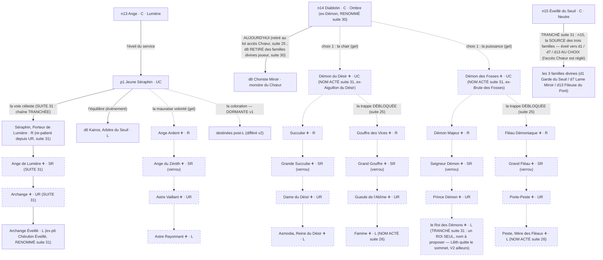

- Note : TRANCHÉ le 14/11 (suite 25) — **n14 n'a PAS accès au Chœur Miroir** ; le nouvel accès du Chœur est **TRANCHÉ suite 31 : n15 l'aînée commune, la source des trois familles** (spec trappes §4-d) — il se pose AVANT de retirer n14 → d8 (le garde-fou demeure). **SUITE 30 : d8 Choriste Miroir et d14 Aiguille du Pont RETIRÉS des familles divines joueur** (§6.9) — les chaînes du Chœur et du Pont se recâblent sans leur UC, à caler en spec. Les trappes sont DÉBLOQUÉES avec leurs lignées complètes (**Famine, Peste : NOMS ACTÉS suite 26** ; **le Roi des Démons, seul sommet de la puissance : TRANCHÉ suite 31**). L'**Astre Capiteux (z8)** est re-racé divine camp ange (fiche seule). d6 Kairos est une **L** (l'étiquette « M monstre » était une scorie, corrigée suite 26). **SUITE 31, l'espèce ange** : p5 re-palieré R, Ange de Lumière ➕ SR et Archange ➕ UR s'interposent, p6 devient Archange Éveillé (L).

### 10.7 Les 3 familles divines joueur (w1-w18) et leurs miroirs

```mermaid
flowchart TD
  subgraph SEUIL["Arbitres du Seuil (d1-d6 : Kairos Arbitre du Seuil)"]
    W1["Garde du Seuil · C"] --> W2["Servante du Sablier · UC"] --> W3["Huissier de l'Entre-Deux · R"] --> W4["Juge des Heures · SR"] --> W5["Maître des Sabliers · UR"] --> W6["Kairos, Arbitre du Seuil · L"]
  end
  subgraph MIROIR["Chœur Miroir (d7-d12 : Écho, Voix Miroir)"]
    W7["Lame Miroir · C"] --> W8["Choriste Miroir · UC"] --> W9["Prisme du Chœur · R"] --> W10["Miroir Antiphonique · SR"] --> W11["Chef du Chœur · UR"] --> W12["Écho, Refrain Absolu · L"]
  end
  subgraph PONT["Tisseuses du Pont (d13-d18 : Ananké, Tisseuse du Pont)"]
    W13["Fileuse du Pont · C"] --> W14["Aiguille du Pont · UC"] --> W15["Brodeuse des Liens · R"] --> W16["Tisseuse des Nœuds · SR"] --> W17["Architecte du Pont · UR"] --> W18["Ananké, Gardienne des Rives · L"]
  end
```

- Accès : le miroir aujourd'hui par n14 (à recâbler) ; le pont par n15 ; le seuil par l'événement d'équilibre du Séraphin (p1 → d6). Les séries d (d1-d18) sont les monstres miroirs des donjons divins.

### 10.8 Les Enge (n10-n12) et leurs deux formes, gorgones et fées (gel)

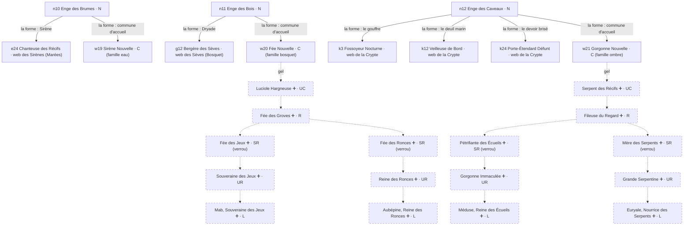

- À trancher en spec (§6.7) : quand gorgones et fées seront posées, w20/w21 devront probablement changer de tag famille vers elles, et le sort du tag eau de w19 se statuera.

### 10.9 Les Embryons (n5-n9) vers les 6 biomes

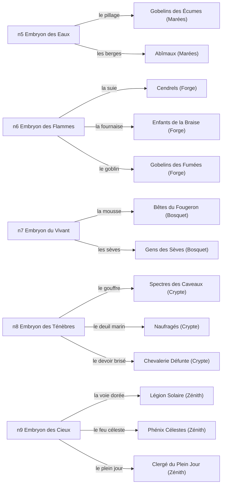

- Chaque commune ouvre son web complet (159 monstres, les L et M par biome : §4). Les Embryons sont aussi les ingrédients du premier saut de fusion (humaine + Embryon → mystique, §7).

### 10.10 Les graines (b1-b7) et les mini-lignées

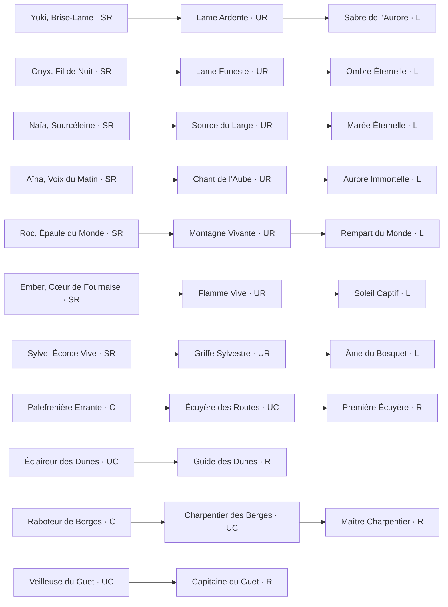

- Les graines sont des voies propres (SR → UR → L, acté v14) ; les mini-lignées Quais et Fête sont dans l'arbre du Voleur (10.5), leurs sommets UR/L restent différés v2 (§3). Les greffes de commune (Garde-Promesse, Étincelle Vive, Pilier Mécanique, Médecin de Camp, Veilleur d'Acier) rejoignent directement leur UC : §3.

### 10.11 Le web des Flots (donjon des Marées) — RESTAURÉ du v17 §8.1, à jour des data (retours suite 28 en §6.8)

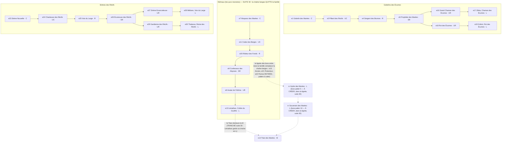

- Side cards : e2 Tirailleur des Récifs C, e10 Veuve des Récifs UC, e8 Matriarche des Récifs R (Gobelins) ; e12 Gardien des Galets SR (Abîmaux — des berges lui aussi, à arbitrer avec le retrait §6.8). **TRANCHÉ suite 30** : la chaîne berges quitte les Abîmaux, la lignée des boss (Hydre des Marées → Souverain des Marées, paliers à caler) la remplace, le Titan reste la M, Léviathan garde sa chaîne en L. Le web n'était pas perdu (v17 §8.1, gabarit validé) : c'est le v18 qui ne l'avait pas reporté — corrigé suite 28. Les 3 webs restants (Fournaise, Vivant, Au-delà) et le Zénith suivent (10.12-10.15). **SUITE 31, la refonte des donjons par famille (§6.10)** : le donjon des Marées devient le **DONJON DES ABÎMES** — 3-4 salles (Moqueurs des Marées et crabes des Berges dans les premières), échelle des boss : premier boss Hydre des Marées OU Rôdeur des Fonds, palier au-dessus Hydre des Marées, palier au sommet Souverain des Marées ; un donjon tardif **Léviathan** ; à caler en spec (donjons par famille partout : Sirènes → Méliane puis Thalassa, Gobelins → Zikka puis Griknir).

### 10.12 Le web de la Fournaise (donjon de la Forge) — RESTAURÉ du v17 §8.2, à jour des data

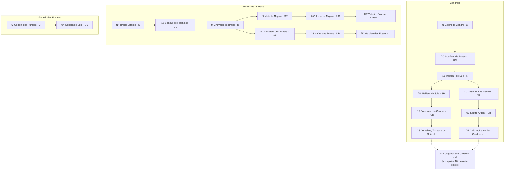

- Side cards : f7 Tisseur de Cendres C, f3 Écorcheur de Suie UC, f8 Foreuse d'Âmes R (Cendrels). Boss palier 5 « Maître des Fours » ≈ f23 Maître des Foyers (quasi-existant, mapping à caler). Ancre du biome (v13) : Vulcain ; la piste du **dragon de la Fournaise** (v15, proposition) reste ouverte.

### 10.13 Le web du Vivant (donjon du Bosquet) — RESTAURÉ du v17 §8.3, à jour des data

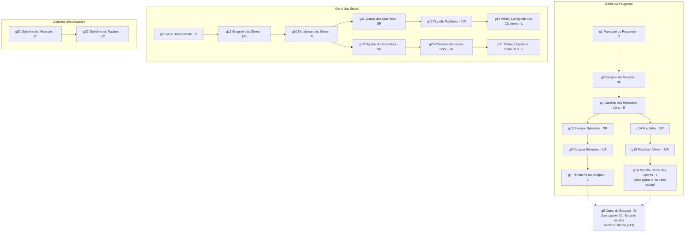

- Side cards : g2 Luciole Hargneuse C, g5 Prisme Vivant SR (Bêtes). La malédiction du Bosquet (une carte de la lignée de Solen tue le Cœur, v12) : le Cœur reste unique.

### 10.14 Le web de l'Au-delà (donjon de la Crypte) — RESTAURÉ du v17 §8.4, à jour des data (les trois familles de la Crypte)

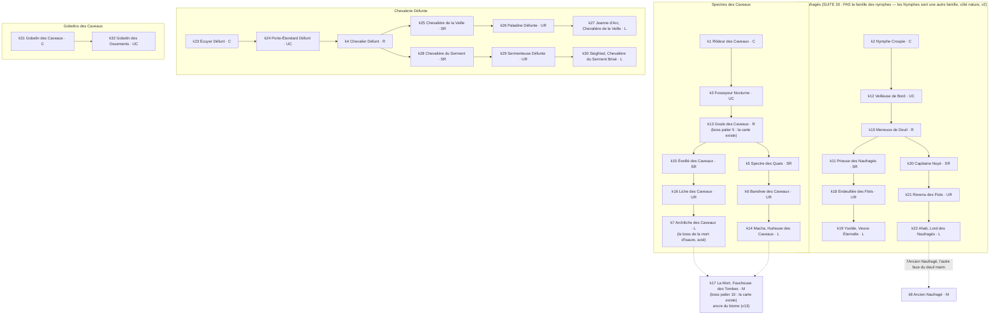

- Side cards : k9 Servante Pâle C (Naufragés). **SUITE 30** : les Naufragés ne sont PAS la famille des nymphes — Nymphe Croupie peut rester en tête de chaîne sans être « spécialement une nymphe » (renommage ouvert) ; les vraies Nymphes = 5 familles côté nature, différées v2 (Alcéides, Naïades, Lampades — piste : les Naufragés en seraient notre version —, Auréades, Dryades ; recherche détaillée à faire, v18 §6.9). Le pont v17 « le chant envoie par le fond » (Sirènes → Revenu des Flots) reste une piste.

### 10.15 Le web du Zénith (les cieux) — RESTAURÉ, à jour des data (phénix = la branche des cieux du v17 §4)

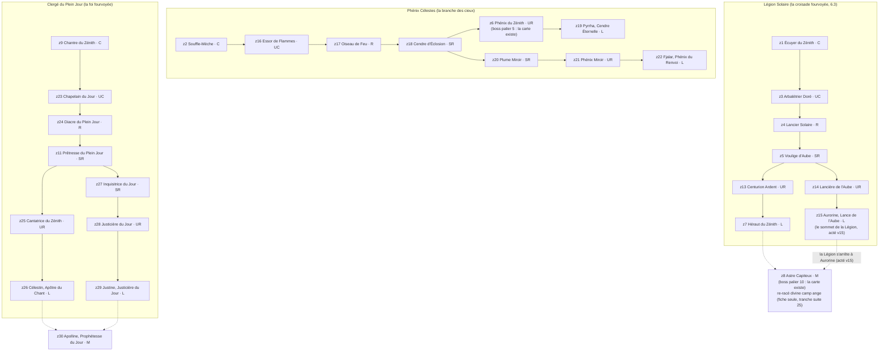

- Side cards : z12 Garde-Flamme UC, z10 Serre-Soleil R (Légion). Les M doubles (Astre Capiteux côté Légion, Apolline côté Clergé) sont les M humains tranchés (Morzak, l'Astre, Apolline). Le donjon divin (d1-d18) est couvert en 10.7.

Les 6 webs sont donc TOUS dans ce document : Flots (10.11), Fournaise (10.12), Vivant (10.13), Au-delà (10.14), Zénith (10.15), divin (10.7). **Règle suite 28 : les diagrammes sont l'outil de repérage premier de Marc-Olivier — toute évolution du design se reporte TOUJOURS sur les diagrammes §10, jamais seulement en texte ou en tableau.**
