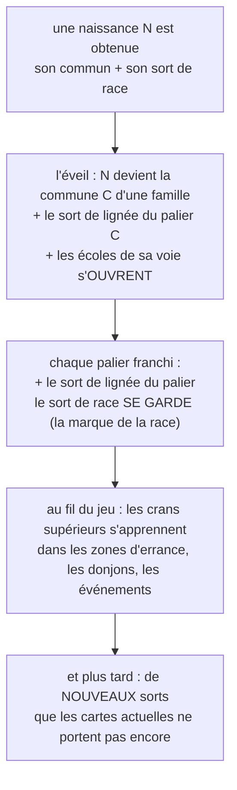

# Refonte des sorts : le grimoire mutualisé, les écoles et l'acquisition (v2)

Ce qui change de la v1 après ta relecture (v2) : **les 189 signatures redondantes meurent (acté, ta demande)** : on mutualise au maximum, les effets proches fusionnent en un sort à crans (quatre crans, inférieur, normal, supérieur, majeur, le RPG à l'ancienne), et les L, M et quelques cartes clés gardent une ou deux uniques. **Un sort ne dépend plus d'une classe, il dépend de son effet (acté)** : les écoles remplacent le verrou de classe, changer de voie change les écoles ouvertes ; ton exemple : un mage, par le chemin de l'eau, peut invoquer des élémentaires d'eau. **Les sorts se débloquent au fil du jeu (acté)** : une carte ne naît plus avec tout, le grimoire s'apprend palier après palier, zone après zone, et dépassera un jour les sorts des cartes actuelles. **Et la base des multiplicateurs est posée (v2.1, ton retour)** : ×1.3 de quoi ? De la **stat principale du personnage** : l'attaque du guerrier, l'agilité de l'assassin, l'intelligence du mage, de l'occultiste et du prêtre. La réponse en section 2.

Ce document reste le DESIGN CIBLE de la refonte. L'état embarqué reste le repo (`dist.html`, `inventaire-sorts.md`, `arbres-sorts.md`, `audit-sorts.md`) ; ce qui est acté ici descendra au dist lors de la grosse mise à jour (section 11).

## 1. La fiche type : chaque sort dit ce qu'il fait

La fiche d'un sort garde son nom, son coût, sa puissance et sa description (la saveur), et gagne **quatre données de jeu** :

| Donnée | Ce qu'elle dit |
| --- | --- |
| **Rôle** | ce que le sort FAIT : dégâts, soin, bouclier, boost, malus, contrôle, invocation, manip |
| **École** | la famille d'effet à laquelle il appartient (section 3) : le sort dépend de son effet, pas de sa classe |
| **Ciblage** | qui il touche : soi, 1 allié, l'équipe, 1 ennemi (mono), les ennemis d'une zone, tous les ennemis |
| **Taux / effet** | les chiffres : 25 % de stun pendant 1 tour, brûlure 30 % × 2 tours, −25 % de précision... |

Les 8 rôles : **dégâts** (frapper), **soin** (refermer), **bouclier** (absorber), **boost** (dresser l'équipe : attaque, précision, warcry), **malus** (affaiblir la cible), **contrôle** (stun, gel, lenteur, immobilisation), **invocation** (appeler un renfort), **manip** (mana, déplacement, vol : les gestes qui ne frappent pas).

Les 6 ciblages : **soi**, **1 allié**, **l'équipe**, **1 ennemi**, **la zone** (une portion du champ), **tous les ennemis**. Le sort L d'une famille est toujours le plus large de sa lignée ; plus le ciblage s'élargit, plus les taux baissent (l'équilibre) ; les gros sorts (9✦ et plus) portent la marque du nommé, et depuis la v0.47 **le sort L ne répète plus le nom de sa carte** (l'exception assumée reste Aube Éternelle).

## 2. La base : ×1.3 de quoi ?

Ta question : « la puissance, c'est ×1.3, mais ×1.3 de quoi ? » Réponse (v2.1, ton retour) : **le mult tire sur la stat principale de la carte**. Chaque profil a sa stat, et tous ses sorts, frappes comme soins, tirent dessus :

| Le profil | Sa stat principale | Le mult tire sur | Exemple |
| --- | --- | --- | --- |
| Le guerrier, l'épéiste | l'attaque | toutes ses frappes | Lame Éclair ×1.9 = 1.9 × l'attaque du spadassin |
| L'assassin, le voleur | l'agilité | ses frappes (et l'initiative, et l'esquive) | Faux du Croissant ×1.9 = 1.9 × l'agilité du faucheur |
| Le mage, l'occultiste | l'intelligence | ses sorts | Décharge Arcanique ×1.65 = 1.65 × l'intelligence du mage |
| Le prêtre | l'intelligence (ton feu vert) | ses soins et ses onctions | Aube Éternelle ×6 = 6 × l'intelligence de Léna |
| Le gardien, la voie du Bouclier | la vie (proposition, 13.1) | ses boucliers, en points de réserve | Égide Renforcée ×1.7 = 1.7 × la vie du gardien, en bouclier sur l'allié |
| Les taux, tous profils | une **chance en pourcentage**, jouée contre le seuil de la cible | le sort affiche sa chance | 25 % de stun = un quart de tours perdus, en moyenne |

Quatre conséquences : (1) le multiplicateur est le **langage**, la stat est la **base** : une L soigne plus qu'une C au même sort parce que son intelligence est plus haute, pas parce que la règle change ; (2) chaque profil monte SA stat : les évolutions, les crans de race (+10, +20, +30 %) et l'équipement renforcent la stat principale, jamais les mults ; (3) l'agilité devient la stat complète de l'assassin (ses dégâts, son initiative, son esquive : les trois au même endroit) ; (4) le soin plafonne à la vie max de la cible : la vie entre par la cible, pas par le lanceur.

## 3. Les écoles : le sort dépend de son effet, pas de sa classe

La couche « classe » disparaît comme verrou. Un sort appartient à une **école d'effet**, et ce sont les voies (la classe d'origine, puis les choix de l'arbre) qui **ouvrent des écoles**. C'est exactement ton usage : changer de classe, changer de voie, et les sorts suivent l'effet, pas l'étiquette.

| École | Son effet | Les sorts d'entrée |
| --- | --- | --- |
| **la Lame** | les dégâts, physiques et magiques | Frappe Précise, Brise-Garde, Décharge Arcanique |
| **le Baume** | les soins | Premiers Soins, Onde Consacrée |
| **le Rempart** | les boucliers | Carapace, Égide |
| **l'Appel** | les invocations | les renforts, les élémentaires (section 8) |
| **l'Entrave** | le contrôle | les chants qui paralysent, les hurlements, les gels |
| **le Mauvais Œil** | les malus | Œil du Malheur, les malédictions, les poisons |
| **la Ferveur** | les boosts | Discipline de Ligne, les warcry, les hymnes |
| **la Ruse** | la manip | Pas de l'Ombre, Larcin Rapide, le vol de mana |

Les règles des écoles :

1. **Un sort d'école est le même partout où il est appris** : mutualisé, avec ses crans (section 4).
2. **Les classes deviennent des profils** : le guerrier ouvre la Lame et la Ferveur, le mage la Lame magique et l'Appel, le prêtre le Baume et la Ferveur, l'assassin la Lame et la Ruse, l'occultiste le Mauvais Œil et l'Entrave. Les classes restent des raccourcis de départ, plus des prisons.
3. **Les voies de l'arbre ouvrent le reste** : ton exemple acté, le mage du chemin de l'eau peut ouvrir **l'Appel** et invoquer des élémentaires d'eau ; le prêtre du caveau ouvre le Mauvais Œil ; l'épéiste mécanique ouvre le Rempart.
4. **Personne n'est verrouillé** : un sort ne demande pas « être mage », il demande d'avoir ouvert l'école, au palier qu'il faut.

Les cinq anciens sorts de classe (Brise-Garde, Décharge Arcanique, Onde Consacrée, Frappe dans le Dos, Œil du Malheur) deviennent les sorts d'entrée des écoles, transverses : leurs rôles et leurs taux sont posés en section 6.

## 4. Le grimoire mutualisé : la fin des 189 redondances

Le constat (ta remarque) : 189 signatures, et beaucoup se ressemblent : les brûlures de la Forge, les chants des Marées, les hurlements de la Crypte, les colonnes du Zénith se répètent de carte en carte avec des noms différents.

La règle (acté) :

1. **Mutualiser au maximum** : les effets proches fusionnent en **un seul sort, à crans**. Les crans sont l'échelle à l'ancienne, **quatre marches : inférieur, normal, supérieur, majeur** (notés I, II, III, IV sur les fiches ; l'exemple des soins : Soins inférieurs, Soins, Soins supérieurs, Soins majeurs). Le cran monte les taux et la puissance, jamais le rôle. La littérature des jeux le vérifie : l'échelle française de D&D monte soins légers, modérés, importants, intensifs, et Final Fantasy suffixe ses sorts sur trois crans ; notre échelle à quatre marches prend le meilleur des deux.
2. **Les L, M et quelques cartes clés gardent une ou deux uniques** : le geste que personne d'autre ne fait (Tranche-Monde, Nuit Éternelle, Aube Éternelle, la Fauchade Universelle de la Mort, l'Abîme Absolu de Léviathan). La liste des cartes clés tombera au tri des 189. Les autres cartes rendent leurs signatures au pot commun.
3. **La fusion se fait par école et par biome** : les trente signatures des Marées deviennent une douzaine de sorts d'école à crans (les chants de sirène : l'Entrave I, II, III ; les morsures d'eau : la Lame I, II, III) ; les brûlures de la Forge : le Mauvais Œil brûlant I, II, III ; les hurlements de la Crypte : l'Entrave I, II, III.
4. **Décompte visé (proposition)** : les 189 signatures fondent en une soixantaine de sorts partagés à quatre crans, plus une vingtaine d'uniques (une ou deux par L, M et carte clé) : environ 80 sorts au grimoire, tous typés, tous lisibles. Le tri exact, biome par biome, en 13.1.

Ce que le joueur y gagne : chaque sort du grimoire se lit (rôle, école, ciblage, taux, base), se compare, et se reconnaît d'une carte à l'autre ; un cran supérieur est une récompense, pas un nouveau nom à mémoriser.

## 5. L'acquisition progressive : les sorts s'apprennent

Rien n'est plus figé à l'obtention (acté, ta demande) : une carte ne naît pas avec tous ses sorts, et le grimoire du joueur dépassera les sorts des cartes actuelles.

Le tableau de l'acquisition :

| Quand | Quoi | Pourquoi |
| --- | --- | --- |
| À l'obtention d'une carte | son commun (+ son sort de race si c'est une naissance) | la carte sait agir dès le premier tour |
| À l'éveil (N → C) | le sort de lignée du palier C, et l'ouverture des écoles de sa voie | la famille apprend son geste, la voie ouvre ses portes |
| À chaque palier franchi | le sort de lignée du palier (la L connaît les 6) | la mémoire de la famille, le cumul reste 100 % |
| Au fil des zones d'errance | les crans supérieurs (II, III) des écoles ouvertes, des sorts d'école nouveaux | la récompense d'explorer, la progression du grimoire |
| Aux événements et aux patchs | des sorts inédits, au-delà des cartes actuelles | le grimoire vit, le jeu prend son temps |

La disponibilité se lit toujours en trois niveaux (ta question d'origine) : **l'école** (partagée entre toutes les voies qui l'ouvrent), **la lignée** (propre à la famille, partagée entre les races qui y entrent : le Bosquet de l'épéiste et celui du mage portent les mêmes 6 sorts), **l'unique** (les L et M seulement).

## 6. Les socles : communs, race, et les entrées d'écoles

**Les communs (universels)** :

| Sort | Rôle | Ciblage | Coût | Puissance | Qui |
| --- | --- | --- | --- | --- | --- |
| Frappe Précise | dégâts | 1 ennemi | 2✦ | ×1.3 | les 152 attaquants (base : l'attaque) |
| Premiers Soins | soin | 1 allié | 2✦ | ×1.15 | les 86 soigneurs (base : l'intelligence) |

**Les sorts de race (uniques à la race, gardés à l'éveil)** :

| Sort | Race | Rôle | Ciblage | Effet / taux |
| --- | --- | --- | --- | --- |
| Discipline de Ligne | Humaine | boost | soi | +15 % d'attaque ce tour (le drill) |
| Instinct Sauvage | Embryon (ex-Bestiau) | dégâts | 1 ennemi | +10 % d'initiative ce tour (vite et fort) |
| Vol en Rase-Mottes | Enge | dégâts | 1 ennemi | +15 % d'esquive ce tour (plonge et remonte) |
| Ferveur Céleste | Divine (depuis l'Esprit Divin) | boost | 1 allié | +15 % d'attaque ce tour (l'onction) |

**Les entrées d'écoles (les anciens sorts de classe, transverses maintenant)** :

| Sort | École | Rôle | Ciblage | Effet / taux | Coût | Puissance |
| --- | --- | --- | --- | --- | --- | --- |
| Brise-Garde | la Lame | dégâts | 1 ennemi | +25 % contre un bouclier | 4✦ | ×1.6 |
| Décharge Arcanique | la Lame | dégâts | zone | le trait brut (base : l'intelligence) | 4✦ | ×1.65 |
| Onde Consacrée | le Baume | soin | l'équipe | l'onde qui referme | 3✦ | ×1.3 |
| Frappe dans le Dos | la Lame | dégâts | 1 ennemi | 20 % de critique | 4✦ | ×1.7 |
| Œil du Malheur | le Mauvais Œil | malus | 1 ennemi | −20 % de précision × 2 tours | 4✦ | ×1.6 |

## 7. Les sorts de lignée : les 7 familles au propre

Les échelles restent : **coûts 2, 3, 5, 9, 14 puis 20✦, identiques pour toutes** ; les puissances suivent le ciblage : mono ×1.4 à 1.9, double ×1.9 à 2.2, zone ×2.6 à 3.2, tous ×3.4 à 4.4, éventail ×4.5 à 6.

### Famille du Sabre (les dégâts nets, la lame)

| Palier | Sort | Coût | Puissance | Rôle | Ciblage | Effet / taux |
| --- | --- | --- | --- | --- | --- | --- |
| C | Taillade du Mat | 2✦ | ×1.4 | dégâts | 1 ennemi | la frappe rapide du matin |
| UC | Lame Vive | 3✦ | ×1.6 | dégâts | 1 ennemi | +10 % de critique |
| R | Lame Éclair | 5✦ | ×1.9 | dégâts | 2 ennemis | la traînée coupe deux fois |
| SR | Millième Taillade | 9✦ | ×2.6 | dégâts | zone | 15 % de saignement × 2 tours |
| UR | Kenji : Zénith Tranchant | 14✦ | ×3.4 | dégâts | tous les ennemis | +10 % si la cible est seule (le duel du sommet) |
| L | **Tranche-Monde** (unique) | 20✦ | ×4.5 | dégâts | tous les ennemis | ignore les boucliers (v0.47 ; la carte reste « Kenji, Sabre Céleste ») |

### Famille de l'Ombre (le poison et le silence)

| Palier | Sort | Coût | Puissance | Rôle | Ciblage | Effet / taux |
| --- | --- | --- | --- | --- | --- | --- |
| C | Poigne du Silence | 2✦ | ×1.4 | dégâts | 1 ennemi | la prise sournoise |
| UC | Pas de l'Ombre | 3✦ | ×1.6 | dégâts | 1 ennemi | +15 % d'esquive ce tour |
| R | Faux du Croissant | 5✦ | ×1.9 | dégâts | 2 ennemis | poison 15 % × 2 tours |
| SR | Danse des Cent Lames | 9✦ | ×2.6 | dégâts | zone | poison 20 % × 2 tours |
| UR | Kira : Voile Déchiré | 14✦ | ×3.4 | dégâts | tous les ennemis | +25 % contre les empoisonnés |
| L | **Nuit Éternelle** (unique) | 20✦ | ×4.5 | dégâts | tous les ennemis | −25 % de précision adverse × 2 tours (v0.47 ; la carte reste « Kira, Nuit Sans Fin ») |

### Famille de l'Eau (le flot qui emporte)

| Palier | Sort | Coût | Puissance | Rôle | Ciblage | Effet / taux |
| --- | --- | --- | --- | --- | --- | --- |
| C | Goutte Percutante | 2✦ | ×1.4 | dégâts | 1 ennemi | la flèche d'eau |
| UC | Brume Mordante | 3✦ | ×1.6 | dégâts | 2 ennemis | −10 % de précision × 1 tour |
| R | Courant Battant | 5✦ | ×1.9 | dégâts | zone | 20 % de lenteur × 1 tour |
| SR | Marée Ascendante | 9✦ | ×2.6 | dégâts | zone | 20 % de stun × 1 tour |
| UR | Raz-de-Marée | 14✦ | ×3.4 | dégâts | tous les ennemis | 20 % de stun × 1 tour |
| L | Colère de l'Océan | 20✦ | ×4.5 | dégâts | tous les ennemis | 30 % de stun × 1 tour |

### Famille de l'Aube (le soin qui monte avec le soleil)

| Palier | Sort | Coût | Puissance | Rôle | Ciblage | Effet / taux |
| --- | --- | --- | --- | --- | --- | --- |
| C | Étreinte Matinale | 2✦ | ×1.5 | soin | 1 allié | la première lumière |
| UC | Rayon Matinal | 3✦ | ×1.7 | soin | 1 allié | retire un malus |
| R | Lumière Réconfortante | 5✦ | ×2.2 | soin | 2 alliés | chasse fatigue et blessures |
| SR | Bénédiction de l'Aurore | 9✦ | ×3.2 | soin | l'équipe | +10 % d'attaque × 2 tours |
| UR | Aurore Radieuse | 14✦ | ×4.4 | soin | l'équipe | retire tous les malus |
| L | Aube Éternelle (unique, l'exception du nom) | 20✦ | ×6 | soin | l'équipe | purge et revigore (la carte de Léna) |

### Famille du Bouclier (le mur)

| Palier | Sort | Coût | Puissance | Rôle | Ciblage | Effet / taux |
| --- | --- | --- | --- | --- | --- | --- |
| C | Carapace Réactive | 2✦ | ×1.5 | bouclier | soi | l'impact raffermit |
| UC | Égide Renforcée | 3✦ | ×1.7 | bouclier | 1 allié | une plaque de plus |
| R | Mur Inflexible | 5✦ | ×2.2 | bouclier | 2 alliés | + provocation sur le lanceur |
| SR | Barrière Runique | 9✦ | ×3.2 | bouclier | l'équipe | renvoi 10 % × 2 tours |
| UR | Argus : Rempart Éveillé | 14✦ | ×4.4 | bouclier | l'équipe | provocation générale |
| L | Argus : Forteresse Vivante | 20✦ | ×6 | bouclier | l'équipe | renvoi 20 % × 2 tours ; **le nom répète la carte, à renommer (13.1 ; proposition : Assise Éternelle)** |

### Famille de la Braise (le feu qui persiste)

| Palier | Sort | Coût | Puissance | Rôle | Ciblage | Effet / taux |
| --- | --- | --- | --- | --- | --- | --- |
| C | Étincelle Filante | 2✦ | ×1.4 | dégâts | 1 ennemi | brûlure 15 % × 2 tours |
| UC | Flèche de Feu | 3✦ | ×1.6 | dégâts | 1 ennemi | brûlure 20 % × 2 tours |
| R | Jet de Braise | 5✦ | ×1.9 | dégâts | 2 ennemis | brûlure 20 % × 2 tours |
| SR | Fournaise | 9✦ | ×2.6 | dégâts | zone | brûlure 25 % × 2 tours |
| UR | Solen : Couronne de Feu | 14✦ | ×3.4 | dégâts | tous les ennemis | brûlure 30 % × 2 tours |
| L | Solen : Braise Éternelle | 20✦ | ×4.5 | dégâts | tous les ennemis | brûlure 35 % × 3 tours |

### Famille du Bosquet (la ronce qui rend coup pour coup)

| Palier | Sort | Coût | Puissance | Rôle | Ciblage | Effet / taux |
| --- | --- | --- | --- | --- | --- | --- |
| C | Trait d'Épine | 2✦ | ×1.4 | dégâts | 1 ennemi | l'épine sèche |
| UC | Lance d'Aubier | 3✦ | ×1.6 | dégâts | 1 ennemi | saignement 15 % × 2 tours |
| R | Épine Vengeresse | 5✦ | ×1.9 | dégâts | 2 ennemis | +10 % de riposte à l'équipe ce tour |
| SR | Rafale d'Épines | 9✦ | ×2.6 | dégâts | zone | −15 % d'esquive adverse × 2 tours |
| UR | Maïa : Danse des Feuilles | 14✦ | ×3.4 | dégâts | tous les ennemis | 20 % d'immobilisation × 1 tour |
| L | Maïa : Cœur du Bosquet | 20✦ | ×4.5 | dégâts | tous les ennemis | invoque un gardien du Bosquet (l'Appel) ; le nom prête à confusion avec la M du Vivant (13.1) |

## 8. Les invocations : l'école qui appelle (l'Appel)

Les invocations existent déjà en natif dans le catalogue : les Foyers de la Forge (Fournaise Invoquée, Gardiens Invoqués), les spectres de la Crypte (Légion des Caveaux), la sève du Bosquet (Sève Éveillée, et le gardien de Maïa), les Pouvoirs summon (9 cartes). La refonte en fait **une école à part entière**, ouverte par les voies qui la méritent :

| La voie | Ce qu'elle appelle |
| --- | --- |
| Le mage du chemin de l'eau (ton exemple, acté) | **les élémentaires d'eau** : des renforts temporaires, typés par élément (les chemins de feu et de terre suivront : élémentaires de braise, de sève) |
| L'Invocateur de Fournaise et sa lignée | les gardiens des Foyers |
| La nécromancie du prêtre (2.3, l'Évocatrice du Caveau) | les défunts de la Crypte |
| Le Bosquet | un gardien de ronces (le sort L de Maïa) |

Les règles à trancher (13.1) : la fiche d'un renfort (ses points de vie, sa durée), combien d'invocations simultanées, et si le renfort est une carte miniature ou un effet persistant. Les élémentaires d'eau sont le premier chantier (le chemin du mage).

## 9. Les Pouvoirs (sans mana, automatiques)

Un Pouvoir n'est pas un sort : il ne coûte rien et se déclenche tout seul, à chaque action. La typologie est partagée (les mêmes rôles et taux), mais la fiche d'une carte garde deux blocs : **les sorts (mana, choisis, appris au fil du jeu) et le Pouvoir (gratuit, automatique, présent dès l'obtention)**. L'inventaire actuel : heal (31 cartes), shield (19), summon (9), stun (6), atkBuff (5), curse (5), slow (4), reflect (4), link (3), warcry (2), copy (2), revive (1), plus les 10 gimmicks uniques des boss. Rien ne bouge à la refonte : les Pouvoirs héritent des rôles et des taux de la fiche type.

## 10. Le moteur : mana, seuils, stats et zones

**Le mana par palier reste** : 8, 11, 14, 22, 30 puis 40 pour les familiales (+2, +3, +3, +5, +6, +8 par action) ; 10 (+2) pour les naissances, solos, monstres et divines.

**Les seuils de résistance** : chaque taux (stun, brûlure, poison, malus) se joue contre le seuil de la cible (son palier, son camp ; le mécanisme exact en 13.1). Le taux baisse quand la largeur du ciblage monte.

**L'agilité et l'intelligence (acté v17)** : chaque profil tire sur sa stat principale (section 2, v2.1) ; l'agilité tire en plus l'ordre du tour (le mode Tactique trie par attaque aujourd'hui, demain par agilité) et l'esquive. La répartition fine par race suit les crans actés (+10, +20, +30 %).

**Les zones d'errance (acté v17)** : la cadence reste (une zone, un donjon, une zone, un donjon, une zone, un donjon) ; les zones portent les récoltes (les éclats des évolutions, les naissances N à des taux très bas) et, depuis cette v2, **l'apprentissage : les crans supérieurs et les sorts d'école neufs s'y dénichent**.

## 11. Le plan de la grosse mise à jour

Les pièces se posent dans cet ordre, chaque phase livrée au dist puis auditée :

1. **La refonte des races** : le canvas des arbres (v17) câblé au dist.
2. **La refonte des sorts** : ce document. (a) valider le gabarit v2 (écoles, crans, base) ; (b) le tri des 189 : biome par biome, la table de fusion vers le grimoire mutualisé ; (c) les sorts des nouvelles familles (section 12) ; (d) l'école de l'Appel (les élémentaires d'eau d'abord) ; (e) tout appliquer au dist.
3. **Le mode RPG** : l'agilité et l'intelligence, la base des mults (section 2), les ciblages (mono, double, zone, tous), l'ordre du tour, les seuils.
4. **Les zones d'errance** : la cadence, les rencontres, les récoltes, l'apprentissage des sorts (les crans, les écoles).
5. **L'audit final et l'équilibrage** : les taux, les coûts, les mults, la montée des zones.

## 12. Les nouvelles familles : les sorts à créer

Chaque famille neuve suit le gabarit (6 sorts, 2/3/5/9/14/20✦, un rôle-cadre, le ciblage qui s'élargit), table à remplir après validation :

| La famille | Son rôle-cadre | Le ton de ses sorts |
| --- | --- | --- |
| Le Crépuscule (Novice du Crépuscule → Servante du Crépuscule) | dégâts d'ombre + malus | l'anti-Aube : la nuit qui affaiblit |
| Le vol (Mercenaire → Pillard → Brigand → Gadianton) | dégâts + la Ruse (larcin) | vol d'éclats et de mana, l'arme qui désarme |
| Le zèle (Fidèle du Jour → les voies du Zénith) | boost + warcry (la Ferveur) | la foi des fourvoyés : les hymnes qui dressent |
| L'école des invocations (2.6) | invocation (l'Appel) | les cartes qui appellent |
| Les trois familles divines (Arbitres, Chœur Miroir, Tisseuses) | contrôle, copie, lien | « Pouvoirs d'abord, sorts ensuite » : leurs lignées sur le même gabarit |
| Les anges dévoyés (depuis l'Ange Éveillé) | dégâts solaires + malus | l'astre qui brûle ce qu'il éclaire |
| Les lignées d'accueil des Enge | selon la famille d'accueil | pour l'essentiel elles existent (les webs) : le tri famille par famille se fait ici |

## 13. Le carrefour

### 13.1 À trancher

1. **Le sort L d'Argus** : « Argus : Forteresse Vivante » répète le nom de sa carte ; proposition : **Assise Éternelle**.
2. **Le sort L de Maïa** : « Maïa : Cœur du Bosquet » porte le nom de la M du Vivant : garder le clin d'œil ou le renommer ?
3. **Le tri des 189** : la table de fusion, biome par biome (quelle signature devient quel cran de quel sort d'école), avec la liste des cartes clés qui gardent une unique ; c'est le gros chantier de la v2.
4. **La saveur des crans** : quatre marches actées (inférieur, normal, supérieur, majeur) ; l'échelle française de D&D dit léger, modéré, important, intensif, Final Fantasy suffixe : quelle dénomination sur les fiches ?
5. **Les écoles** : valider les huit noms (la Lame, le Baume, le Rempart, l'Appel, l'Entrave, le Mauvais Œil, la Ferveur, la Ruse) et le tableau des profils de classe.
6. **Les invocations** : la fiche des renforts, leur durée, combien simultanément ; les élémentaires d'eau d'abord (le chemin du mage).
7. **L'apprentissage** : où chaque cran s'apprend (zones d'errance ? donjons ? paliers ? événements ?), et à quel rythme.
8. **Les sorts de race et les renommages** : Instinct Sauvage et Ferveur Céleste gardent leurs noms (proposition) ?
9. **Les seuils de résistance** : le mécanisme exact des taux (le palier ? un stat ? le camp ?).
10. **La zone** : la grille de ciblage (combien de cases, comment on la pose en Tactique).
11. **Le gardien** : ses boucliers tirent sur sa vie (la proposition de la v2.1) : acté ou ajusté ?

### 13.2 Acté et validé

1. **Mutualiser au maximum** : les 189 signatures redondantes fondent en un grimoire partagé ; les L, M et quelques cartes clés gardent une ou deux uniques.
2. **Les crans** : **quatre marches**, inférieur, normal, supérieur, majeur (I, II, III, IV) ; le cran monte les taux et la puissance, jamais le rôle ; l'échelle vérifiée contre la littérature des jeux (D&D en français : soins légers, modérés, importants, intensifs ; Final Fantasy : les suffixes).
3. **Un sort dépend de son effet, pas de sa classe** : les écoles remplacent le verrou ; les classes deviennent des profils ; changer de voie change les écoles ouvertes.
4. **Le déblocage progressif** : une carte naît avec son commun (+ la race pour une naissance), le reste s'apprend ; le grimoire dépassera les cartes actuelles.
5. **La fiche type** : rôle, école, ciblage, taux, base ; les descriptions restent la saveur.
6. **La base des mults (v2.1, ton retour)** : le mult tire sur la **stat principale du profil** : l'attaque du guerrier, l'agilité de l'assassin, l'intelligence du mage, de l'occultiste et du prêtre (ton feu vert), la vie du gardien (proposition) ; les taux en pourcentage contre le seuil de la cible.
7. **La couche lignée reste** : un sort par palier, 2/3/5/9/14/20✦, le cumul 100 %, la L les connaît toutes ; le sort de race se garde à l'éveil.
8. **Les noms v0.47** : Tranche-Monde et Nuit Éternelle ; l'exception assumée (Aube Éternelle) ; « Kenji : Zénith Tranchant » reste.
9. **L'Appel est une école** : les élémentaires d'eau par le chemin du mage, les Foyers, les défunts, le gardien du Bosquet.
10. **Les Pouvoirs restent sans mana** : la même typologie, deux blocs sur la fiche.
11. **Les zones d'errance portent l'apprentissage** : la cadence (zone, donjon, zone, donjon), les éclats, les N, et maintenant les crans.