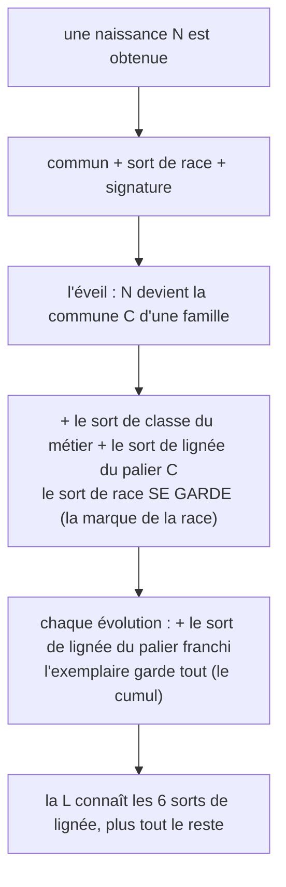
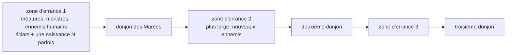

# Refonte des sorts : la typologie, l'acquisition et l'arbre complet (v1)

Ta demande v17 : « on ne sait pas ce que font les sorts, à quoi ils servent : sorts de zone, sorts unitaires, monocibles, multicibles, stun, bonus, malus, soins... réécris tous les sorts, remets-les au propre : les communs, les sorts de lignée, les sorts de race, quand on les débloque, pourquoi ; par rapport aux arbres de race, fais tout cet arbre de sorts ; et dis s'ils sont communs à plusieurs races, uniques, ou propres à une lignée. » Ce document est le DESIGN CIBLE de cette refonte. L'état embarqué reste le repo (`dist.html` et les docs d'audit) ; ce qui est acté ici descendra au dist lors de la grosse mise à jour (section 10).

Sources : `inventaire-sorts.md` (les 653 entrées), `arbres-sorts.md` (l'acquisition), `audit-sorts.md` (les constats), le canvas des arbres v17 (les nouvelles familles), et le dist v0.47 (Tranche-Monde et Nuit Éternelle déjà appliqués).

## 1. La fiche type : chaque sort dit ce qu'il fait

Aujourd'hui la fiche d'un sort donne un nom, un coût, une puissance et une description. La refonte ajoute **trois données de jeu**, sans toucher aux descriptions (elles restent la saveur) :

| Donnée | Ce qu'elle dit |
| --- | --- |
| **Rôle** | ce que le sort FAIT : dégâts, soin, bouclier, bonus, malus, contrôle, invocation, manip |
| **Ciblage** | qui il touche : soi, 1 allié, l'équipe, 1 ennemi (mono), les ennemis d'une zone, tous les ennemis |
| **Taux / effet** | les chiffres de l'effet : 25 % de stun pendant 1 tour, brûlure 30 % × 2 tours, −25 % de précision... |

Les 8 rôles : **dégâts** (frapper), **soin** (refermer), **bouclier** (absorber), **bonus** (boost d'attaque, de précision, warcry), **malus** (affaiblir la cible), **contrôle** (stun, gel, lenteur, immobilisation), **invocation** (appeler un renfort), **manip** (mana, déplacement, vol : les gestes qui ne frappent pas).

Les 6 ciblages : **soi**, **1 allié**, **l'équipe**, **1 ennemi** (le monocible), **la zone** (une portion du champ, tous les ennemis dessus), **tous les ennemis** (le multicible total). La zone exacte (combien de cases, comment on la pose en Tactique) est à câbler au moteur (12.1).

Quatre règles de cohérence, le squelette de tout l'équilibrage :

1. **Un sort a un rôle principal.** Le soin soigne, l'attaque attaque ; les effets secondaires (une brûlure sur une attaque, un malus sur un contrôle) s'ajoutent en taux, jamais en double rôle.
2. **Le ciblage s'élargit avec le palier.** Mono en C et UC, double en R, zone au SR, tous au UR, l'éventail et la synergie au L : le sort L est toujours le plus large de sa famille.
3. **Plus le ciblage s'élargit, plus les taux baissent.** Un stun de zone passe moins souvent qu'un stun monocible : le taux affiché est la contrepartie de la largeur.
4. **Les gros sorts (9✦ et plus) portent la marque du nommé**, et depuis la v0.47 **le sort L ne répète plus le nom de sa carte** (Tranche-Monde, Nuit Éternelle) ; l'exception assumée reste Aube Éternelle, le nom de la carte de Léna.

## 2. Les cinq couches : qui a quoi, quand, pourquoi

La grammaire v0.43 garde ses couches, chacune répond aux trois questions : qui la porte, quand elle se débloque, pourquoi elle existe.

| Couche | Qui la porte | Quand | Disponibilité | Pourquoi |
| --- | --- | --- | --- | --- |
| **Commun** (2 sorts) | toutes les cartes | à l'obtention | universelle | aucune carte sans geste : le socle |
| **Race** (4 sorts) | les naissances N | à l'obtention | **unique à la race** | le geste de la race, il se garde à l'éveil |
| **Classe** (5 sorts) | les naissances et les solos de métier | à l'obtention | **transverse aux races** | le geste du métier, pas du sang |
| **Lignée** (6 par famille) | les familiales | un sort par palier franchi, à l'évolution | **propre à la lignée, partagée entre les races qui y entrent** | la mémoire de la famille : le palier C apprend le geste, chaque marche ajoute la sienne, la L les connaît toutes |
| **Signature** (189) | chaque carte | à l'obtention | **unique, jamais partagée** | le geste personnel, celui que personne d'autre ne fait |

Le cumul reste la règle (audit-sorts, constat vérifié) : à chaque évolution, l'exemplaire garde 100 % des sorts de ses formes passées.

Quand et pourquoi, en une phrase par couche : le commun existe pour que chaque carte agisse dès le premier tour ; le sort de race existe pour que l'origine se voie à l'éveil (l'Enge devenue Sirène garde Vol en Rase-Mottes à côté de la lignée des Récifs : c'est sa marque) ; le sort de classe existe parce que le métier se choisit, le sang ne se choisit pas ; les sorts de lignée existent pour que la famille ait une mémoire (on entre au C, on apprend le geste de la maison) ; la signature existe pour que chaque carte soit quelqu'un.

Comptes actuels du catalogue (inventaire-sorts) : 653 entrées de fiches, soit 242 sorts distincts (2 communs, 4 de race, 5 de classe, 42 de lignée, 189 signatures).

## 3. Les sorts communs (le socle universel)

| Sort | Rôle | Ciblage | Coût | Puissance | Qui |
| --- | --- | --- | --- | --- | --- |
| Frappe Précise | dégâts | 1 ennemi | 2✦ | ×1.3 | les 152 attaquants |
| Premiers Soins | soin | 1 allié | 2✦ | ×1.15 | les 86 soigneurs |

Le rôle de la carte (attaquant ou soigneur) décide lequel elle porte : 238 cartes, aucune exception (vérifié par l'audit). Pourquoi : le mode Tactique a besoin d'un geste toujours jouable, même à vide de mana.

## 4. Les sorts de race (uniques à leur race)

| Sort | Race | Rôle | Ciblage | Effet / taux |
| --- | --- | --- | --- | --- |
| Discipline de Ligne | Humaine | bonus | soi | +15 % d'attaque ce tour (le drill) |
| Instinct Sauvage | Embryon (ex-Bestiau) | dégâts | 1 ennemi | +10 % d'initiative ce tour (vite et fort) |
| Vol en Rase-Mottes | Enge | dégâts | 1 ennemi | +15 % d'esquive ce tour (plonge et remonte) |
| Ferveur Céleste | Divine (depuis l'Esprit Divin) | bonus | 1 allié | +15 % d'attaque ce tour (l'onction) |

Tous à 3✦ ×1.5 (l'échelle actuelle, inchangée). Le sort de race **se garde à l'éveil** : le N devenu commune le porte dans sa nouvelle famille, à côté de la lignée, c'est la marque de l'origine. À trancher (12.1) : les noms suivent-ils les renommages de races (Instinct Sauvage avec Bestiau devenu Embryon) ; proposition : tout garder, les noms restent justes.

## 5. Les sorts de classe (transverses : le métier, pas le sang)

| Sort | Classe | Rôle | Ciblage | Effet / taux | Coût | Puissance |
| --- | --- | --- | --- | --- | --- | --- |
| Brise-Garde | Guerrier | dégâts | 1 ennemi | +25 % contre un bouclier (cherche la jointure) | 4✦ | ×1.6 |
| Décharge Arcanique | Mage | dégâts | zone | le trait brut | 4✦ | ×1.65 |
| Onde Consacrée | Prêtre | soin | l'équipe | l'onde qui referme | 3✦ | ×1.3 |
| Frappe dans le Dos | Assassin | dégâts | 1 ennemi | 20 % de critique | 4✦ | ×1.7 |
| Œil du Malheur | Occultiste | malus | 1 ennemi | −20 % de précision × 2 tours | 4✦ | ×1.6 |

Ces sorts passent les races : une naissance humaine, une Enge, un Embryon qui choisit le métier portent le même geste de classe. Pourquoi : la classe est le premier vrai choix de la carte (après l'éveil), il doit se voir partout où le métier se rencontre.

## 6. Les sorts de lignée : les 7 familles au propre

Les échelles restent celles du jeu : **coûts 2, 3, 5, 9, 14 puis 20✦, identiques pour toutes les familles** ; les puissances suivent le ciblage (règle 2) : mono ×1.4 à 1.9, double ×1.9 à 2.2, zone ×2.6 à 3.2, tous ×3.4 à 4.4, éventail ×4.5 à 6. Chez les soigneurs (l'Aube, le Bouclier), plus le sort est cher, plus il protège ou soigne.

### Famille du Sabre (les dégâts nets, la lame)

| Palier | Sort | Coût | Puissance | Rôle | Ciblage | Effet / taux |
| --- | --- | --- | --- | --- | --- | --- |
| C | Taillade du Mat | 2✦ | ×1.4 | dégâts | 1 ennemi | la frappe rapide du matin |
| UC | Lame Vive | 3✦ | ×1.6 | dégâts | 1 ennemi | +10 % de critique |
| R | Lame Éclair | 5✦ | ×1.9 | dégâts | 2 ennemis | la traînée coupe deux fois |
| SR | Millième Taillade | 9✦ | ×2.6 | dégâts | zone | 15 % de saignement × 2 tours |
| UR | Kenji : Zénith Tranchant | 14✦ | ×3.4 | dégâts | tous les ennemis | +10 % si la cible est seule (le duel du sommet) |
| L | **Tranche-Monde** | 20✦ | ×4.5 | dégâts | tous les ennemis | ignore les boucliers (v0.47 ; la carte reste « Kenji, Sabre Céleste ») |

### Famille de l'Ombre (le poison et le silence)

| Palier | Sort | Coût | Puissance | Rôle | Ciblage | Effet / taux |
| --- | --- | --- | --- | --- | --- | --- |
| C | Poigne du Silence | 2✦ | ×1.4 | dégâts | 1 ennemi | la prise sournoise |
| UC | Pas de l'Ombre | 3✦ | ×1.6 | dégâts | 1 ennemi | +15 % d'esquive ce tour |
| R | Faux du Croissant | 5✦ | ×1.9 | dégâts | 2 ennemis | poison 15 % × 2 tours |
| SR | Danse des Cent Lames | 9✦ | ×2.6 | dégâts | zone | poison 20 % × 2 tours |
| UR | Kira : Voile Déchiré | 14✦ | ×3.4 | dégâts | tous les ennemis | +25 % contre les cibles empoisonnées |
| L | **Nuit Éternelle** | 20✦ | ×4.5 | dégâts | tous les ennemis | −25 % de précision adverse × 2 tours (v0.47 ; la carte reste « Kira, Nuit Sans Fin ») |

### Famille de l'Eau (le flot qui emporte)

| Palier | Sort | Coût | Puissance | Rôle | Ciblage | Effet / taux |
| --- | --- | --- | --- | --- | --- | --- |
| C | Goutte Percutante | 2✦ | ×1.4 | dégâts | 1 ennemi | la flèche d'eau |
| UC | Brume Mordante | 3✦ | ×1.6 | dégâts | 2 ennemis | −10 % de précision × 1 tour |
| R | Courant Battant | 5✦ | ×1.9 | dégâts | zone | 20 % de lenteur × 1 tour |
| SR | Marée Ascendante | 9✦ | ×2.6 | dégâts | zone | 20 % de stun × 1 tour |
| UR | Raz-de-Marée | 14✦ | ×3.4 | dégâts | tous les ennemis | 20 % de stun × 1 tour |
| L | Colère de l'Océan | 20✦ | ×4.5 | dégâts | tous les ennemis | 30 % de stun × 1 tour |

### Famille de l'Aube (le soin qui monte avec le soleil)

| Palier | Sort | Coût | Puissance | Rôle | Ciblage | Effet / taux |
| --- | --- | --- | --- | --- | --- | --- |
| C | Étreinte Matinale | 2✦ | ×1.5 | soin | 1 allié | la première lumière |
| UC | Rayon Matinal | 3✦ | ×1.7 | soin | 1 allié | retire un malus |
| R | Lumière Réconfortante | 5✦ | ×2.2 | soin | 2 alliés | chasse fatigue et blessures |
| SR | Bénédiction de l'Aurore | 9✦ | ×3.2 | soin | l'équipe | +10 % d'attaque × 2 tours |
| UR | Aurore Radieuse | 14✦ | ×4.4 | soin | l'équipe | retire tous les malus |
| L | Aube Éternelle | 20✦ | ×6 | soin | l'équipe | purge et revigore ; **l'exception assumée** : le sort porte le nom de sa carte (Léna) |

### Famille du Bouclier (le mur)

| Palier | Sort | Coût | Puissance | Rôle | Ciblage | Effet / taux |
| --- | --- | --- | --- | --- | --- | --- |
| C | Carapace Réactive | 2✦ | ×1.5 | bouclier | soi | l'impact raffermit |
| UC | Égide Renforcée | 3✦ | ×1.7 | bouclier | 1 allié | une plaque de plus |
| R | Mur Inflexible | 5✦ | ×2.2 | bouclier | 2 alliés | + provocation sur le lanceur |
| SR | Barrière Runique | 9✦ | ×3.2 | bouclier | l'équipe | renvoi 10 % × 2 tours |
| UR | Argus : Rempart Éveillé | 14✦ | ×4.4 | bouclier | l'équipe | provocation générale |
| L | Argus : Forteresse Vivante | 20✦ | ×6 | bouclier | l'équipe | renvoi 20 % × 2 tours ; **le nom répète la carte, à renommer (12.1 ; proposition : Assise Éternelle)** |

### Famille de la Braise (le feu qui persiste)

| Palier | Sort | Coût | Puissance | Rôle | Ciblage | Effet / taux |
| --- | --- | --- | --- | --- | --- | --- |
| C | Étincelle Filante | 2✦ | ×1.4 | dégâts | 1 ennemi | brûlure 15 % × 2 tours |
| UC | Flèche de Feu | 3✦ | ×1.6 | dégâts | 1 ennemi | brûlure 20 % × 2 tours |
| R | Jet de Braise | 5✦ | ×1.9 | dégâts | 2 ennemis | brûlure 20 % × 2 tours |
| SR | Fournaise | 9✦ | ×2.6 | dégâts | zone | brûlure 25 % × 2 tours |
| UR | Solen : Couronne de Feu | 14✦ | ×3.4 | dégâts | tous les ennemis | brûlure 30 % × 2 tours |
| L | Solen : Braise Éternelle | 20✦ | ×4.5 | dégâts | tous les ennemis | brûlure 35 % × 3 tours |

### Famille du Bosquet (la ronce qui rend coup pour coup)

| Palier | Sort | Coût | Puissance | Rôle | Ciblage | Effet / taux |
| --- | --- | --- | --- | --- | --- | --- |
| C | Trait d'Épine | 2✦ | ×1.4 | dégâts | 1 ennemi | l'épine sèche |
| UC | Lance d'Aubier | 3✦ | ×1.6 | dégâts | 1 ennemi | saignement 15 % × 2 tours |
| R | Épine Vengeresse | 5✦ | ×1.9 | dégâts | 2 ennemis | +10 % de riposte à l'équipe ce tour |
| SR | Rafale d'Épines | 9✦ | ×2.6 | dégâts | zone | −15 % d'esquive adverse × 2 tours |
| UR | Maïa : Danse des Feuilles | 14✦ | ×3.4 | dégâts | tous les ennemis | 20 % d'immobilisation × 1 tour |
| L | Maïa : Cœur du Bosquet | 20✦ | ×4.5 | dégâts | tous les ennemis | invoque un gardien du Bosquet ; le nom prête à confusion avec la M du Vivant (12.1) |

**La disponibilité des lignées** (ta question : où chaque sort vit) : une lignée est **propre à sa famille mais partagée entre toutes les races qui y entrent**. Le Bosquet est l'exemple type : l'épéiste humain et le mage qui y convergent portent les mêmes 6 sorts ; les Enge de la forêt qui s'éveillent chez les Gens des Sèves les porteront aussi. Les sorts de race, eux, restent uniques à la race, et la signature unique à la carte : les trois niveaux se lisent toujours (l'origine, la maison, la personne).

## 7. Les signatures (189, la personnalité de chaque carte)

La règle reste : **une signature par carte, jamais partagée** (vérifié par l'audit, zéro doublon). La refonte leur applique la même fiche type (rôle + ciblage + taux), sans en changer les coûts : les naissances restent à 5✦ ×1.85, les monstres montent de 3 à 8✦ et de ×1.4 à ×2.0 avec leur palier, les divines vivent surtout par leurs Pouvoirs.

Le gabarit par biome, pour la table complète (phase 2, 12.1) :

| Biome | La palette des signatures |
| --- | --- |
| Les Marées | brumes (malus de précision), morsures d'eau (dégâts), les chants des sirènes (contrôle : stun, ensorcellement) |
| La Forge Cendrée | suie et braises (dégâts + brûlure 25 à 40 % × 2-3 tours), le métal (boucliers) |
| Le Bosquet | sève (soin volé : Spores Vampires), ronces (saignement), la lumière des clairières (bonus) |
| La Crypte | le deuil (malus), les hurlements (stun), la noyade (brûlure d'ombre) |
| Le Zénith Ardent | colonnes de lumière (zone), le phénix (renvoi, renaissance : Renaissance Pyrique) |
| Les divines | les Pouvoirs d'abord : le Chœur copie, les Arbitres figent, les Tisseuses lient |

La phase 2 remplira la table des 189 (chaque signature avec son rôle, son ciblage, ses taux), biome par biome, une fois ce gabarit validé. Les signatures des L gardent la règle v0.47 : elles ne répètent plus le nom de leur carte.

## 8. Les Pouvoirs (sans mana, automatiques)

Un Pouvoir n'est pas un sort : il ne coûte rien et se déclenche tout seul, à chaque action. La typologie est partagée (les mêmes rôles et taux), mais la fiche d'une carte garde deux blocs : **les sorts (mana, choisis) et le Pouvoir (gratuit, automatique)**. L'inventaire actuel : heal (31 cartes), shield (19), summon (9), stun (6), atkBuff (5), curse (5), slow (4), reflect (4), link (3), warcry (2), copy (2), revive (1), plus les 10 gimmicks uniques des boss (la ronde du Capitaine du Guet, le rituel de la Matriarche des Récifs...). Rien ne bouge à la refonte : les Pouvoirs héritent des rôles et des taux de la fiche type, c'est tout.

## 9. Le moteur : mana, taux, et les nouvelles stats (le mode RPG)

**Le mana par palier reste** : 8, 11, 14, 22, 30 puis 40 pour les familiales (+2, +3, +3, +5, +6, +8 par action) ; 10 (+2) pour les naissances, solos, monstres et divines. Une incantation vide la réserve ; l'auto-battle lance le sort le plus cher payable.

**Les taux se lisent contre un seuil** : chaque effet (stun, brûlure, poison, malus) affiche sa chance en pourcentage ; la cible résiste selon son palier et son camp (le mécanisme exact à câbler, 12.1). C'est la contrepartie de la règle 3 : le taux baisse quand la largeur monte.

**L'agilité et l'intelligence (acté v17 avec le mode RPG)** : deux stats s'ajoutent aux cartes. Propositions à trancher (12.1) : l'agilité tire **l'ordre du tour** (le mode Tactique trie aujourd'hui par attaque, demain par agilité) et l'esquive ; l'intelligence augmente **la puissance des sorts** (le multiplicateur) et abaisse leurs coûts. La répartition fine par race suit les stats de base actées (+10, +20, +30 % par cran de race).

**Les zones d'errance (acté v17)** : la progression s'ouvre en cadence, une zone libre, puis un donjon, une zone, un donjon, une zone, un donjon...

Dans les zones d'errance : les premières rencontres (les créatures du biome, les premiers ennemis humains), la récolte des **éclats** (les évolutions s'y paient petit à petit), et les **naissances N à des taux très bas** (le tirage borné par les déblocages reste : rien d'un biome dont le donjon n'est pas ouvert). Le début du jeu en offre une ou deux : le premier choix entier, dès le départ.

## 10. Le plan de la grosse mise à jour

Les pièces se posent dans cet ordre, chaque phase livrée au dist puis auditée (itérations courtes, tu réagis, je corrige) :

1. **La refonte des races** : le canvas des arbres (v17) câblé au dist (les N, les éveils, les communes nouvelles, l'Ange Éveillé).
2. **La refonte des sorts** : ce document. (a) valider le gabarit v1 ; (b) la table des 189 signatures typées ; (c) les sorts des nouvelles familles (section 11) ; (d) tout appliquer au dist (les fiches gagnent rôle, ciblage, taux).
3. **Le mode RPG** : l'agilité et l'intelligence, les ciblages (mono, double, zone, tous : la fenêtre de combat les propose), l'ordre du tour, les seuils de résistance.
4. **Les zones d'errance** : la cadence (zone, donjon, zone, donjon), les rencontres, les récoltes, les drops de N et d'éclats.
5. **L'audit final et l'équilibrage** : les taux, les coûts, les multiplicateurs, la montée des zones.

## 11. Les nouvelles familles : les sorts à créer

Le rework des races crée des familles neuves ; chacune suivra le gabarit (6 sorts, 2/3/5/9/14/20✦, un rôle-cadre, le ciblage qui s'élargit), table à remplir après validation de ce document :

| La famille | Son rôle-cadre | Le ton de ses sorts |
| --- | --- | --- |
| Le Crépuscule (Novice du Crépuscule → Servante du Crépuscule) | dégâts d'ombre + malus | l'anti-Aube : la nuit qui affaiblit |
| Le vol (Mercenaire → Pillard → Brigand → Gadianton) | dégâts + manip (larcin) | vol d'éclats et de mana, l'arme qui désarme |
| Le zèle (Fidèle du Jour → les voies du Zénith) | bonus + warcry | la foi des fourvoyés : les hymnes qui dressent |
| L'école des invocations (2.6) | invocation | les cartes qui appellent |
| Les trois familles divines (Arbitres, Chœur Miroir, Tisseuses) | contrôle, copie, lien | « Pouvoirs d'abord, sorts ensuite » (audit-sorts) : leurs lignées à créer sur le même gabarit |
| Les anges dévoyés (depuis l'Ange Éveillé) | dégâts solaires + malus | l'astre qui brûle ce qu'il éclaire |
| Les lignées d'accueil des Enge | selon la famille d'accueil | pour l'essentiel elles existent déjà (les webs) : le tri famille par famille se fait ici |

## 12. Le carrefour

### 12.1 À trancher

1. **Le sort L d'Argus** : « Argus : Forteresse Vivante » répète le nom de sa carte ; proposition : **Assise Éternelle** (le mur devient montagne).
2. **Le sort L de Maïa** : « Maïa : Cœur du Bosquet » ne répète pas sa carte, mais porte le nom de la M du Vivant (le Cœur du Bosquet) : garder le clin d'œil ou le renommer ?
3. **Les sorts de race et les renommages** : Instinct Sauvage (Bestiau devenu Embryon), Ferveur Céleste (la race divine, depuis l'Esprit Divin) : les noms restent (proposition) ou suivent ?
4. **Les seuils de résistance** : le mécanisme exact des taux (le stun passe selon quoi ? le palier ? un stat ? le camp ?).
5. **L'agilité et l'intelligence** : ce qu'elles tirent exactement (l'ordre du tour, l'esquive, la puissance, le coût), et leur répartition par race.
6. **La zone** : la grille de ciblage (combien de cases, comment on la pose dans la fenêtre Tactique).
7. **La table des 189 signatures typées** : le gabarit v1 validé d'abord, puis biome par biome.
8. **Les sorts des nouvelles familles** (section 11) : les tables à remplir après le gabarit.

### 12.2 Acté et validé

1. **Le gabarit** : chaque sort reçoit un rôle, un ciblage, des taux ; les descriptions restent la saveur.
2. **Les cinq couches restent** (commun, race, classe, lignée, signature), avec leurs disponibilités : universelle, unique à la race, transverse, propre à la lignée, unique à la carte.
3. **Les noms v0.47** : Tranche-Monde et Nuit Éternelle ; l'exception assumée (Aube Éternelle) ; « Kenji : Zénith Tranchant » reste.
4. **Les échelles** : coûts 2/3/5/9/14/20✦ ; les puissances suivent le ciblage ; les gros sorts portent la marque du nommé.
5. **Le cumul 100 %** : l'exemplaire garde tout à chaque évolution.
6. **Le sort de race se garde à l'éveil** (la marque de l'origine à côté de la lignée d'accueil).
7. **Les Pouvoirs restent sans mana** : la même typologie, deux blocs sur la fiche.
8. **Les zones d'errance** : la cadence (zone, donjon, zone, donjon, zone, donjon), les éclats et les N dans la nature, une ou deux N offertes au début du jeu.
9. **L'agilité et l'intelligence entrent au moteur avec le mode RPG** (leurs effets exacts en 12.1-5).
